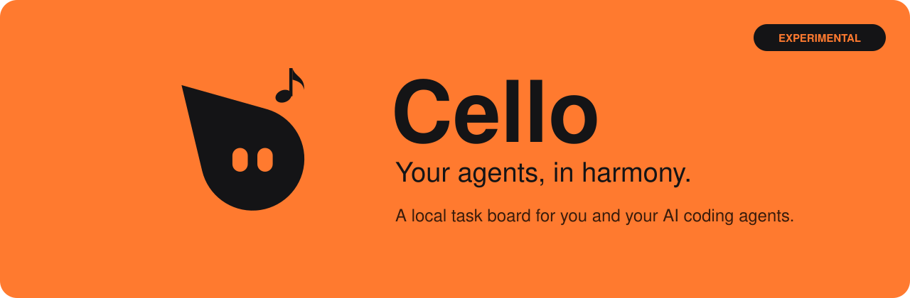
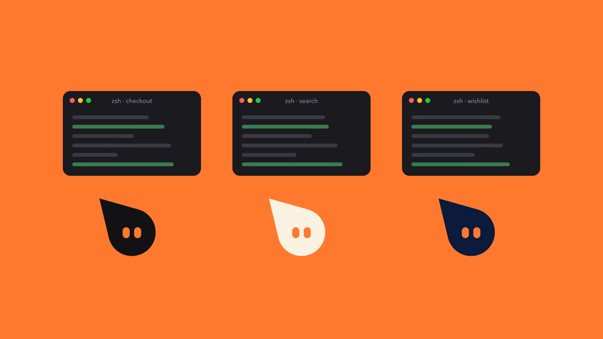
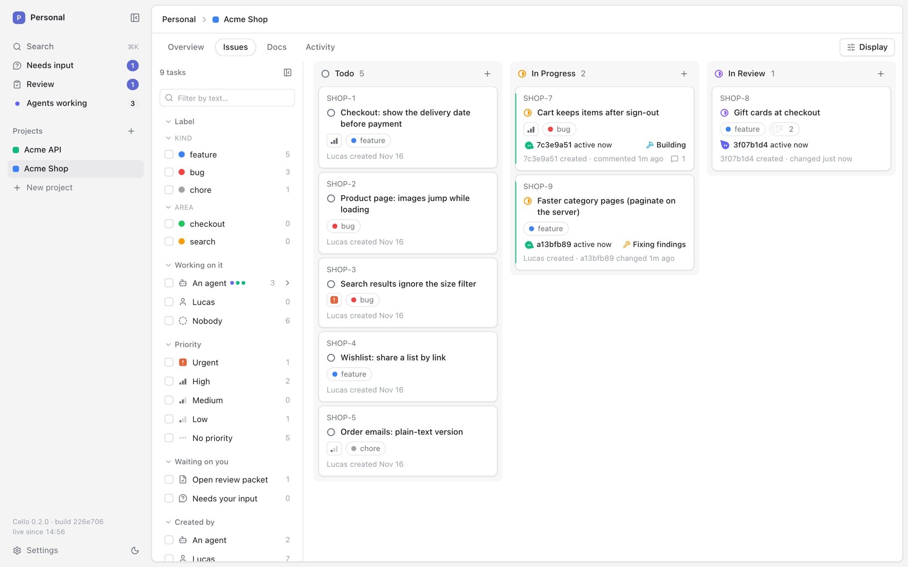
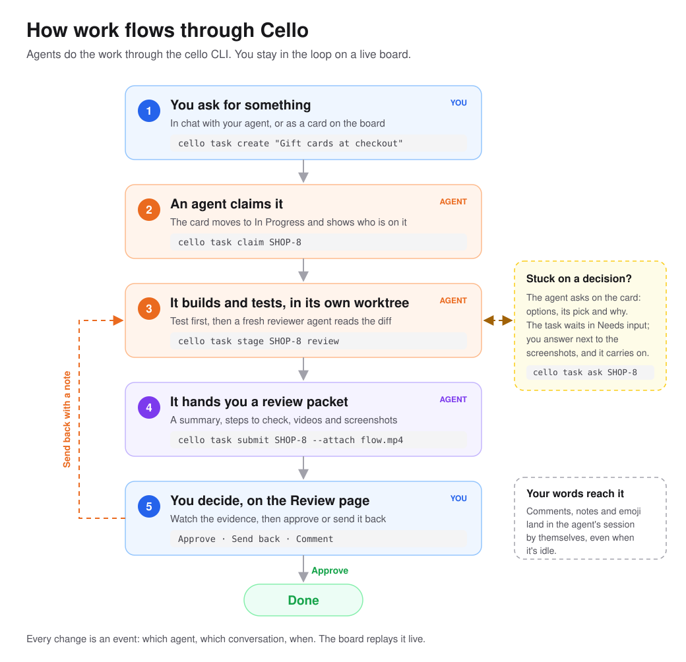
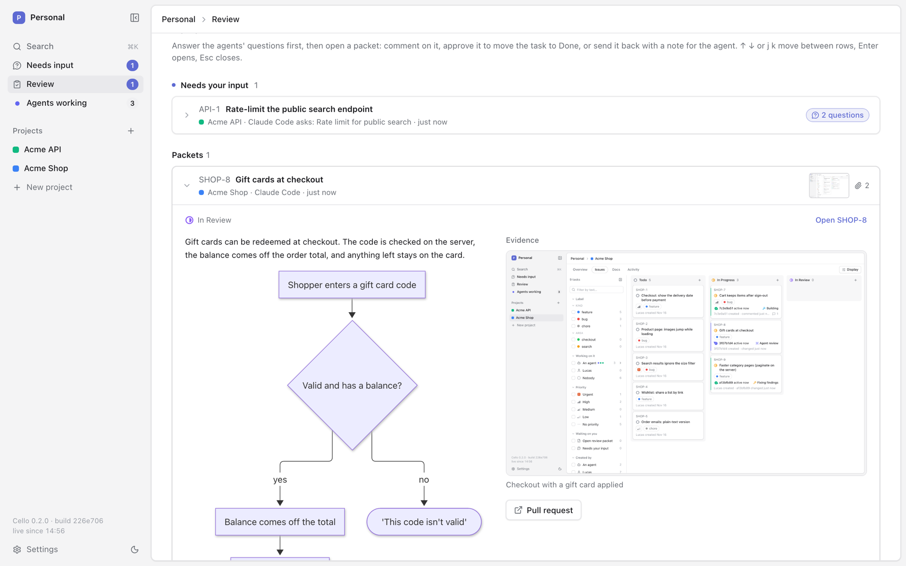
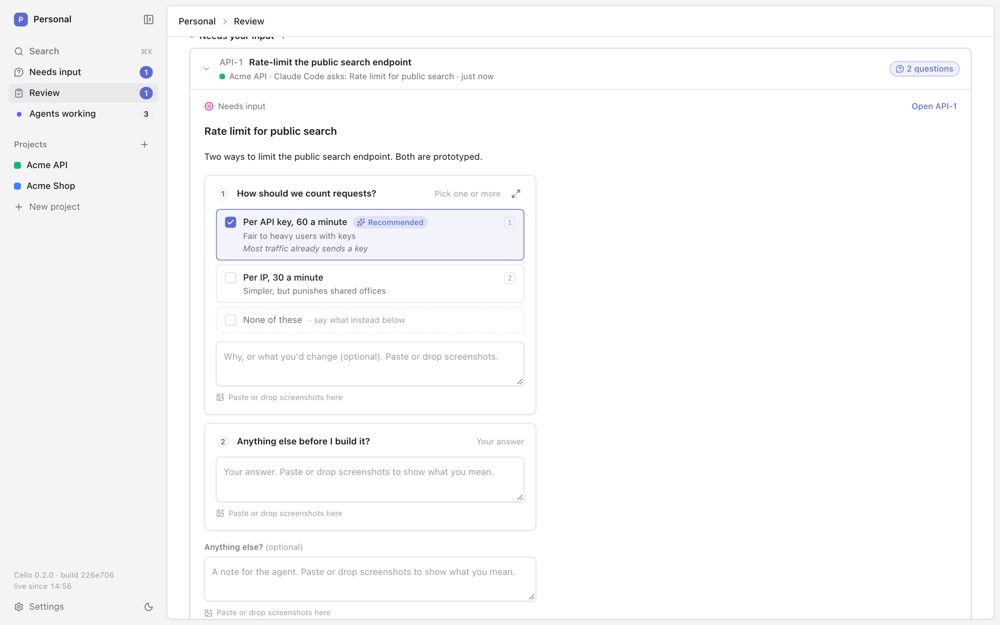
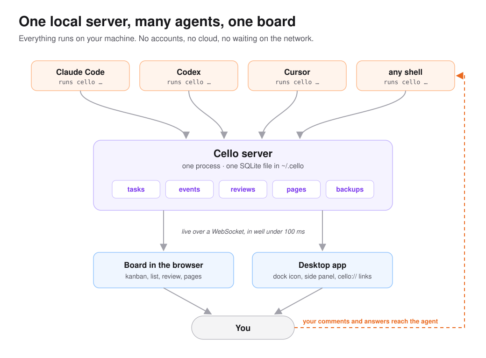
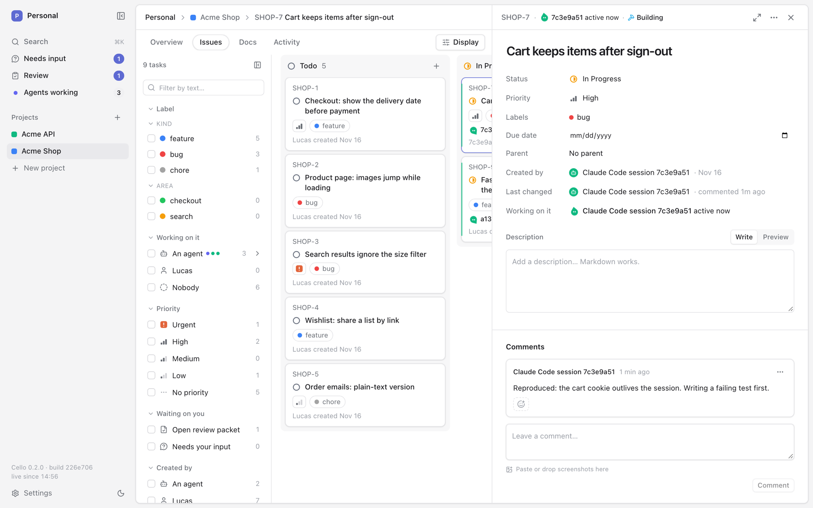

<p align="center">
  
</p>

<p align="center">
  <b>A local task board where AI coding agents are teammates, not integrations.</b><br>
  They claim cards, show you what they're doing, and hand finished work back with proof.
</p>

> [!WARNING]
> **Cello is experimental and changes fast.** It's built in the open by one developer for his own daily work, mostly by the agents it coordinates. Expect rough edges and breaking changes. It runs on macOS and is tuned for [Claude Code](https://claude.com/claude-code) today. Try it, open issues, but don't trust it with anything you can't lose yet.

<p align="center">
  <a href="docs/readme/setup-video.mp4"></a><br>
  <a href="docs/readme/setup-video.mp4"><b>▶ Watch: set up Cello for a project</b></a> (2:33)
</p>

<picture>
  <source media="(prefers-color-scheme: dark)" srcset="docs/readme/board-dark.png">
  
</picture>

## The problem

Working with several coding agents at once feels powerful for about an hour. Then:

- **You lose track.** Three terminals, two repos, a dozen conversations. Which agent is on what? Is it still working, stuck, or done an hour ago?
- **"Done" means nothing.** An agent says the feature works. Did it run the tests? Did anyone look at the screen? You find out by checking everything yourself.
- **Questions get buried.** The agent needed a decision, asked it in a terminal you weren't watching, and has been waiting ever since.
- **Nothing remembers who did what.** A task changed, but which conversation changed it, and why? Finding out means digging through transcripts.
- **The usual trackers don't fit.** GitHub Issues and Linear are built for teams of humans: every change is a network round trip, agents reach them through slow, token-heavy tools, and the page doesn't move while you watch.

Cello is the board I wanted instead: one place where you see every agent's work as it happens, and where nothing reaches you without evidence.

## How it works

<picture>
  <source media="(prefers-color-scheme: dark)" srcset="docs/readme/loop-dark.svg">
  
</picture>

Agents use Cello the way you'd want a colleague to use a tracker, through one small CLI they call from their own shell:

```bash
cello context                         # where am I, what's mine, anything new for me?
cello task claim SHOP-8               # I'm on it (the card moves, with my name on it)
cello task stage SHOP-8 review        # building → agent review → fixing → merged
cello task ask SHOP-8 --file ask.yaml # I need a decision: here are the options and my pick
cello task submit SHOP-8 \
  --summary-file summary.md \
  --step "Open checkout with a cart over 50" \
  --attach checkout-flow.mp4          # here's the proof
```

You watch it all on the board, live, and decide on the **Review page**: every packet with its summary, steps to check, videos and screenshots side by side.

<picture>
  <source media="(prefers-color-scheme: dark)" srcset="docs/readme/review-dark.png">
  
</picture>

## Philosophy

**1. Agents are users, not integrations.**
An agent doesn't need an API key, an MCP server or a plugin to use Cello. It runs `cello` from its shell like any other tool. The CLI is written for agents to read: short output, `--json` when they want it, and errors that say what to do next.

**2. Identity comes from the process, not from the agent.**
Agents forget to say who they are, so they never have to. The CLI reads the agent's session from its environment (`CLAUDE_CODE_SESSION_ID` and friends) and the project from the folder it runs in, worktrees included. Every card says which agent and which conversation touched it, with a command to resume that conversation.

**3. You see the work, not just the result.**
When an agent moves a card, you see it move. Cards show who's on them, whether that session is active right now, and what stage the work is in. Changes never just appear; they play out, and the data stays correct even when the animations fall behind.

**4. Nothing reaches you without evidence.**
Agents can't drag a card to In Review. The only way in is `cello task submit`: a summary, steps you can follow, and proof. UI work comes with videos of the real app; flows come with a diagram. Cello's own UI tests run in Docker, so they record videos without ever opening a window on your screen.

**5. Your decisions are asked where the evidence is.**
When an agent needs you (which design, which scope, what wording), it doesn't ask in a terminal you might not be watching. It asks on the card, with options, its recommendation and why, and the screenshots to decide from. The task waits in **Needs input**; your answer goes straight back to the agent's session, even if it went idle.

<picture>
  <source media="(prefers-color-scheme: dark)" srcset="docs/readme/ask-dark.png">
  
</picture>

**6. Every change is an event.**
Every write appends to one event log in the same transaction. That single table drives live sync, the activity feed, provenance on every card, animations and replay. Nothing happens that the board can't tell you about later.

**7. Local and instant.**
One process, one SQLite file in `~/.cello`, on your machine. No accounts, no cloud, no waiting. An agent's change reaches your open board in well under 100 ms. Daily backups of the database and evidence come built in.

**8. Built with itself.**
Cello's own backlog lives on a Cello board. Most of it was built by agents claiming Cello tasks, reviewed by other agents, and approved by a human on the Review page, the same way it asks you to work.

## What's in the box

<picture>
  <source media="(prefers-color-scheme: dark)" srcset="docs/readme/architecture-dark.svg">
  
</picture>

| | |
| --- | --- |
| **Board and list** | Kanban and list layouts, filters by label, priority, who's working on it and what's waiting on you, ⌘K search across everything. Workspaces group projects; each project has its own key (`SHOP-12`) and labels. |
| **Agent presence** | Every card shows the agent session on it, "active now" or "seen 2h ago", its stage, and which subagent (a builder, a reviewer) made each change. An **Agents working** page follows each agent's live log. |
| **Review packets** | Summary, how-to-check steps, videos, screenshots, test output and links, reviewed on one page. Approve, send back with a note, or comment without deciding. |
| **Needs input** | Agents ask structured questions on the card, with options, a recommendation and evidence. You answer in the app, with screenshots if you like. |
| **Comments that reach agents** | Your comments, send-back notes and emoji reactions arrive in the agent's session through Claude Code hooks, or `cello inbox --wait` while it's idle. |
| **Pages** | Agents publish reports, specs and docs as markdown pages with images, video and Mermaid diagrams, versioned, linked to their tasks, and read in a side panel next to the board. |
| **Desktop app** | An Electron app with a dock icon, a side panel for evidence and pages, and `cello://` links agents can put in their replies. |
| **Claude Code plugin** | `cello install claude` adds hooks, the `/cello:orchestrate` command (it follows the repo's `LIFECYCLE.md`), and guards that keep agents from editing a repo before they've claimed a task. |
| **Backups** | Automatic daily backups of the database and evidence, plus `cello backup` and `cello restore`. |

<picture>
  <source media="(prefers-color-scheme: dark)" srcset="docs/readme/task-dark.png">
  
</picture>

## Try it

**The easy way: let your agent do it.** Open your coding agent (Claude Code, for example) in the project you want to track, and tell it:

```text
Set up Cello for this project: https://github.com/lnmunhoz/cello
```

It follows [docs/agent-setup.md](docs/agent-setup.md): installs and builds Cello, starts it on your machine, connects your project to a board, and helps you fill it with your first tasks.

**By hand:** there are no releases yet, so Cello runs from source. You need macOS, [Bun](https://bun.sh) 1.4.4 and git.

```bash
git clone https://github.com/lnmunhoz/cello.git && cd cello
bun install

# Build the cello binary (the web app is embedded in it) and put it on your PATH
bun run --filter @cello/cli build
ln -sf "$PWD/apps/cli/dist/cello" ~/.local/bin/cello

# Start the server and open the board
cello start                 # http://127.0.0.1:4747, data in ~/.cello
```

Then, in any repository you want your agents to track work in:

```bash
cello init --hooks --agents-md
```

That creates the project, installs the Claude Code hooks and plugin, and adds a short "Tracking work in Cello" section to the repo's `AGENTS.md` (or `CLAUDE.md`) so every new agent session knows the workflow. Agents learn the rest from `cello guide`, the full CLI reference written for them: [docs/cli.md](docs/cli.md).

## Roadmap

A snapshot of Cello's own board as of November 2026. Priorities move every week.

### ✅ Works today

- **The board:** kanban and list layouts, labels per project (kinds, areas, milestones), filters, ordering, a resizable sidebar and task panel, ⌘K search
- **Agents as users:** the `cello` CLI, agent sessions read from the environment, provenance on every card, subagents named on their changes
- **Watching agents work:** live updates, agent cursors and animations, presence (active now, seen, ended), stages, the Agents working page with live logs
- **The review loop:** review packets with videos and screenshots, the Review page, Needs input questions, comments and emoji reactions that reach the agent's session, even when it's idle
- **Pages:** reports, docs and specs published by agents, with versions, images, video and zoomable diagrams
- **Desktop app:** Electron, with a side panel for evidence and pages and `cello://` links
- **Setup and safety:** `cello init`, the Claude Code plugin and hooks, a guard that blocks edits before a task is claimed, daily backups and restore, a build history, and a reload prompt when Cello updates
- **Testing:** unit, integration and end-to-end tests, the browser and desktop ones in Docker with recorded videos

### 🔨 In progress

- **A testing profile per project:** `cello init` inspects a repo, works out how its changes can be tested and proven, and suggests the setup it's missing
- **Reviving an agent's session** when you comment on its task after its process has exited
- **Smoother Claude Code setup:** `cello install claude` allows `cello` commands up front, so a permission prompt can't cut an agent off the board

### 🧭 Next

- **Standalone builds** for macOS and Linux, and proper releases with versions and a changelog
- **Server as a background service**, not tied to the desktop app
- **Sub-tasks:** a parent task lists its children, with progress
- **Undo** for changes on the board
- **An activity page:** everything that happened, live, filterable by agent session
- **Telling an agent when you end its claim** (moved back, reassigned, canceled)
- **Browsing a repo's `docs/` folder** and its agent definitions inside Cello
- **Keyboard chords** (`G R` for Review, `C` to create a task) and code coverage reports

### 💡 Ideas we're exploring

- **A docs review loop:** read docs on wide screens, compare versions inline, annotate text, and send the notes back to the agent until it's final
- **Agent roles in Cello:** builders and reviewers defined on the board and assigned to tasks
- **An orchestrator chat** on the project page that starts agent work from Cello itself
- **Watching an agent's test run live,** with a progress bar on the card
- **Running Cello on a server** and connecting to it remotely
- **A media library per project** for designs, icons and promo videos
- **A website** at cello.build

## Repository layout

| Path | What's there |
| --- | --- |
| `apps/server` | The Cello server: Bun, [Effect](https://effect.website), SQLite, RPC over HTTP and a WebSocket |
| `apps/web` | The board: React, built into the `cello` binary |
| `apps/cli` | The `cello` CLI, which also runs the server (`cello start`) |
| `apps/desktop` | The Electron desktop app |
| `packages/contract` | The RPC contract and tagged errors shared by every entry point |
| `packages/client`, `packages/shared` | The typed client and shared pure logic |
| `e2e` | End-to-end tests (Playwright), run in Docker with videos |
| `docs` | The CLI guide for agents, how a feature flows end to end, decisions in `docs/internals` |
| [`SPEC.md`](SPEC.md) | The original design: problem, data model, architecture |

Developing on Cello itself: `bun run dev` starts a server on port 4748 with its data in `./.cello` (never your real board), and `bun run test`, `bun run typecheck` and `bun run test:e2e` run the suites. [AGENTS.md](AGENTS.md) holds the working rules the agents follow.

## Status and contributing

Cello is a personal tool going public early. The workflow it encodes (agents claim, prove, and ask; a human decides) is the stable part. The code, the CLI's flags and the data format will keep changing. Issues and ideas are very welcome; for anything bigger than a small fix, open an issue first so we can talk about it.

## License

[MIT](LICENSE)

---

<p align="center"><sub>Made with agents, for working with agents. 🎻</sub></p>
