# Cello

* **Author:** Lucas N. Munhoz
* **Date:** 2026-11-14
* **Status:** Draft, planning only. No code yet.

## Overview

Cello is a local task board for one developer and the AI agents working with them. It runs on your Mac as one process with one SQLite file. You can see tasks as a kanban board, a list or a table, the same way GitHub Projects or Linear do. It is grouped into workspaces and projects, and you can register any repository as a project.

Three things set it apart from Trello, Linear or GitHub Issues:

1. **Agents are users.** Every agent works through the `cello` command-line tool from its own shell. Cello records which agent and which conversation created or changed each task, with no extra work from the agent.
2. **You can watch agents work.** When an agent moves a card, you see its labelled cursor pick the card up and carry it to the new column. Reads, edits and comments all show up the same way. Changes never just appear.
3. **It is instant.** Everything is local. A change made by an agent's `cello` command reaches the open board over a WebSocket in well under 100 ms.

## Problem

- GitHub Issues is the current tracker. Every change goes out to the network, the page doesn't update live, and agents reach it through `gh` or the GitHub MCP, both slow and heavy on tokens.
- When an agent creates or moves an issue, nothing records which conversation did it or why. Finding the session that made a task means searching transcripts.
- Work is spread over many repositories. Nothing shows one board across all of them.
- When an agent changes things while you watch, the page jumps to the new state. You can't tell what moved, from where, or who moved it, and after a refresh even that is gone.

## Who uses it

- **Lucas**, in the browser on the same Mac: plans work, drags cards, reads what agents did.
- **Coding agents** (Claude Code, Codex, T3 Code threads, Cursor, anything with a shell) through the `cello` CLI: create tasks, claim them, comment progress, link commits, write docs and specs.
- **Git**, through an optional hook: reports commits that mention a task key.

## Goals and non-goals

**In scope (v1)** (decided 2026-11-14: v1 is milestones M0 to M3, plus search and a basic list)

- Workspaces holding projects. A project can point at one or more repository folders, worktrees included.
- Tasks with status, priority, labels, due date, parent/sub-tasks, assignee, markdown description, comments and links (commit, PR, branch, URL).
- The board, a basic list layout, filters, and the All projects view.
- `cello search` over tasks and comments.
- A `cello` command-line tool for agents (and for you and scripts), with JSON output, and a short agent guide installed as a skill.
- Agent sessions recorded automatically on every change, with a way to get back to that conversation.
- Live updates, agent cursors and animations, markers on recently changed cards, an activity feed and replay.
- Linking commits to tasks by hand (`cello task link`).
- Runs locally with one command; data lives in `~/.cello/`.
- Installable as a standalone app from the browser (a PWA): its own dock icon and window, no browser chrome.

**Next (v1.1, decided after two weeks of real use)**

- **Pages first**: `cello doc publish` and the page reader, with task links. *(Pulled into M2 on 2026-11-14 as CEL-13, see docs/M2.md.)*
- Then, in an order set by use: table layout, grouping and sorting, saved views, Docs and Specs, version history, Inbox, command menu.
- Git hook and GitHub links (M5).
- **Desktop app** (decided 2026-11-14; moved into M2 as CEL-14 the same day, for its built-in browser panel), following T3 Code's `apps/desktop`: an Electron app with a dock icon, tray menu and `cello://THAI-12` links. Electron's Node runtime can't run the Bun server, so the app bundles the compiled `cello` binary as a sidecar, starts it or joins the running one through the server lock, and loads the board from it. Agents' CLI calls work the same whether the app is open or not.

**Out of scope (v1)**

- Teams, multiple human users, permissions, logins.
- Hosting, cloud sync, mobile app. Phone access can come later through Tailscale (see Open questions).
- Two-way sync with GitHub Issues. A one-way import may come in M5.
- Live co-editing of a document by two writers at once (CRDTs). Docs use "last save wins" with a version check.
- Sprints, estimates, time tracking, burndown charts, notifications by email.
- An MCP server. It can come later for agents that have no shell (Claude desktop chat, claude.ai), calling the same services as the CLI and the web app.

## Three core ideas

Most of the design follows from these three choices, so they come first.

### 1. Every change is an event

All writers (the browser, the CLI, the git hook) go through one HTTP API in the Cello server. Each write does two things in one SQLite transaction:

- updates the current state (`tasks`, `comments`, …)
- appends a row to `events`: sequence number, time, who (actor and session), what (`task.moved`), and the before and after values

After the transaction commits, the server sends the event to every open browser. That one table drives live sync, the activity feed, "who did this" on every card, the animations and replay. Undo comes after v1.

### 2. Agent identity comes from the process, not the agent

Agents forget to pass IDs. So the agent never has to say who it is.

- Agents run `cello` from their own shell. The command is a child of the agent's process, so it inherits the agent's environment and working folder.
- On every run, `cello` reads the session environment variables (`CLAUDE_CODE_SESSION_ID`, `CLAUDE_PID`, `AI_AGENT`, `CLAUDE_CODE_ENTRYPOINT`, and the equivalents for other hosts once we find them) and the working folder. It sends them with the request. The server finds or creates the **agent session** for that id and tags the change with it.
- The working folder also picks the project. `git rev-parse --git-common-dir` maps a worktree back to its main repository, so an agent in any worktree of `~/projects/thailookup` lands in the ThaiLookup project with no arguments.
- Fallback for hosts that pass no session variable: the session is keyed by the agent's parent process id and its start time. Cello can still group that agent's changes, but can't link back to a conversation. An agent or a human can also set `CELLO_SESSION` by hand.
- A command run by you in a normal terminal (no agent variables) is recorded as you.

On a task, provenance shows like this:

> Created by **Claude Code** · session `2fd0505c` · `~/projects/cello` · Nov 14, 10:02 · [Copy resume command]

"Copy resume command" gives `claude --resume 2fd0505c-…` for Claude Code sessions. Other hosts get whatever reopens them, or nothing.

### 3. State changes at once; the picture catches up

There's a conflict here. The board has to be correct right away, but the animations take time to play. Cello keeps the two apart:

- The **store** (the browser's copy of the data) applies each event the moment it arrives. Filters, counts and search are always correct.
- The **animation layer** is drawn on top of the board. It replays events for the eye: the cursor moves, the card lifts, travels and lands. It never blocks or changes the store. If animations fall behind, they speed up or skip, and the data stays right.

## Concepts and data model

```
Workspace ─┬─ Project ─┬─ Task ─┬─ Comment
           │           │        ├─ Link (commit, PR, branch, URL)
           │           │        └─ Sub-task (a task with parent_id)
           │           ├─ Label (kind, area, milestone; the project's own)
           │           ├─ Document (kind: doc | spec)
           │           └─ Repo path (one or more folders)
           ├─ Status (columns, shared by the workspace's projects)
           └─ View (saved layout, grouping, filters)

Actor (human | agent) ── Agent session ── Event (everything above, over time)
```

**Workspaces and projects**

- A **project** is one product, usually one repository. Each project has its own backlog, its own task key (`THAI-12`), its own labels (kinds, areas, milestones) and its own docs and specs.
- A **workspace** is a group of projects that belong together, for example "Personal" (ThaiLookup, Cello) and a client's repos. Its projects share board columns and saved views, and the workspace is the scope of the **All projects** view.
- **Labels belong to a project** (CEL-80). Pickers, filters, `cello label list`, `cello context` and search show only the project's own; a task carries only its project's labels. Two projects may each have a label of the same name; the All projects view groups labels by name, so filtering `bug` there matches every project's `bug`.
- A project belongs to exactly one workspace.
- **Cello starts with one workspace, created for you, and hides the concept** until you create a second one. Day to day you only see projects. If you never need a second workspace, you never see the switcher.

| Table | Main fields | Notes |
| --- | --- | --- |
| `workspaces` | id, name, slug | e.g. "Personal", "Rentabus" |
| `projects` | id, workspace_id, name, key, color, archived_at | `key` is the task prefix, e.g. `THAI` |
| `project_repos` | project_id, path, git_remote | Several paths per project (clones, worktrees) |
| `statuses` | id, workspace_id, name, category, position, hidden | category: backlog, unstarted, started, completed, canceled. Defaults: Backlog, Todo, In Progress, In Review, Done, Canceled |
| `tasks` | id, project_id, number, title, description, status_id, priority 0–4, position, due_date, parent_id, assignee_actor_id, assignee_session_id, created_by (actor, session), version, timestamps, archived_at | Shown as `THAI-12`. `position` is a fractional index string, so moving a card never renumbers the others |
| `labels`, `task_labels` | id, workspace_id, project_id, name, color, label_group, archived_at | A label belongs to one project; names are unique per project, ignoring case, archived ones included |
| `comments` | id, task_id, body, actor_id, session_id, timestamps | Markdown |
| `links` | id, task_id, kind, ref, url, title, actor_id, session_id | kind: commit, pr, branch, url, file |
| `documents` | id, workspace_id, project_id, kind, slug, title, summary, body, version, created_by (actor, session), updated_by_session, timestamps | `kind` = doc, spec or page. Specs and pages can link to tasks |
| `document_versions` | document_id, version, body, actor_id, session_id, created_at | Every save, so a page can show what changed and roll back |
| `assets` | id, document_id, path, mime, bytes | Images and files a page references by relative path |
| `actors` | id, kind, name, client, color | One human ("Lucas") plus one per agent client |
| `agent_sessions` | id, actor_id, external_id, client_name, client_version, cwd, project_id, pid, title, resume_hint, started_at, last_seen_at, ended_at | `external_id` = the host's conversation id when known |
| `events` | seq, ts, workspace_id, project_id, entity_type, entity_id, type, actor_id, session_id, payload (JSON: before/after) | Append-only. Index on (entity_id, seq) and (ts) |
| `views` | id, workspace_id, project_id (null = all projects), name, config (JSON) | Layout, group by, sort, filters, visible fields |

Internal ids are ULIDs. Humans and agents use task keys (`THAI-12`).

## Architecture

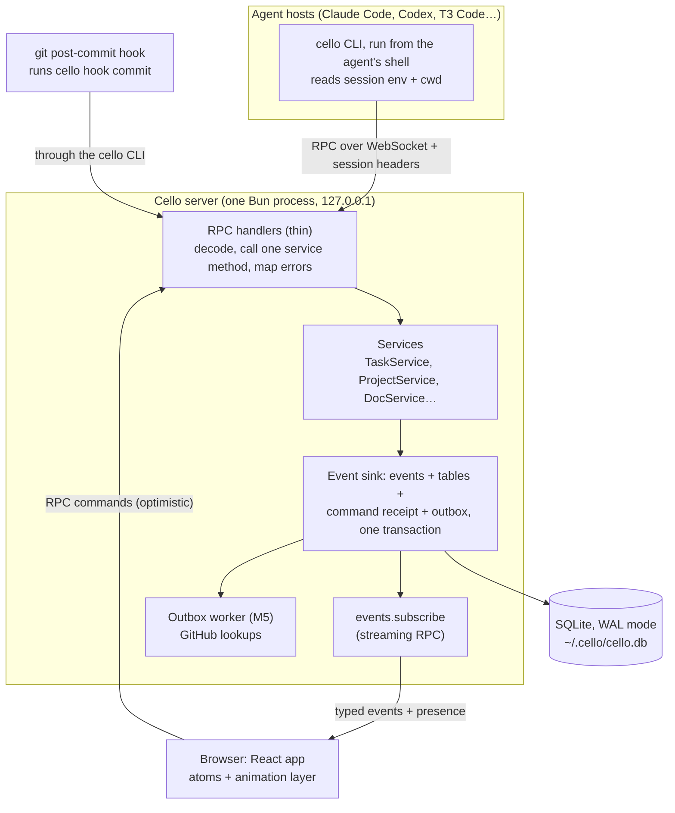

- **One process** serves the RPC WebSocket and the built React app. `cello start` runs it; a launchd agent can keep it running.
- **One writer.** Only the server touches the SQLite file, so there's no file locking between agents.
- **Local only.** It listens on `127.0.0.1`. It checks the `Host` and `Origin` headers so a web page in your browser can't call it (DNS rebinding). Non-browser clients send a token from `~/.cello/token`.
- **Backups.** The SQLite file is the only copy, so the server takes a daily backup with SQLite's backup API, keeps 14, and can export everything to JSON and Markdown.

## API contract and clients

Several things talk to the server: the web app, the CLI (which the git hook also uses), and later an MCP server. They must agree on every input, output, error and event. So the API is written once as a **contract**, and every feature is a **service** that each entry point calls. This is T3 Code's structure, on the same library (Effect 4).

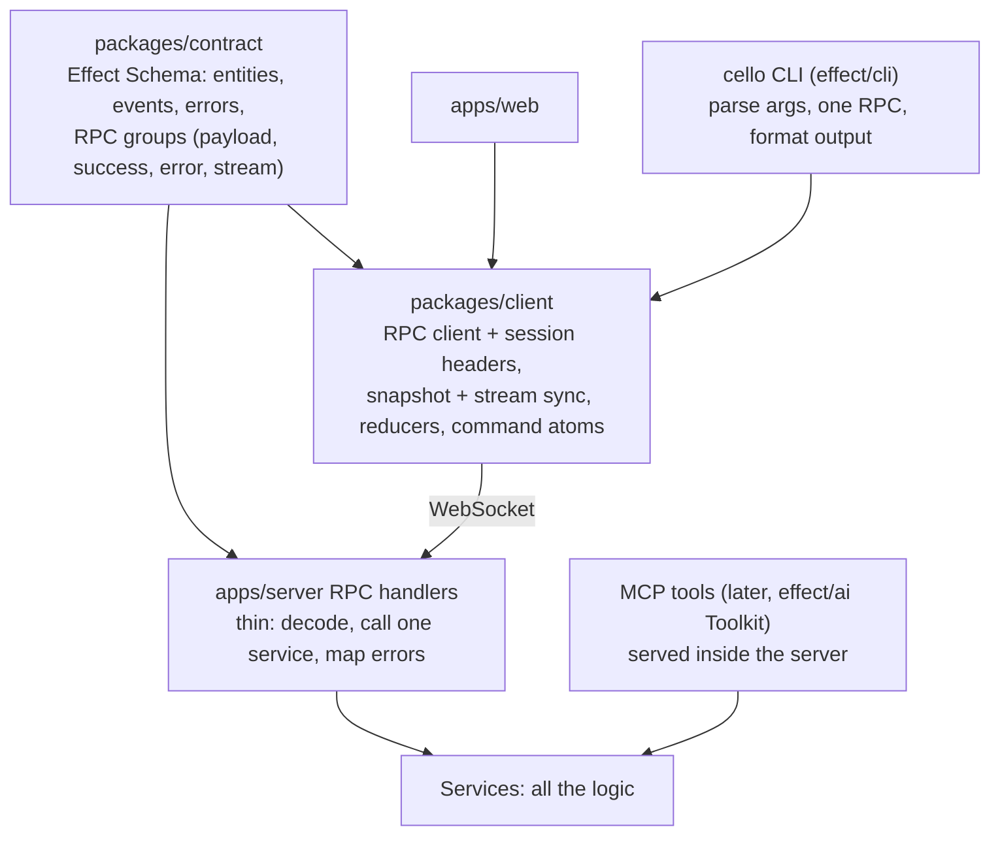

**The contract (`packages/contract`)** holds only schemas, no runtime logic:

- every entity and event as an Effect Schema
- every RPC with its payload, success and error schemas, collected in an RPC group
- errors as tagged classes (`TaskNotFound`, `TaskClaimed`, `VersionConflict`), so each RPC's failures are part of its type
- streaming RPCs for live data: `events.subscribe` streams a union of every event type

Stored events are replayed on reconnect, so a schema change must keep old events decodable.

An illustrative sketch, modelled on T3 Code's `packages/contracts/src/rpc.ts` (to be checked in M0):

```ts
// packages/contract/src/task.ts
export class TaskClaimed extends Schema.TaggedError<TaskClaimed>()("TaskClaimed", {
  key: TaskKey,
  sessionId: SessionId,
  lastActiveAt: Schema.DateTimeUtc,
}) {}

export const TaskClaim = Rpc.make("task.claim", {
  payload: Schema.Struct({ key: TaskKey }),
  success: TaskSummary,
  error: Schema.Union([TaskNotFound, TaskClaimed]),
})

export const EventsSubscribe = Rpc.make("events.subscribe", {
  payload: Schema.Struct({ afterSequence: Schema.Number }),
  success: CelloEvent, // union of every event type
  stream: true,
})

export const CelloRpcs = RpcGroup.make(TaskClaim, EventsSubscribe /* , … */)
```

**The server (`apps/server`)** keeps all logic in services (`TaskService`, `ProjectService`, `DocService`, …). An RPC handler only decodes, calls one service method and maps errors:

```ts
"task.claim": (input) => TaskService.claim(input.key)
```

Who is calling (actor, agent session, project) comes from the connection's session headers. It's provided to every service as a `Caller` service (`yield* Caller`), so services never take identity as an argument.

**One client (`packages/client`)** is shared by the web app and the CLI. It:

- connects to the WebSocket and sends the session headers (from the environment and working folder) and the local token
- starts the server if it isn't running (CLI only)
- exposes typed calls for every RPC
- holds the browser sync: snapshot, stream, pure reducers and command atoms (see "Live sync and state in the browser")

**The CLI** uses `effect/cli`. Each command is a few lines: parse the arguments, make one RPC call, format the result. Simple commands get their flags from the RPC's payload schema through a small helper; commands that need care are written by hand. Two shared pieces sit on top:

- an output formatter per command: short text by default, `--json` for the raw result
- one table that turns each tagged error into a "what to do next" message

The git hook runs `cello hook commit`, so it needs no client of its own.

**MCP later** uses `effect/ai` (McpServer and Toolkit), served by the Cello server itself at `/mcp`. Tools are defined from the same schemas and call the same services, with a per-session caller context like T3 Code's. No new API is needed.

## Agent CLI

Agents use Cello through the `cello` command, not an MCP server. Why:

- **No cost until used.** MCP tool descriptions sit in every agent session from the start. A CLI costs nothing until the agent runs it; a short skill tells the agent it exists and loads only when relevant.
- **Identity for free.** The command inherits the agent's environment and folder (see "Agent identity" above). No extra process per conversation.
- **One tool for everyone.** Agents, you in a terminal, git hooks and scripts all use the same binary. `--json` output pipes into `jq`.
- **Works in any agent with a shell**, with no setup step per host.
- **Easy to debug.** You can rerun the exact command an agent ran.

Commands are thin wrappers over the same RPCs and services (see "API contract and clients"), so a later MCP server and the CLI can't drift apart.

### Rules for the commands

- **Short text output by default**: key, title, status, one line per task. `--json` gives stable, versioned JSON for scripts.
- **The project is implied** by the working folder. `--project THAI` overrides it.
- **Long text from stdin.** `--body-file -` (or `-F -`) reads markdown from stdin, so agents pass descriptions with a heredoc instead of fighting shell quoting.
- **Batch where agents batch.** `cello task create --from-file -` takes a list (JSON or one title per line), so breaking a feature into eight tasks is one command. The board still animates them one by one.
- **Errors say what to do next**: "THAI-12 is claimed by Codex session 9f2c (active 3 min ago). Pick another task or run `cello task get THAI-12`."
- **`cello guide`** prints the agent conventions: run `cello context` first, claim a task before working on it, comment progress, put the task key in commit messages. The installed skill points here, so the guide lives in one place.

### Commands

| Command | What it does |
| --- | --- |
| `cello context` | Start here. Current project and workspace, statuses, labels, tasks this session has claimed, recent activity. |
| `cello whoami` | Print, as JSON, who Cello thinks is calling: agent variables seen, session, project, working folder. |
| `cello task list` | Filter by status, label, priority, assignee, due date, text. Default: open tasks in the current project. |
| `cello task get THAI-12` | One task with description, sub-tasks, comments, links and a short history. Shows as "reading" on the board. |
| `cello task create "Title"` | One task, or a list with `--from-file`. Description, status, priority, labels, due date, parent. |
| `cello task update THAI-12` | Change fields, move status or position (`--before`/`--after` another key), add or remove labels. `--expect-version` returns a conflict instead of overwriting. |
| `cello task claim THAI-12` | Assign to this session and move to the first "started" status, in one step. Fails if another session holds it (see the claim rule in "Settled in review"). |
| `cello task release THAI-12` | Give up a claim without finishing the task. |
| `cello task comment THAI-12` | Add a markdown comment. |
| `cello task link THAI-12 <sha\|url>` | Attach a commit, PR, branch or URL. |
| `cello doc list / get / write` | Read and write docs and specs. `write` creates or updates, with an optional version check. |
| `cello doc publish report.md` | Publish a markdown file as a page and print its link. Running it again on the same file updates the same page. `--title`, `--task THAI-12`, `--asset img.png`. |
| `cello search "query"` | Full-text search over tasks, comments and docs (SQLite FTS5). |

Plus commands for you: `cello start`, `cello init`, `cello install`, `cello hook install`, `cello backup`, `cello export`.

### Setup

```bash
cello install claude     # installs the Cello skill, allowlists Bash(cello *) so agents aren't prompted
cello install codex      # adds the guide pointer to ~/.codex/AGENTS.md
cello init               # in a repo: registers it as a project (asks workspace, key)
```

If the server isn't running, any `cello` command starts it in the background first.

## Live sync and state in the browser

The browser keeps two kinds of state, in two places:

| State | Where | Examples |
| --- | --- | --- |
| Data from the server | **Effect atoms** in `packages/client`, updated by pure reducers | workspaces, projects, statuses, labels, tasks, comments, links, docs, agent sessions |
| State that only lives on screen | **Zustand** | presence, cursors, the animation queues, selection, open panels |

**How data arrives** (T3 Code's pattern):

1. On connect, `snapshot.get` returns the rows plus the sequence number they're current to.
2. `events.subscribe({ afterSequence })` streams every later event. A pure function, `applyEvents(snapshot, events)`, ignores anything at or below the snapshot's number, keeps unchanged rows as the same objects so React skips them, and applies a batch with one index.
3. After a reconnect, the client resumes from the last number it saw. If the server says the gap is too big, it takes a fresh snapshot.
4. Subscriptions are scoped. A project's board subscribes to that project; All projects subscribes to the workspace.

**Views** are derived atoms over the task rows. The board, list, table and All projects views read their filters, grouping and sort from the URL. Switching "this project" to "all projects" changes one input.

**How your changes leave.** Each change is a *command atom*, like T3 Code's RPC commands. It applies an optimistic patch at once, then sends the RPC with a command id. The patch stays until the server's event with that id arrives, so the board never flickers between your version and the server's. If the server refuses, the patch rolls back with a toast. The command id also makes server retries safe through command receipts.

**Why Zustand for the rest.** The animation layer reads the raw event stream, not the data atoms. It needs a small store it can read and write outside React, many times per second, and none of this state belongs on the server.

**Rules that don't change with the library**

- **Conflicts.** Each field keeps the last write. Card positions use fractional indexes, so two moves at once never collide. Agents can send `--expect-version` to get a conflict error instead.
- **Presence** (who is looking at what) travels on the event stream but is never stored. An agent's `cello task get` shows it reading that card for about 10 seconds.

## Agent cursors and animation

This is the part that makes Cello different, so it gets its own milestone (M3) and its own prototype in M0.

**The cursor.** Each agent session has a cursor: an arrow with a pill label like `Claude · thailookup · fix billing`. Its color comes from the session id, so it stays the same across reloads. It appears when that session acts and fades after a few seconds of quiet.

**What each event looks like**

| Event | Animation |
| --- | --- |
| Task read | Cursor glides to the card, which gets a soft outline for the read. |
| Task moved | Cursor goes to the card, card lifts (scale and shadow), travels with the cursor to the new column and spot, lands. Other cards make room with a layout animation. |
| Task created | Cursor goes to the column's `+`; the card grows in and its title types out. |
| Field changed | Cursor goes to the card; the changed chip (label, priority, date) pulses. |
| Comment added | A small speech bubble pops from the card; the comment count ticks up. |
| Doc edited | In an open doc, the changed lines highlight in the agent's color. A typing replay comes later. |

**Pacing**

- Each agent has its own queue. Different agents animate at the same time.
- One move takes about 1.1 s at full speed. With more than 2 waiting, moves speed up (scale = 2 / waiting, down to 0.35×, including the move in flight). With more than 8 waiting, the queue skips to the end and shows "Claude made 23 changes · Replay". These numbers come from the M0 spike; see `docs/internals/spike-board-ui.md`.
- If a card is off screen or filtered out, the cursor waits at the edge of the board pointing at it, the way Figma does, and the event goes into the activity feed.
- Your own drags never wait for a queue.
- `prefers-reduced-motion` swaps the motion for fades and markers.

**After a refresh.** Markers come from the event log, so they survive reloads:

- Cards changed in the last 10 minutes (adjustable) get a thin ring in the actor's color and a note like "moved by Claude · 2 min ago".
- The Activity panel lists recent events by session. "Replay last 10 min" plays them on the board.

## UI

The starting point is this Linear board, which Lucas shared as the reference:

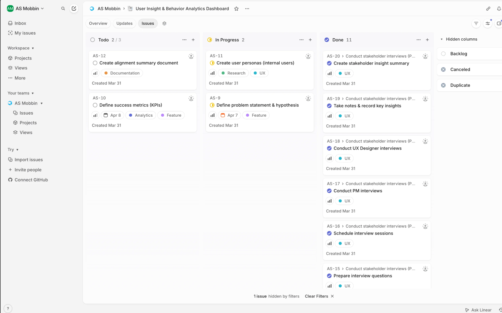

*Reference: a Linear project's Issues board. Saved in the repo at `docs/reference/linear-board-reference.png`.*

**What Cello keeps from it**

- The sidebar on the left with Inbox, My issues, Projects and Views.
- The breadcrumb and the Overview / Updates / Issues tabs at the top.
- Columns with a status icon, a count, a `…` menu and a `+`.
- Cards with the key (`AS-12`), the parent breadcrumb (`AS-20 › Conduct stakeholder interviews`), the status icon and title, then chips for priority, due date and labels, then "Created Mar 31".
- Hidden columns (Backlog, Canceled, Duplicate) folded on the right.
- Filter and display buttons at the top right, and the "1 issue hidden by filters · Clear Filters" note at the bottom.

**What Cello changes**

- **No teams.** "Your teams" goes away. Projects sit directly in the sidebar, each opening to Issues and Docs.
- **The workspace switcher** replaces "AS Mobbin ▾" at the top left, and only shows once there's a second workspace.
- **A new Agents section** in the sidebar lists live agent sessions.
- **Tabs become** Overview, Issues, Docs, Activity. Updates becomes Activity, the event feed with replay.
- **The avatar slot on each card** (top right) shows who made or last changed it: an agent icon in the session's color, or you.
- **Agent cursors** move over the board on top of all of this.
- "Import issues", "Invite people" and "Connect GitHub" go away. GitHub comes back in M5 as commit and PR links.

### More Linear references

Pulled from Mobbin and saved in `docs/reference/linear/`. Each one shows a screen Cello needs, with what we take from it.

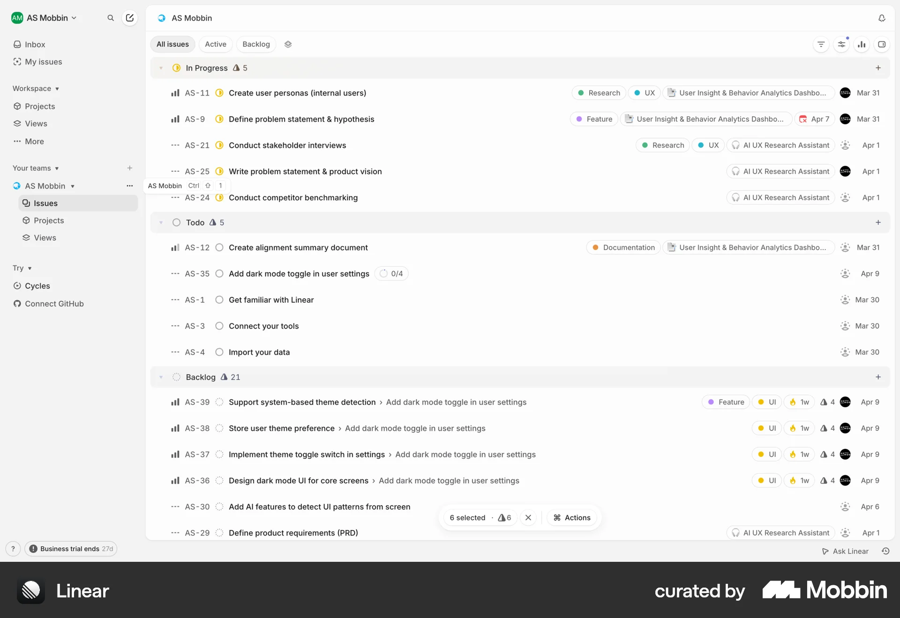

*List layout.* Status groups with a count and `+`. Each row: priority, key, status icon, title, parent breadcrumb, labels, project chip, assignee avatar, date. Selecting rows brings up a floating "6 selected · Actions" bar. **For Cello:** the list layout as is, with the avatar slot showing the agent or you, and bulk actions from the floating bar.

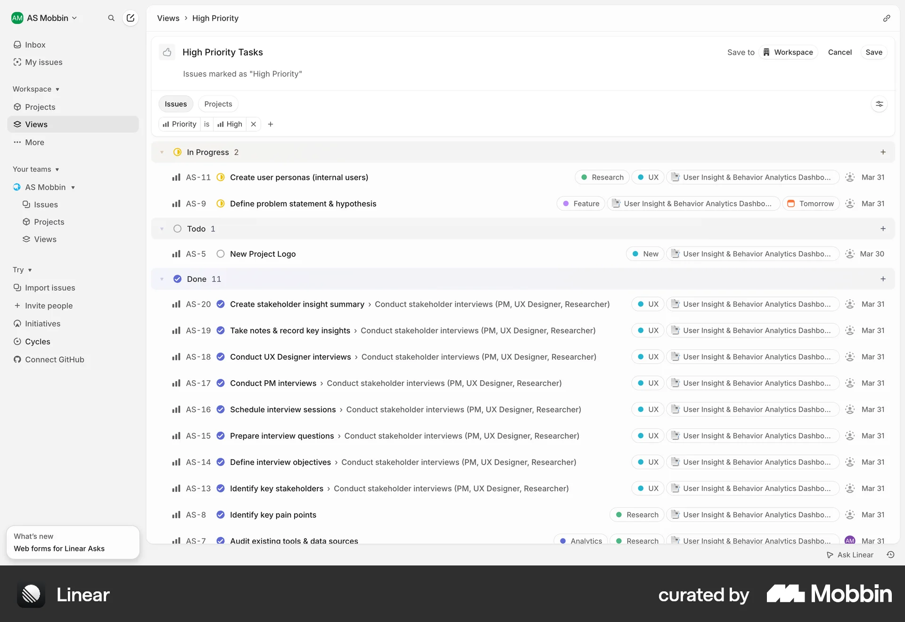

*Saved view.* A name, a description, filter chips (`Priority is High`) and "Save to Workspace". **For Cello:** saved views look like this; "Save to" picks this project or all projects.

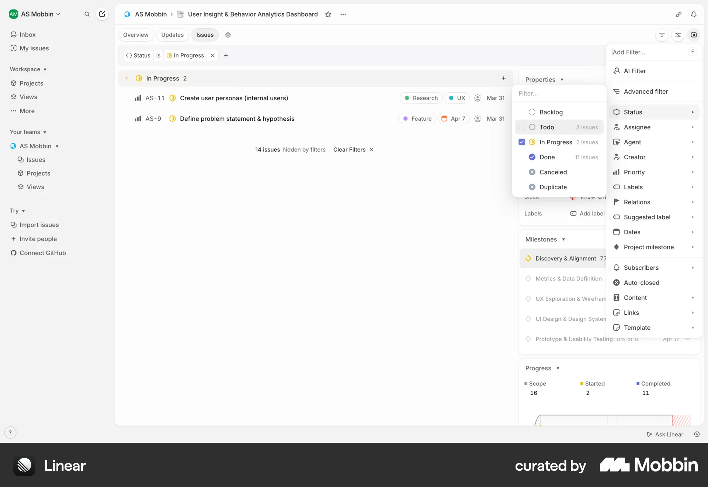

*Filter menu.* One menu with typed filters, each opening a submenu with counts (Backlog, Todo 3 issues, In Progress 2 issues…). Linear already has an **Agent** filter. **For Cello:** the same menu, plus "Agent session" and "Changed by" filters.

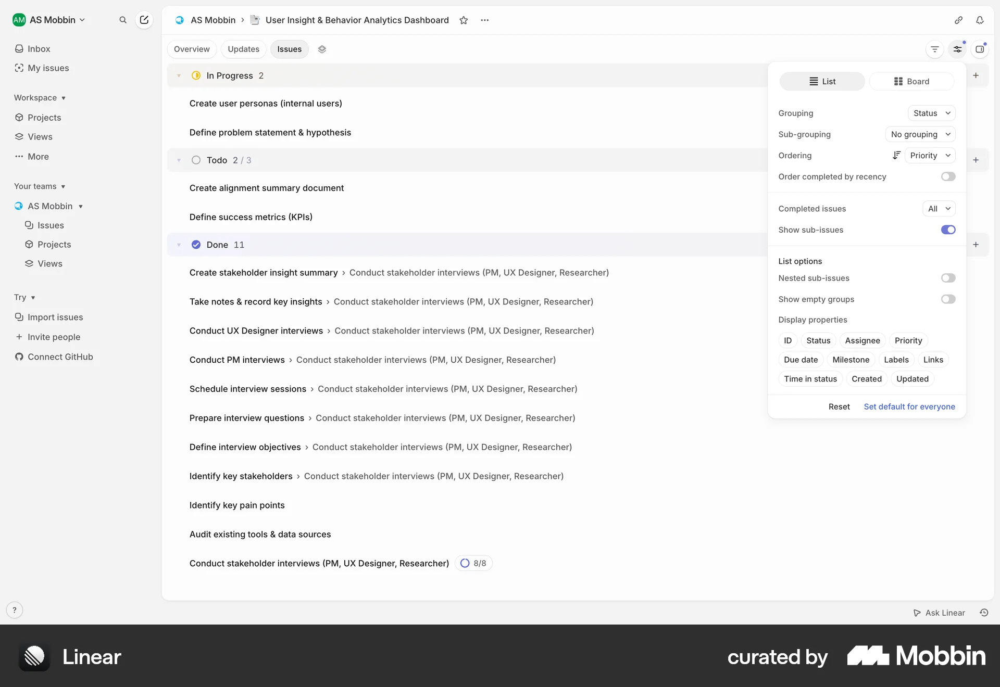

*Display options.* List or Board, grouping, sub-grouping, ordering, which completed issues to show, sub-issues on or off, and chips that toggle which properties rows show. **For Cello:** copy this panel almost as is. Add Table as a third layout and "Project" as a grouping for the All projects view.

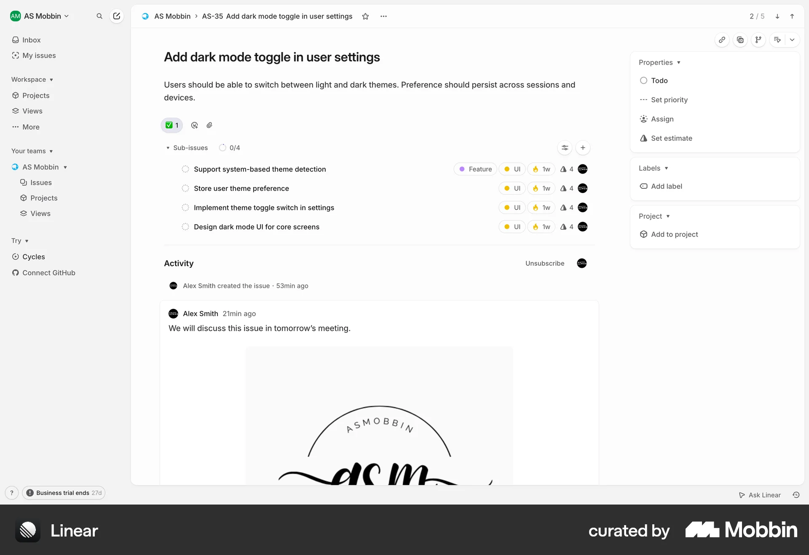

*Task detail.* Title and description, sub-issues with progress (`0/4`), an activity timeline with a comment box, and a properties sidebar (status, priority, assignee, labels, project). **For Cello:** the same layout. Activity lines name the agent and session ("Claude Code · session 2fd0505c moved this to In Progress"), and the sidebar gains a Links panel for commits and PRs.

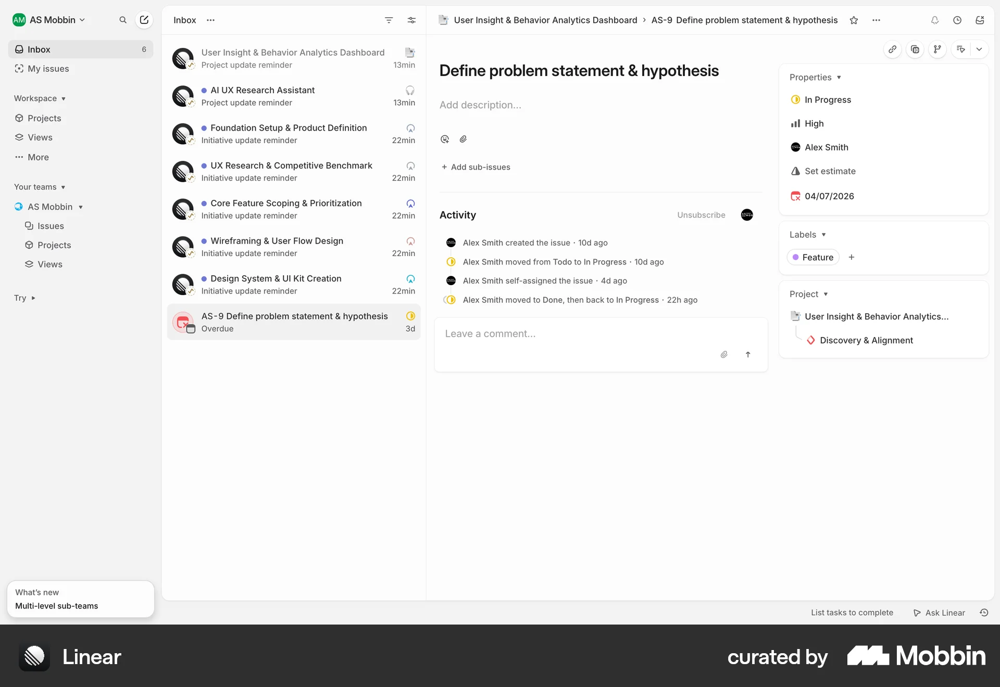

*Inbox.* A list on the left, the selected item open on the right, snooze from the item. **For Cello:** the Inbox uses this split: agents asking for review, comments on your tasks, overdue tasks.

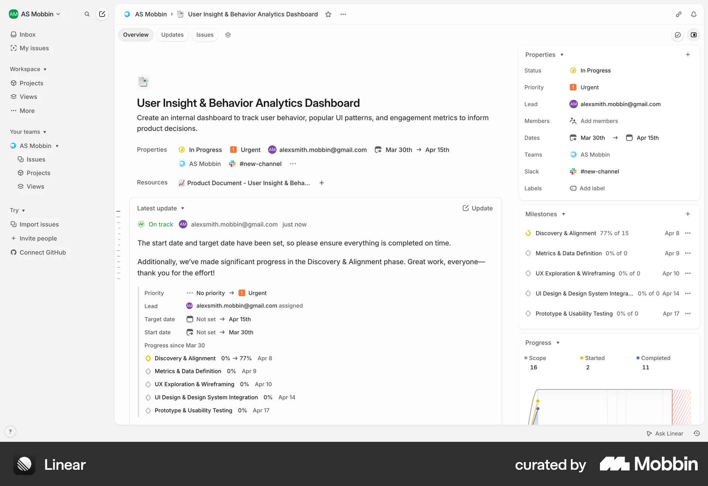

*Project overview.* Properties in a row, resources, the latest update, milestones, a progress chart and recent activity. **For Cello:** the Overview tab uses this layout with repo paths, counts by status, active agents and recent activity. Milestones and updates wait until after v1.

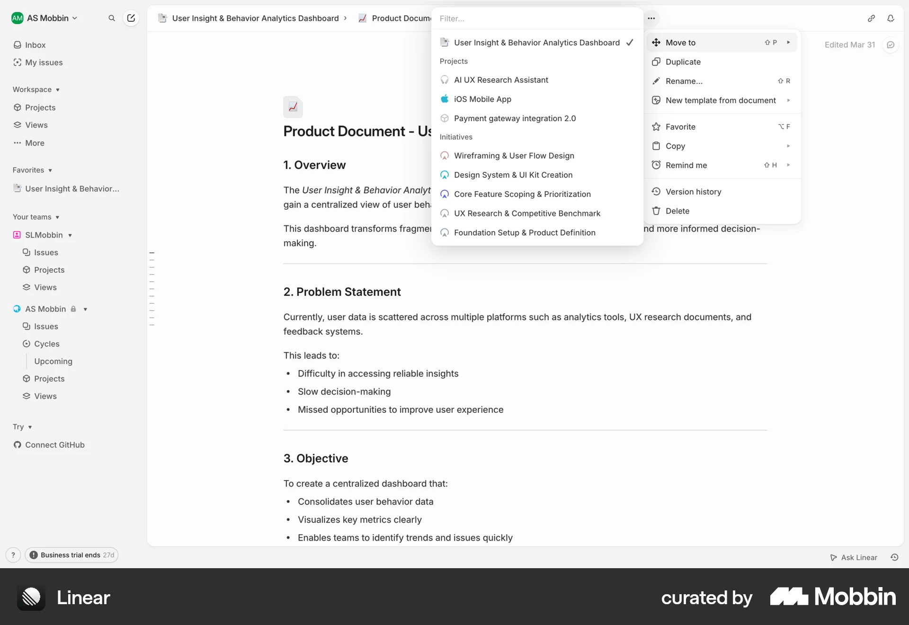

*Document page.* A full-width document inside a project, with a menu to move it to another project. **For Cello:** Docs and Specs pages look like this.

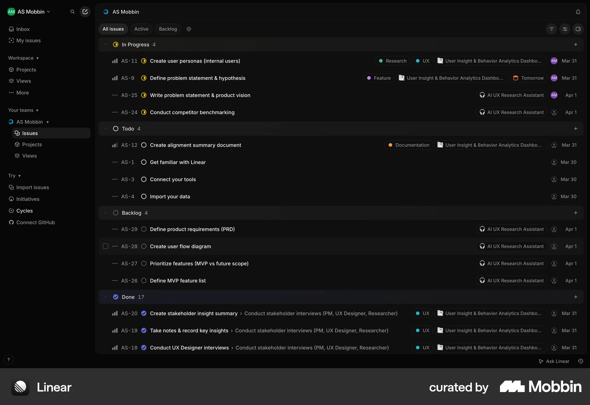

*Dark theme.* **For Cello:** the reference for the dark palette. Both themes ship from the start.

**Sidebar**

- Workspace switcher at the top (only once you have two or more workspaces), then search and a "new task" button.
- Inbox: comments on your tasks, and tasks agents created or moved to "In Review" for you. v1.1.
- My tasks: assigned to you.
- **Agents**: live sessions with what each is doing right now (claimed task, last action). Click one to filter the board to its changes.
- Workspace: Projects, Views (saved views, including cross-project ones).
- Projects, each opening to Issues and Docs.

**Project tabs**

- **Overview**: description, repo paths, counts by status, recent activity.
- **Issues**: the task views below.
- **Docs**: one tab for every document, with a kind filter (Doc, Spec, Page) and the newest first. All read in the page reader (see "Pages: built-in artifacts"). A spec also shows its linked tasks and their progress.
- **Activity**: the event feed with replay.

**Task views** (like GitHub Projects)

- Layouts: board, list, table.
- Group by status, priority, label, project, assignee or agent session, due date. Sort by any field. Filter by any field, including "created by agent" and "changed by session X".
- Show or hide fields on cards and columns. Hidden columns fold to the right, as in the screenshot.
- View state lives in the URL, so a link reopens the same view. "Save view" stores it.
- **All projects**: every project's tasks in one place, in any layout (board, list, table). Cards carry a project chip. Filter to some projects, group by project to see each backlog as its own lane, or search and sort across all of them. Each project's own Issues tab still shows only its backlog. Same filters, same saved views, one scope switch: "this project" or "all projects".

**Card**: key, parent breadcrumb, status icon and title, priority bars, due date, labels, avatar of who made it (agent icon or you), "Created Mar 31" or the recent-change note.

**Task detail**: a side panel from the board, or a full page. Title, markdown description, properties, sub-tasks, links (commits show sha and message), comments, and a timeline of events with provenance on each line.

**Keyboard**: `C` new task, `⌘K` command menu, `/` search, arrow keys move between cards, `Space` picks a card up and arrow keys carry it (the UI SDK kanban example already supports this). `⌘Z` undo comes after v1 (see the undo rule in "Settled in review").

## Pages: built-in artifacts

When an agent finishes a piece of work, it often writes a report, a plan or a comparison. Today that goes to a Claude artifact. Pages bring that into Cello: the agent publishes markdown with one command, and you read it as a designed page next to the tasks it belongs to.

The reading view follows the Claude artifact page Lucas uses today:

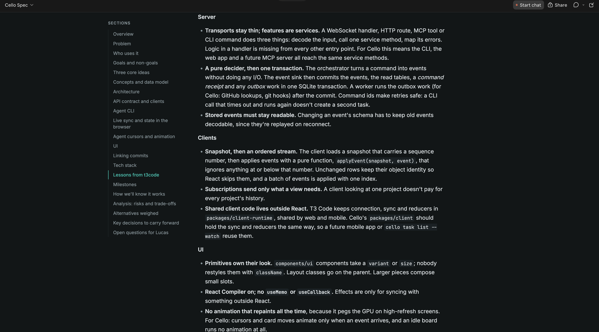

*Reference: the Cello Spec page as a Claude artifact. Saved at `docs/reference/artifact-page-reference.png`.*

**How an agent publishes**

```bash
cello doc publish report.md --title "Billing audit" --task THAI-12 --asset chart.png
# → http://localhost:4747/thai/pages/billing-audit
```

- The page belongs to the current project (from the working folder) and records the agent session that published it, like every other change.
- Publishing the same file again updates the same page and keeps the old version. The link never changes.
- Images and files go up with `--asset` and are referenced by relative path in the markdown.
- `--task` links the page to tasks; the task shows the page under Links, and the page shows the task.
- Agents read pages back with `cello doc get <slug>`, so a later session can continue from a report.

**The reader**

- A sticky section list on the left that marks where you are; on a phone it folds into a menu.
- A reading column sized for text, with headings, tables, code blocks, Mermaid diagrams and images with captions.
- An optional **summary** at the top: the frontmatter `summary:` field, or the first paragraph.
- Light and dark themes.
- Live updates: when an agent republishes while you read, the changed sections highlight in the agent's color for a few seconds (the same idea as the board's cursors). Your scroll position stays.
- Version history: see what each save changed, by whom, and restore an older version.
- Copy link, open the linked tasks, and "copy resume command" for the session that wrote it.

**Getting pages out**

Pages live in SQLite like everything else. `cello export` writes them out as markdown files (with their images) whenever you want a copy in the repo. Two-way folder sync was cut from v1 (decided 2026-11-14); the rules for it, if it returns, are in "Settled in review".

**One kind of document, three uses**

Docs, Specs and Pages share one table, one reader and **one Docs tab** with a kind filter. Keeping `kind` in the data means a kind can get its own tab or view later without a migration. They differ in intent:

| Kind | Who writes it | Typical content |
| --- | --- | --- |
| Doc | You or agents, edited over time | How the project works, decisions |
| Spec | You or agents, before the work | What to build; links to the tasks it breaks into |
| Page | Agents, at the end of a piece of work | A report, summary, comparison or plan to read now |

**Limits in v1**

- Markdown only, sanitized: no scripts and no interactive HTML. Claude artifacts can run code; Cello pages can't, by design.
- No comments on paragraphs yet. Comments go on the linked task.
- Pages are local like the rest of Cello. Sharing a page with someone else means exporting the markdown.

## Needs input: decisions on the card

When an agent needs Lucas to decide something, it asks **on the card**, never in the terminal (Lucas, Nov 15). `cello task ask CEL-n` posts questions with options (one may be recommended, with a reason) and evidence (screenshots, videos, a scope page). The card moves to a **Needs input** column, counted in the sidebar and shown first on the Review page. Lucas answers next to the evidence; the answers reach the asking session through the inbox and hooks, the card returns to In Progress, and an agent waiting with `--wait` wakes up. Every question and answer stays in the task's history. Full spec: [docs/specs/needs-input.md](docs/specs/needs-input.md) (CEL-47).

## Linking commits

1. **CLI**: the agent runs `cello task link THAI-12 <sha>`. The guide asks for this.
2. **Git hook** (more reliable): `cello hook install` adds a `post-commit` hook to each registered repo. It sends the sha, message and branch to Cello. Cello finds task keys in the message (`THAI-12`) and links them. When an agent makes the commit, the hook also reads `CLAUDE_CODE_SESSION_ID`, so the commit links to the session too.
3. **GitHub (M5)**: with `gh`, look up PRs whose branch or title mentions a key and attach them; optionally move the task to Done when the PR merges.

## Tech stack

Decided 2026-11-14: Effect 4, the same library line as T3 Code. Two differences from T3 Code: Cello runs on Bun (T3 Code runs on Node 26 with pnpm), and Cello uses `@effect/sql-sqlite-bun` (T3 Code wraps `node:sqlite` itself). So T3 Code's server and persistence layers are a pattern to follow, not code to copy. Pin Effect packages to one exact 4.1.x version, the same for all.

| Area | Choice | Why |
| --- | --- | --- |
| Runtime | **Bun**, through `@effect/platform-bun` | Built-in SQLite and WebSocket, runs TypeScript directly, and `bun build --compile` produces one `cello` binary. |
| Core library | **Effect 4.1** | Services and layers, typed errors, streams, schedules, tracing. T3 Code runs the same line, on Node. |
| API contract | **Effect Schema** + **`effect/rpc`** | RPC groups with typed payloads, results and errors. Streaming RPCs carry live events. One WebSocket. |
| HTTP | Effect's HTTP server (platform-bun) | Serves the web app and the RPC WebSocket. `Host`/`Origin` and token checks run as middleware. |
| Database | **SQLite** (WAL) through **`@effect/sql-sqlite-bun`**, migrations in code | Typed queries inside services, one transaction per command. FTS5 for search. |
| CLI | **`effect/cli`** | Commands, flags and help. A helper derives simple flags from the RPC payload schemas. |
| MCP (later) | **`effect/ai`** McpServer and Toolkit | Tools from the same schemas, served by the server at `/mcp` with a per-session caller context. |
| Web app | **React + Vite + TypeScript**, React Compiler on | A single-page app. No server rendering needed. No `useMemo` or `useCallback` (T3 Code's rule). |
| Routing | **TanStack Router** | Typed routes and typed search params, which hold the view state. T3 Code uses it too. |
| Server data in the browser | **Effect atoms** (`@effect/atom-react`) + pure reducers | Subscription atoms fed by streaming RPCs; command atoms with optimistic patches. |
| Screen-only state | **Zustand** | Presence, cursors, animation queues, selection. Readable outside React. |
| UI behaviors | **UI SDK** (`@ui-sdk/react`, `@ui-sdk/core`) | Headless and accessible: drag and drop across lists (`createTransfer`), menus, command menu, combobox, date picker, popovers, toasts, tabs. Has a kanban example to start from. |
| Styling | **Tailwind CSS** | UI SDK is unstyled; Tailwind styles it. Primitives in `components/ui` own their look through variants. Light and dark themes from the start. |
| Animation | **Motion** (motion.dev) | Layout animations for cards moving between columns, springs for the cursor. Only on events: an idle board runs no animation. |
| Editor | Markdown textarea with preview at first | Simple, and easy to animate agent edits. Tiptap later (T3 Code uses it). |
| Tests | **`@effect/vitest`** (`it.effect` with a test clock), Vitest browser mode, **Playwright** end to end with videos | No sleeps or timeouts in tests. |
| Lint | **oxlint**, **knip**, Effect language service | Custom lint rules for the AGENTS.md taste rules, as T3 Code does. |
| Repo | **Bun workspaces** monorepo | |

### Repo layout

```
cello/
├─ apps/
│  ├─ server/        # the `cello` binary: services, RPC handlers, HTTP, event sink,
│  │                 #   outbox worker, backups, persistence; src/cli/ holds the CLI
│  └─ web/           # React app; components/ui primitives own their look
├─ packages/
│  ├─ contract/      # Effect Schema: entities, events, RPC groups, errors, task keys. No runtime logic
│  ├─ client/        # RPC client, session headers, snapshot + stream sync, reducers, command atoms
│  └─ shared/        # pure helpers used by more than one package, each with unit tests; subpath exports, no barrel
├─ docs/reference/   # reference screenshots
├─ docs/internals/   # decisions and cross-cutting constraints only
├─ AGENTS.md         # glossary, ways to hurt yourself, taste rules (modelled on T3 Code's)
└─ SPEC.md
```

As in T3 Code, the CLI lives in the server's binary: `cello start` runs the server, and every other command is a client of it.

## Lessons from t3code

T3 Code (`~/projects/t3code`) is a local server with web, desktop and mobile clients, event-sourced on SQLite, with a CLI and an MCP server. It's close to Cello's shape and works well, so Cello copies its patterns, and its library (Effect 4). What we take:

**Server**

- **Transports stay thin; features are services.** A WebSocket handler, HTTP route, MCP tool or CLI command does three things: decode the input, call one service method, map its errors. Logic in a handler is missing from every other entry point. For Cello this means the CLI, the web app and a future MCP server all reach the same service methods.
- **A pure decider, then one transaction.** The orchestrator turns a command into events without doing any I/O. The event sink then commits the events, the read tables, a *command receipt* and any *outbox* work in one SQLite transaction. A worker runs the outbox work after the commit. Cello has no outbox work until GitHub lookups in M5; backups run on a plain schedule. Command ids make retries safe: a CLI call that times out and runs again doesn't create a second task.
- **Stored events must stay readable.** Changing an event's schema has to keep old events decodable, since they're replayed on reconnect.

**Clients**

- **Snapshot, then an ordered stream.** The client loads a snapshot that carries a sequence number, then applies events with a pure function, `applyEvents(snapshot, events)`, that ignores anything at or below that number. Unchanged rows keep their object identity so React skips them, and a batch of events is applied with one index.
- **Subscriptions send only what a view needs.** A client looking at one project doesn't pay for every project's history.
- **Shared client code lives outside React.** T3 Code keeps connection, sync and reducers in `packages/client-runtime`, shared by web and mobile. Cello's `packages/client` should hold the sync and reducers the same way, so a future mobile app or `cello task list --watch` reuse them.

**UI**

- **Primitives own their look.** `components/ui` components take a `variant` or `size`; nobody restyles them with `className`. Layout classes go on the parent. Larger pieces compose small slots.
- **React Compiler on; no `useMemo` or `useCallback`.** Effects are only for syncing with something outside React.
- **No animation that repaints all the time**, because it pegs the GPU on high-refresh screens. For Cello: cursors and card moves animate only when an event arrives, and an idle board runs no animation at all.

**Working on the code**

- **Dev never touches real data.** Each worktree gets its own data folder and its own ports. The dev database is seeded from a read-only copy of the real one. For Cello: dev uses `<worktree>/.cello/`, never `~/.cello/`.
- **Tests never wait on time.** No sleeps, no timeouts, no polling: drain the worker or await the event. Test at the lowest layer that fails.
- **AGENTS.md as the rulebook:** a glossary, "ways to hurt yourself", and taste rules, enforced by custom lint rules and knip for unused code.
- **Docs only for decisions.** `docs/internals/` holds decisions and constraints that span components. Agents can read the code for the rest.

### Decided: the Effect stack (2026-11-14)

T3 Code builds all of this on Effect 4, and Cello will too. Lucas chose it after weighing:

**What Effect gives Cello**

- **Typed errors.** `task.claim` fails with `TaskNotFound | TaskClaimed` in its type, so every caller, including the CLI's "what to do next" messages, has to handle each case.
- **A test clock.** Claim expiry (2 quiet hours) and animation pacing are tested by moving the clock, instantly, with no sleeps.
- **One schema** for the type, validation, wire format, CLI flags, MCP tool schemas and stored events.
- **Streams with cleanup.** The live feed batches, applies backpressure and stops by itself when a tab closes. Background jobs shut down with the server.
- **Retries and schedules** in one line (GitHub lookups, daily backup), and **tracing** from named service methods.
- **One project for RPC, CLI, MCP and SQL** at one version, and T3 Code on this machine as a working reference.

**What it costs**

- A learning curve (generators, services, layers), more verbose code and dense type errors.
- Fewer outside examples for v4; T3 Code offsets this.
- It's all or nothing across the codebase.
- Optimistic writes are hand-built, with T3 Code's command atoms as the model.

## Settled in review (round 1)

Three fresh-context reviewers (scope, design, implementation readiness) read this spec on 2026-11-14. These rules close the design gaps they found. Scope cuts they suggested are listed under "Open questions" for Lucas.

**Optimistic writes and command ids**

- Every write RPC carries a `command_id` (a client-made ULID). The `events` table stores it, and a `command_receipts(command_id, rpc, result, created_at)` table records each accepted command. A retried command returns the stored result instead of running again.
- Every write RPC returns the highest event `seq` it committed, or "no change".
- The client drops its optimistic patch when it has applied events up to that `seq`, when the RPC fails (rollback), or when a fresh snapshot replaces its state. It doesn't wait for one particular event, so no-op writes, batch creates and moves into another project all clear.

**Task claims**

- One rule: a claim holds until the task is done, the session runs `cello task release`, you change the task yourself, or the holder is gone.
- "Gone" means its agent process has exited, checked by pid (`CLAUDE_PID` or the process found by the identity walk). With no pid, it means 2 hours without any `cello` command from that session.
- Taking over a claim writes a `task.claim_taken` event. The old session's next `cello` command warns it by name: "THAI-12 was taken by Codex session 9f2c."
- A human change always wins over a claim and writes a claim-ended event.

**Agent identity**

- Precedence when several sets of variables are present: `CELLO_SESSION`, then the most specific host variable (the innermost agent).
- Fallback without a host variable: walk up the process tree to the first known agent binary and key the session on that pid plus its start time. The direct parent is usually a short-lived shell and isn't used.
- The raw identity (variables, pids, cwd) is stored on the session, so mistakes can be traced.
- Subagents that share their parent's session id count as the parent's session unless M0 finds a sub-agent id.
- A command you type in an agent's built-in terminal inherits the agent's variables and is recorded as the agent. Run `CELLO_SESSION=me cello …` to record it as you.

**One server, always**

- Before opening the database, the server takes an exclusive lock on `~/.cello/server.lock` and writes its pid and port. When several CLI calls start a server at once, the losers wait for the port and connect.
- The connection handshake carries a contract version. On a mismatch after an upgrade, the CLI asks the old server to restart, or says "run `cello restart`".
- Integration test: N CLI calls at once against a stopped server end with one server and N successes.

**Connection and identity protocol**

- One WebSocket at `/rpc`, on `127.0.0.1:4747` by default.
- The browser is served from the same origin. The server accepts its connection only with an allowed `Origin` (`http://127.0.0.1:4747`, `http://localhost:4747`), and the caller is the human actor.
- The CLI sends `x-cello-token` on the WebSocket upgrade. Identity (`x-cello-session`, `x-cello-client`, `x-cello-cwd`, `x-cello-pid`) travels as per-request RPC headers set by a client middleware and read by a server middleware that provides `Caller`. Spike (d) proved this works the same from Bun and the browser, and it will work over a future MCP transport.
- The token is created on first start in `~/.cello/token` with file mode 0600.
- Caller resolution order: browser origin → human; `CELLO_SESSION=me` → human; agent identity headers → that agent session; no agent variables → human.

**Subscriptions**

- `seq` is global. A scoped stream skips the numbers outside its scope; the client tracks the highest `seq` it has seen.
- A project subscription also receives workspace-level events (statuses, views). Label events are their project's.
- Moving a task to another project emits a removal in the old scope and a full-row upsert in the new one.
- Presence uses its own unsequenced message type, so the seq filter never drops it.
- `events.subscribe({ scope, afterSequence })` joins the live channel first, buffers, replays stored events up to the newest `seq`, then drains the buffer, skipping duplicates by `seq`.
- More than 5,000 missed events returns a `SnapshotRequired` error, and the client takes a fresh snapshot.

**Animations without a lost "from" state**

- Before the store applies an event, the animation layer records the card's position and screen rectangle.
- While a move waits in its queue, the card stays as a static copy in its old slot and is hidden at its new one (parking copies at a recorded rectangle drifted as columns reflowed, found in M0). When the move plays, the new spot holds an invisible spacer and a ghost flies from the old slot with the cursor. The spacer turns into the real card when the ghost lands.
- Queued animations for the same card merge, newest wins, across agents.
- Grabbing a card cancels its ghost.
- Events whose `command_id` came from this tab never animate.
- Events delivered as catch-up (after a reconnect or a fresh snapshot) never animate; they show as recent-change markers.

**Folder sync (cut from v1; rules for when it returns)**

- The server stays the only writer. A file edit is imported as an event by "you (file edit)", so it keeps an actor.
- `documents` stores `synced_hash`. A watcher event whose content matches what Cello last wrote is ignored, so Cello's own writes don't echo back.
- Only the project's main worktree folder syncs.
- A deleted file detaches the page from the file; it never deletes the page.
- Importing pauses while `.git/index.lock` exists or right after HEAD changes (checkout, rebase).
- Each synced file carries a `cello_id` in its frontmatter; republishing matches on that, not on the path.

**Conflicts, undo and stored events**

- The browser sends the task `version` it last saw. If someone else changed the same field since, the server refuses and the board says "changed by Claude since you opened it".
- Undo (after v1) is a compare-and-set: it applies only if the field still holds the value the event set.
- `events` rows carry a `schema_version`, and M1 includes the decoders that bring older versions up to date.

**First start**

- The first `cello start` creates the human actor (name from `git config user.name`), the default workspace and the default statuses with their categories. A "New project" dialog in the web app registers projects in M1, before `cello init` exists.

**M1 details**

The readiness review's M1 blockers are written up in [the M1 plan](docs/M1.md): the full RPC list, the event catalog, column-level tables, first-start seed, the M1 screens and 19 named tests.

## Testing and TDD

Cello is built test first. Every behavior starts as a failing test, then the code that makes it pass, then a cleanup with the test still green. A bug fix starts with a test that fails because of the bug.

There are three layers of tests, and each behavior is tested once, at the lowest layer where it can fail.

### 1. Unit tests: inside each module

Code is organized by domain, and each domain folder holds its own tests next to the code they test:

```
apps/server/src/
├─ task/
│  ├─ TaskDecider.ts            # pure: command → events
│  ├─ TaskDecider.test.ts
│  ├─ TaskService.ts            # claim, create, move…
│  ├─ TaskService.test.ts
│  └─ taskKey.ts / taskKey.test.ts
├─ project/      (same shape)
├─ document/     (same shape: docs, specs, pages, export)
├─ session/      (agent identity from env + cwd)
├─ events/       (event sink, outbox worker, event stream)
└─ persistence/  (SQLite layer, migrations)

packages/client/src/
├─ sync/          applyEvents.ts + applyEvents.test.ts, snapshot resume
├─ commands/      command atoms, optimistic patch and rollback
└─ views/         board/list/table derivations

apps/web/src/components/board/
├─ Board.tsx
└─ Board.browser.test.tsx       # Vitest browser mode, real DOM
```

- **What they cover:** the decider (command in, events out), service rules (claim refuses a task another active session holds), reducers (`applyEvents` skips old events and keeps unchanged rows), view derivations, task-key parsing, schema decoding of stored events, animation pacing rules.
- **How:** `@effect/vitest` with `it.effect`. Services get a real in-memory SQLite, not mocks. Time comes from the **test clock**, so "a claim expires after 2 quiet hours" runs instantly.
- **Only external things get test layers:** GitHub, the file system watcher, the system clock. The logic under test is never mocked.

### 2. Integration tests: parts working together

These live in `test/integration/` in the package that owns the boundary, and run the real pieces together in one process:

| Test | What runs together |
| --- | --- |
| RPC round trip | the WebSocket RPC server, the handlers, the services, SQLite and the event stream |
| Client sync | `packages/client` against an in-process server: snapshot, stream, reconnect from a sequence, fresh snapshot after a large gap |
| Optimistic writes | a command atom, the server refusing it, and the rollback |
| CLI | `cello task create`, `claim`, `move` against an in-process server, with agent environment variables set, checking the event's actor and session |
| Agent identity | env vars and a temp git worktree map to the right project and session |
| Export | `cello export` into a temp folder writes every page and its images as markdown |
| Git hook | a temp repo with the hook installed: a commit mentioning `THAI-12` links to the task |
| Outbox | a command that queues work, then draining the worker and checking the result |

### 3. End-to-end tests: the whole product

These live in `e2e/` at the repo root and run the built `cello` binary with a temp data folder, a real browser (Playwright) and real CLI calls:

- an agent-style CLI call creates a task, and the open board shows the card appear
- a CLI move plays the cursor animation and the card lands in the new column
- you drag a card in the browser and `cello task list` shows the new status
- `cello doc publish` opens a page that updates live when republished (v1.1)
- two "agents" (two env setups) try to claim one task; one wins, the other gets the "what to do next" message

Every E2E run records videos (converted to MP4) so UI changes come with proof.

### Rules (from T3 Code)

- **No sleeps, timeouts or polling** in tests. Advance the test clock, drain the worker, or wait for the specific event.
- **No retries for flaky tests.** A flaky test gets fixed.
- **Test at one layer.** Don't repeat a unit case in an integration test or an E2E test.
- **Skip what types already guarantee**, trivial code, copy text and static markup.
- **Dev and tests never touch `~/.cello/`.** Every test gets its own temp data folder.

### Write it once

Shared logic exists in exactly one place, with its own unit tests, and every caller uses it. That keeps the system consistent: a rule fixed once is fixed everywhere.

- **Where shared code lives:**
  - `packages/contract`: schemas and the small pure helpers that belong to them (task-key parsing, event type guards)
  - `packages/shared`: pure helpers used by more than one package (fractional positions, markdown section extraction for the page reader, relative-time labels, session-color hashing)
  - the owning service: domain rules (claiming, moving, publishing), which every entry point reaches through the service
- **Before writing a helper, search for one.** The second time the same logic is needed, it moves to a shared module with tests, and the first copy is deleted.
- **Shared functions are unit tested where they live**, so their callers can rely on them without re-testing them.
- **The CLI, the web app and a future MCP server never re-implement a rule.** They call the service or the shared helper.
- **Checks:** knip flags unused exports and files, and a duplicate-code check (jscpd) runs in `check:changed` to catch copied blocks.

### Commands

```bash
bun run test               # unit + integration (Vitest projects)
bun run test:browser       # component tests in Vitest browser mode
bun run test:e2e           # builds the binary, runs Playwright, records videos
bun run check:changed      # format, lint, typecheck and tests for changed files
```

M0 spikes are throwaway prototypes and aren't test-first. From M1 on, everything is.

## Milestones

| | Milestone | Done when |
| --- | --- | --- |
| **M0** | Spikes: **done 2026-11-14, all pass** | (a) Identity: Claude Code passes session id and pid; nested agents get their own; subagents share the parent's (`docs/internals/session-env.md`); Codex untested until its usage limit resets. (b) UI SDK drag: 59.5–60 fps with 50 cards, keyboard moves work; keep UI SDK. (c) Agent cursor: all behaviors work; pacing numbers set (`docs/internals/spike-board-ui.md`). (d) Effect slice: compiled CLI to browser in 78–81 ms; identity in RPC headers; the contract carries into M1 (`docs/internals/spike-effect-slice.md`). |
| **M1** | Local board | Server, schema, workspaces, projects, statuses, tasks, labels, comments. Board with drag and drop, live sync between two browser tabs, task detail. |
| **M2** | Agents | The `cello` agent commands, `cello guide` and the skill, agent sessions, provenance on cards and in task detail, `cello init` and `cello install`, Agents section in the sidebar. |
| **M3** | Watching agents | Presence, cursors, animation queues, recent-change rings, Activity tab, replay, a basic list layout, `cello search`. **v1 ends here.** |
| **v1.1** | After two weeks of use | Pages first (`cello doc publish`, the reader, task links). Then, in the order use shows: table layout, grouping and sorting, saved views, Docs and Specs, version history, Inbox, command menu. |
| **M5** | Git and GitHub | Post-commit hook, commit and PR links, optional one-way import of GitHub Issues. |

## How we'll know it works

Proposed; Lucas to confirm.

- After two weeks, new tasks for active projects are made in Cello, not GitHub Issues.
- Agents create, claim and move most tasks without being told to in the prompt.
- An agent's `cello` command shows on the open board in under 100 ms (excluding the animation).
- For every task an agent made, you can open the conversation that made it in two clicks.

## Analysis: risks and trade-offs

- **UI SDK is beta** (`0.1.0-beta.2`). Its API may change under us. Fix: pin the version, and wrap it in our own components (`apps/web/src/components/ui/*`) so a change touches one folder. Fallback for drag and drop: dnd-kit.
- **Effect has a learning curve.** Generators, services and layers take time for Lucas and for reviewing agent code. Fix: copy T3 Code's patterns and its AGENTS.md service rules, and keep Effect's LLM docs in the repo for agents (T3 Code keeps them in `.repos/effect/`).
- **Effect 4 is new.** Most examples online are for v3. T3 Code runs the 4.1 line, and Cello pins the same line.
- **Optimistic writes are hand-built.** The command atoms apply a patch, wait for the matching event and roll back on failure. T3 Code's command atoms are the model; M1 covers this with tests.
- **The animation layer is the hardest part.** Optimistic writes, live events and queued animations can drift apart. The rule in "Three core ideas" (the store is the truth, animation is only a picture) keeps this contained. The M0 prototype proves it before M1 adds real data.
- **Session identity depends on each host.** Claude Code passes `CLAUDE_CODE_SESSION_ID` to child processes (seen in this session's environment). Codex and T3 Code are unknown until M0. Without a variable, Cello still groups changes by the agent's parent process but can't link back.
- **The SQLite file is the only copy.** Daily backups and JSON/Markdown export cover this. Tasks don't travel with git branches; commit links are the bridge.
- **Agents have to know the CLI exists.** Unlike MCP tools, a CLI isn't listed to the agent automatically. The skill, `cello guide`, clear `--help` text and errors that say what to run next cover this. M2 should test that an agent with only the skill can finish a task end to end.
- **Permission prompts.** Each `cello` call is a shell command. `cello install claude` allowlists `Bash(cello *)`; other hosts need the same once.
- **Agents with no shell** (Claude desktop chat, claude.ai) can't use a CLI. An MCP server over the same services is the answer when that matters.
- **Agents forget conventions.** The guide helps, and the git hook links commits even when the agent doesn't run `cello task link`.
- **Scope.** Trello, Linear and Notion together is a lot. The non-goals list is the guard; Docs and Specs stay plain markdown in v1.
- **Two agents, one task.** `cello task claim` is atomic and refuses a task another session holds. The claim rule (held until done, released, changed by you, or the holder is gone) is in "Settled in review".

## Alternatives weighed

- **An MCP server as the agent interface.** Not chosen for v1: tool descriptions cost context in every session, it needs a process per conversation for identity, and it only serves agents. The CLI covers every agent with a shell plus humans and hooks. MCP stays possible as a thin layer over the same services.
- **Keep GitHub Issues and Projects.** Rejected by author: not live, slow to work with, and Lucas doesn't need GitHub tracking for most work. Commit links plus a later GitHub integration cover what's needed.
- **Markdown files in each repo as storage.** Not chosen: a cross-project board would read many folders, branches can conflict, and there's no event history to replay. SQLite plus an event log gives all three.
- **Next.js.** Not chosen: Cello is one long-lived local process with WebSockets, and server rendering adds nothing. Vite + a Bun server is simpler.
- **The oRPC stack** (oRPC contract with Zod, trpc-cli, Drizzle, TanStack DB). The first draft's choice. Not chosen by Lucas (2026-11-14) in favor of Effect: it spreads the contract, CLI, MCP, database and browser state over five libraries, with no local reference app. It stays the fallback if the M0 spike shows Effect is too heavy.
- **Elysia with Eden.** A Bun-first framework (about 19k stars, v1.4) with a typed client, built-in WebSocket, OpenAPI and Zod support. Not chosen: Eden's types come from the server code, not a separate contract package; nothing generates a CLI from it; MCP support is only small community plugins. With Effect, the HTTP layer is Effect's own.
- **TanStack DB** for browser data. Not chosen: it would be a second data model next to Effect's. Effect atoms plus pure reducers do the job, as in T3 Code. Its built-in optimistic writes are the main thing we give up.
- **LiveStore** (event-sourced SQLite in the browser). Not chosen: it wants to own the event log and sync, while in Cello the server's log is the truth. It's also pre-1.0 (v0.5).
- **A sync engine (Zero, Replicache, ElectricSQL) or CRDTs (Yjs).** Not chosen for v1: built for many users over a network. One local writer plus an ordered event log does the job with less to learn. Yjs could return for live doc co-editing.
- **Linear.** Not chosen: hosted, not local, and we can't add agent cursors or session provenance to it. (Claude's reasoning; Lucas didn't evaluate it.)
- **dnd-kit for drag and drop.** Lucas chose UI SDK. dnd-kit stays the fallback if the M0 spike fails.

## Key decisions to carry forward

1. Build from scratch. TypeScript end to end on Effect 4: Bun + Effect RPC, SQL and CLI + SQLite on the server; React + Vite + TanStack Router + Effect atoms + Zustand + UI SDK + Tailwind + Motion in the browser.
2. One local server is the only writer. Every change is an event in an append-only `events` table, written in the same transaction as the state change.
3. Agents use the `cello` CLI from their own shell, guided by a skill and `cello guide`. Their identity and project come from inherited environment variables and the working folder, never from arguments. A later MCP server calls the same services.
4. Animations are a separate layer that replays events and never blocks or changes the store.
5. No teams. Workspace, then project, then modules: Issues, Docs (one tab for docs, specs and pages), Activity. Workspaces stay (Lucas, 2026-11-14). One default workspace, hidden until a second exists. Each project has its own backlog; the All projects view shows them together with the same filters.
6. GitHub is optional and comes last. Commits link to tasks through the task key in the message, a git hook and `cello task link`.
7. The API is an Effect RPC contract (Effect Schema) in `packages/contract`. Every feature is an Effect service; the RPC handlers, the CLI and a later MCP server are thin layers over the services. One client (`packages/client`) serves the web app and the CLI.
8. In the browser, server data lives in Effect atoms fed by a snapshot and the event stream through pure reducers, with command atoms for optimistic writes. Zustand holds screen-only state.
9. Test first. Unit tests sit next to the code in each domain module; integration tests in `test/integration/` run real pieces together; end-to-end tests in `e2e/` run the built binary with a real browser and record videos.
10. Write a function once. Shared logic lives in one module (`packages/shared`, `packages/contract` or the owning service) with its own unit tests, and every caller uses it.
11. v1 is M0 to M3 plus search and a basic list; everything else waits for two weeks of real use. Pages come first after v1. No two-way folder sync: `cello export` is the way out.
12. Decisions that are Lucas's are asked on the card (`cello task ask`, the Needs input column) and answered in Cello, next to the evidence, never in the terminal. The answer reaches the agent the way a Send back does.

## Open questions for Lucas

1. ~~**Statuses**~~ Decided 2026-11-14: shared by all projects in a workspace.
2. **T3 Code:** does a T3 thread pass its thread id to the shell commands its agents run? If so, provenance can link straight to the thread. M0 will check, but you may know.
3. **Phone:** do you want to see the board from your phone soon? That changes the security model (Tailscale plus a login).
4. **Inbox:** what should reach you there: only agents asking for review, or every comment?
5. **Name and port:** `cello` on `localhost:4747`? (Any free port works.)
6. **Where agents publish:** should agents be told to publish reports to Cello instead of Claude artifacts in every project (a line in `~/.claude/CLAUDE.md`), or only in projects registered with Cello? (Matters from v1.1.)
