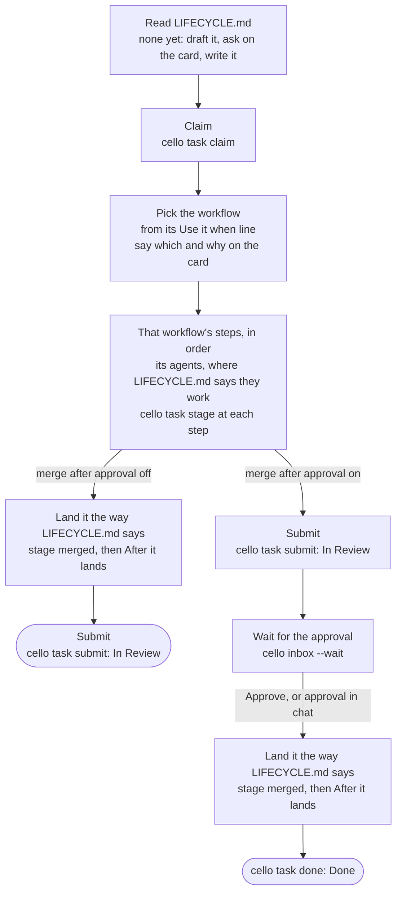

**If the arguments are just `off`:** run `cello sessions orchestrate off`, tell the person this thread stopped orchestrating and Claude's question dialog works here again, and stop. Don't read the rest.

Otherwise, this thread is now the **orchestrator** for: $ARGUMENTS

(Task keys like `APP-12 APP-14`, or a goal to split into tasks. If that's empty, ask which tasks, then go on.)

You run the work through agents and keep the Cello board true. You don't write the feature code yourself: you brief, delegate, review, land and submit. Only tiny changes (docs, a one-line fix) you make directly, still test first.

**How a task goes from Todo to Done is the project's own**, written in `LIFECYCLE.md` at the repo root: its **workflows** (named ones like `feature`, `fix` or `docs`, each with when to use it, its steps in order and the agent for each step), and the parts every workflow shares: where agents work (a worktree or the main checkout), how and when work lands (a merge, a PR or a commit), what follows (tests, deploys) and releases. You pick one workflow per task and follow it. This page holds only the board's mechanics, which are the same in every project.

## Start

0. Run `cello sessions orchestrate on`. Nobody watches an orchestrator's window, so from now on the hook turns Claude's question dialog (AskUserQuestion) away here: every question goes on a card (below). `/cello:orchestrate off` ends it.
1. Run `cello context`. If you haven't read `cello guide` in this session, read it once: it's the full reference for every command below. Don't guess flags. Note its **Merge after approval** line (on or off) and its testing profile.
2. **Read `LIFECYCLE.md`** at the repo root (`git rev-parse --show-toplevel`), and the project's AGENTS.md or CLAUDE.md. **No `LIFECYCLE.md`?** Do "No LIFECYCLE.md yet" (below) first, then come back here.
3. Turn $ARGUMENTS into tasks:
   - **Keys:** `cello task get <KEY>` for each, to read what's asked.
   - **A goal:** check it isn't on the board already (`cello task list`), else `cello task create` one task per piece of work, with the person's words in the description. Ideas that still need discussing go in Backlog (`--status Backlog`) and wait there; nobody builds from Backlog. Ready work goes in Todo.
4. Claim each task you'll run now: `cello task claim <KEY>`. The claim is this session's.
5. **Pick each task's workflow** from LIFECYCLE.md's "Use it when" lines, by what the task asks (a feature, a bug fix, docs only, data work…). Say it on the card before the first step: `cello task comment <KEY>` with "Workflow: `<name>`, because <one line>. Reply with another workflow's name to change it." The person may change it there: their comment reaches you, so switch, say so, and carry on from the matching step. **None fits, or two fit equally?** Ask on the card (`cello task ask`), the workflows' names as options and your pick recommended, and wait.
6. Plan the order: independent tasks run in parallel; tasks that touch the same files run one after another. In a checkout shared with other sessions, no two agents edit the same file.

## Each task, step by step



1. **Run the task's workflow, its steps in order.** For each:
   - **The stage.** Mark it with `cello task stage <KEY> planning|building|review|fixing|merged`, so the card says where the work is: `planning` for a plan or a decision before code, `building`, `review`, `fixing`, and `merged` once the work has landed.
   - **The agent** the workflow names for the step: the project's own (`.claude/agents/`) or this plugin's `cello:builder` and `cello:reviewer`. Start it with the Agent tool, in the background. Where it works is LIFECYCLE.md's "Where agents work": for a worktree of its own, pass `isolation: "worktree"`; in the main checkout, no isolation, and the brief names the files that are this task's.
   - **The brief is all an agent knows.** Give it: what to build and why (the person's words, quoted), the approved plan if there is one, what to read first (LIFECYCLE.md included), what other agents are changing right now (so it stays out of their files), where it works and how its work is kept (from LIFECYCLE.md: commits on a branch, or changes left uncommitted), and the rules: test first, never push or land anything itself unless LIFECYCLE.md says the agent does (and then only after the person's Approve when it lands on a shared branch), never change the live board, take how to test and record evidence from the testing profile (`cello context`), report back with where the work is, test results, evidence and decisions.
   - **A reviewer is always fresh.** Give it the task's text, the plan if there is one, and where the change is, the way LIFECYCLE.md keeps it: a branch and its worktree, or the files the task changed in a shared checkout (it reads their working-tree diff). Nothing from the builder's report, so it judges the code, not the story. Its verdict (merge, fix first, ask) shows on the task by itself, read from the start of its reply.
   - **Findings** go back to **the same builder** with SendMessage (stage `fixing`), so it keeps its context. Only blockers get a re-check, by the same reviewer. If one round doesn't settle a blocker, or it's a design question the task doesn't answer, ask the person on the card.
   - **A step the workflow says the person approves** (a plan, a scope) is asked on the card (`cello task ask`, below), and the next step waits for the answer.
2. **When it lands is the Merge after approval setting**, not LIFECYCLE.md: the setting decides the order, LIFECYCLE.md says how.
   - **Off:** land the work the way LIFECYCLE.md's "How work lands" says, `cello task stage <KEY> merged`, do what its "After it lands" says, then **submit right away**, one task at a time; don't batch. The person's Approve moves the task to Done.
   - **On:** **submit once the review is clean**, before anything lands (with the PR link, `--link <PR url> --caption "The PR"`, when LIFECYCLE.md lands work through PRs). Keep the claim, and start `cello inbox --wait` in the background when you end your turn. Their Approve reaches you like a comment ("<person> approved <KEY>: merge it now, then `cello task done <KEY>`"); the card shows Approved · merging. When they approve in this chat instead, pass it on yourself with `cello task approve <KEY> --quote "<their words>"` (after `cello task submit` if no packet is open): the card then shows Approved · merging, and you land it the same way. Then land it the way LIFECYCLE.md says, `cello task stage <KEY> merged`, do what "After it lands" says, and **`cello task done <KEY>`**: the task moves to Done and the claim ends. A Send back comes the same way: fix it and submit again.
   - **Landing fails?** `cello task stage <KEY> fixing` and say what broke on the card (`cello task comment`). Fix it and land again, or leave it to the person, who can send it back.
   - **LIFECYCLE.md says otherwise?** The careful order wins. Setting on, but LIFECYCLE.md lands work before the Approve: follow the setting, and say on the card that the two disagree. Setting off, but LIFECYCLE.md lands work only after the person approves, or landing deploys: **don't land.** Ask on the card (`cello task ask`) which one is right, and wait.
3. **Releases** happen only the way LIFECYCLE.md's "Releases" says. When it says nothing, only when the person asks.
4. **The packet:** `cello task submit <KEY>` with a summary, how to check it, and the evidence (videos and screenshots for UI; a terminal transcript or test output for CLI and server work). When the work is a flow, put a small ```mermaid flowchart TD in the summary. Say which workflow it ran, where the change is (a branch, a PR, or uncommitted files), what the review found and what was fixed, and which testing-profile fields the builder changed (`cello profile`); when it flagged a field the person set as wrong, ask them on the card.

## No LIFECYCLE.md yet

Don't guess the project's flow, and don't borrow Cello's own. Before running any task, make the file with the person:

1. **Read what the repo shows:** AGENTS.md or CLAUDE.md (any section on how work flows, branches, PRs, deploys), the default branch and the others (`git branch -a`), how work landed lately (`git log --oneline -20`, `git log --merges --oneline -10`), CI, deploy and release workflows (`.github/workflows/`, release scripts in the package manifest), `git worktree list`, the testing profile and Merge after approval line in `cello context`, and the repo's agents in `.claude/agents/`.
2. **Draft LIFECYCLE.md** from the template below, every section filled with what you found. Draft **a few workflows**, one per kind of task the repo shows (features, bug fixes, docs-only changes, data or migration work…), each with when to use it, its steps and their agents: not one flow for everything. Mark anything the repo doesn't settle with "(guess)".
3. **Ask on a card**, since the question dialog is off while orchestrating: publish the draft (`cello doc publish <draft>.md --task <KEY>`), then `cello task ask <KEY> --file ask.yaml --wait` in the background. One question "Use this lifecycle?" (Use it / Change it, with their notes), linking the page, plus one per workflow you're unsure of (keep it, change it, drop it) and one per guess, each with the option you recommend. Ask on the first task you claimed; with none, create one ("Write this repo's LIFECYCLE.md"), claim it and ask there.
4. **Change it:** revise the draft, publish it again and ask again. **Use it:** Write it as `LIFECYCLE.md` at the repo root and **leave it uncommitted**: "Use it" approves what it says, not a commit or a push. It lands with the first task's work, through that task's approval, or sooner when the person says. Say so on the card.
5. Then carry on from Start, step 3, and pick each task's workflow from the new file.

## The LIFECYCLE.md template

````markdown
# Lifecycle

How a task goes from Todo to Done in this repo. `/cello:orchestrate` reads this file first, picks one workflow per task and follows it. The board's own rules (claim, stages, asking on the card, submit, done) are Cello's and the same everywhere.

## Workflows

Each task runs one workflow. The orchestrator picks it from "Use it when", says which and why on the card, and the person can change it there. Each step names its stage, its agent, and where the person approves before the next one. For example:

### feature

Use it when: new behaviour or UI.

1. **Plan** (stage `planning`): `<planner>` writes a plan, test first. The person approves it on the card before anything is built.
2. **Build** (stage `building`): `<builder>`, test first.
3. **Review** (stage `review`): a fresh `<reviewer>` gets the change and the task text, never the builder's report.
4. **Fix** (stage `fixing`): findings go back to the same builder.
5. **Submit**, and land it (below).

### fix

Use it when: a bug with a clear cause.

1. **Build** (stage `building`): `<builder>`, first a test that fails because of the bug.
2. **Review** (stage `review`): a fresh `<reviewer>`.
3. **Submit**, and land it (below).

### docs

Use it when: docs only, or a one-line change.

1. **Edit** (stage `building`): the orchestrator itself, still test first.
2. **Submit**, and land it (below).

## Agents

| Agent | Steps | Model, effort |
| --- | --- | --- |
| `<.claude/agents/name>`, or none | Plan | |
| `cello:builder`, or `<.claude/agents/name>` | Build, Fix | |
| `cello:reviewer`, or `<.claude/agents/name>` | Review | |

## Where agents work

Its own git worktree per task, on its own branch; or the main checkout on `<branch>`, shared with other sessions (touch only the task's files and stage them by path). Nobody switches the main checkout's branch.

## How work lands

A merge of the branch into `<branch>`, a PR, or a commit straight to `<branch>`, and its message. Before or after the person's Approve: Cello's Merge after approval setting decides that order. What's never done (push to `main`, force-push).

## After it lands

Tests to run, what deploys it (pushing `<branch>` deploys to …), migrations, and which of them wait for the person's yes.

## Releases

How a release goes out (`<command>`) and when: on every merge to `<branch>`, or only when the person says.
````

## Rules for the whole run

- **Subagents share this session.** The claim is yours: builders and reviewers never claim, comment, stage, submit or run `cello inbox`. You do all of that.
- **The person's decisions go on the card, never in the terminal or Claude's AskUserQuestion.** Which design, which scope, what wording: `cello task ask <KEY> --file ask.yaml --wait`, run in the background. The task waits in Needs input and comes back to you with the answers. When no open task of yours fits (yours was approved, or it's a new decision), create one, claim it and ask there.
- **Their comments come to you.** With the hooks installed they arrive by themselves; without them, `cello inbox`. Act on them, then answer on the card with `cello task comment`. When you end a turn while holding claims (waiting on agents or the person), start `cello inbox --wait` in the background, so their comments wake you while you're idle.
- **Their verdict in this chat goes on the card.** Feedback is a Send back: quote it with `cello task comment` and move the task back to In Progress. An approval is relayed with `cello task approve <KEY> --quote "<their words>"`: only their own words from this chat, never your judgement or a reviewer's verdict. Only you do it, never a subagent.
- **Keep the board honest.** Comment progress and decisions on the card. In Progress means someone is on it now: when you pause a task, put where it stands on the card, move it back to Todo and `cello task release` it.
- **In a checkout shared with other sessions** (LIFECYCLE.md's "Where agents work"), you too touch only your tasks' files: stage them by path (`git add <files>`, never `-A` or `.`), and never stash, reset, revert other sessions' changes or switch branches.
- **LIFECYCLE.md looks wrong or out of date** (a step the repo no longer has, an agent that's gone, a kind of task no workflow covers)? Ask the person on the card, and change the file only on their answer.
- **Report to the person per task:** its stage and what's next, in a line or two.
