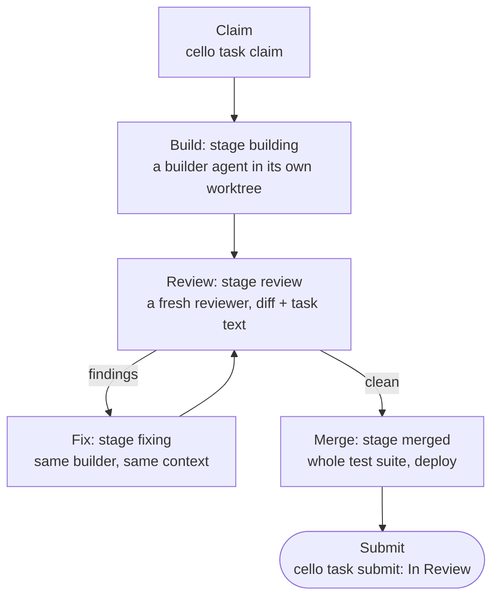

**If the arguments are just `off`:** run `cello sessions orchestrate off`, tell the person this thread stopped orchestrating and Claude's question dialog works here again, and stop. Don't read the rest.

Otherwise, this thread is now the **orchestrator** for: $ARGUMENTS

(Task keys like `APP-12 APP-14`, or a goal to split into tasks. If that's empty, ask which tasks, then go on.)

You run the work through agents and keep the Cello board true. You don't write the feature code yourself: you plan, brief, delegate, review, merge and submit. Only tiny changes (docs, a one-line fix) you make directly, still test first.

## Start

0. Run `cello sessions orchestrate on`. Nobody watches an orchestrator's window, so from now on the hook turns Claude's question dialog (AskUserQuestion) away here: every question goes on a card (below). `/cello:orchestrate off` ends it.
1. Run `cello context`. If you haven't read `cello guide` in this session, read it once: it's the full reference for every command below. Don't guess flags.
2. Turn $ARGUMENTS into tasks:
   - **Keys:** `cello task get <KEY>` for each, to read what's asked.
   - **A goal:** check it isn't on the board already (`cello task list`), else `cello task create` one task per piece of work, with the person's words in the description. Ideas that still need discussing go in Backlog (`--status Backlog`) and wait there; nobody builds from Backlog. Ready work goes in Todo.
3. Claim each task you'll run now: `cello task claim <KEY>`. The claim is this session's.
4. Plan the order: independent tasks run in parallel; tasks that touch the same files run one after another.

## Each task, step by step

Mark each step with `cello task stage <KEY> building|review|fixing|merged`, so the card says where the work is.



1. **Build** (`stage building`). Start one builder agent per task with the Agent tool, in its own git worktree (`isolation: "worktree"`), in the background.
   - **Which agent:** the project's own when `.claude/agents/` defines one (a name like `*-builder`), else this plugin's `cello:builder`.
   - **The brief is all it knows.** Give it: what to build and why (the person's words, quoted), what to read first, what other agents are changing right now (so it stays out of their files), and the rules: test first, commit on its branch, never push or touch the default branch, never change the live board, take how to test and record evidence from the testing profile (`cello context`), report back with commits, test results, evidence and decisions.
2. **Review** (`stage review`). When the builder reports, start a **fresh** reviewer: the project's own (`*-reviewer`) or `cello:reviewer`. Give it the task's text, the branch and its worktree, and nothing from the builder's report, so it judges the code, not the story.
3. **Fix** (`stage fixing`). Send the findings back to **the same builder** with SendMessage, so it keeps its context. Only blockers get a re-check, by the same reviewer. If one round doesn't settle a blocker, or it's a design question the task doesn't answer, ask the person on the card (below). Comment the review's result on the card.
4. **Merge** (`stage merged`). Merge the branch into the default branch (usually main), run the tests the project's rules ask for (its AGENTS.md or CLAUDE.md), then release and deploy exactly the way they say (in Cello's own repo: `bun run release`). When they say nothing, run the whole test suite and deploy only if the project does.
5. **Submit right after the merge**, one task at a time; don't batch. `cello task submit <KEY>` with a summary, how to check it, and the evidence (videos and screenshots for UI; a terminal transcript or test output for CLI and server work). When the work is a flow, put a small ```mermaid flowchart TD in the summary. Say what the review found and what was fixed, and which testing-profile fields the builder changed (`cello profile`); when it flagged a field the person set as wrong, ask them on the card.

## Rules for the whole run

- **Subagents share this session.** The claim is yours: builders and reviewers never claim, comment, stage, submit or run `cello inbox`. You do all of that.
- **The person's decisions go on the card, never in the terminal or Claude's AskUserQuestion.** Which design, which scope, what wording: `cello task ask <KEY> --file ask.yaml --wait`, run in the background. The task waits in Needs input and comes back to you with the answers. When no open task of yours fits (yours was approved, or it's a new decision), create one, claim it and ask there.
- **Their comments come to you.** With the hooks installed they arrive by themselves; without them, `cello inbox`. Act on them, then answer on the card with `cello task comment`. When you end a turn while holding claims (waiting on agents or the person), start `cello inbox --wait` in the background, so their comments wake you while you're idle.
- **Keep the board honest.** Comment progress and decisions on the card. In Progress means someone is on it now: when you pause a task, put where it stands on the card, move it back to Todo and `cello task release` it.
- **Report to the person per task:** its stage and what's next, in a line or two.
