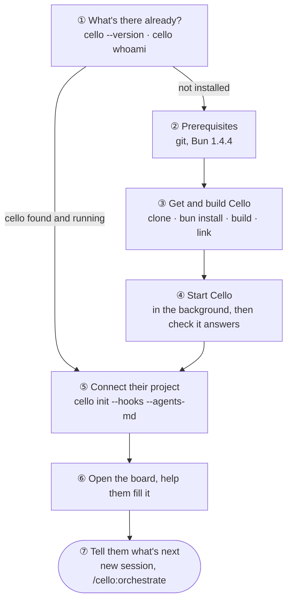

# Set up Cello for someone, from scratch

**This page is for you, the agent.** The person you work for opened you in one of their projects and said something like *"Set up Cello for this project: github.com/lnmunhoz/cello"*. They shouldn't have to type any command. You do it, step by step, and tell them what you did.

If Cello is already installed and running on this machine, most steps say so and you skip them. **Never delete, move or overwrite an existing Cello data folder (`~/.cello`)**: it holds someone's real board.



## ① What's there already?

Run these in the person's project folder:

```bash
cello --version        # is the CLI on the PATH?
cello whoami           # is a Cello server answering? (prints JSON with a "server" entry)
```

- **Both work:** Cello is installed and running. Go to ⑤.
- **`cello` works but no server answers:** go to ④.
- **`cello: command not found`:** go to ②.

Cello reads two environment variables everywhere: `CELLO_PORT` (default 4747) and `CELLO_DATA_DIR` (default `~/.cello`). If they're set in your environment, leave them alone: every `cello` command below uses them.

## ② Prerequisites

Cello runs from source today. It needs **git** and **[Bun](https://bun.sh) 1.4.4 or newer**. It's developed on macOS; Linux works for the server and CLI.

```bash
git --version
bun --version          # 1.4.4 or newer
```

If Bun is missing or too old, **ask the person before installing it** (it's a system-wide tool). With their OK: `curl -fsSL https://bun.sh/install | bash`, then open a new shell or add `~/.bun/bin` to the PATH for the rest of this setup.

## ③ Get and build Cello

Keep Cello's source in its own folder, never inside the person's project and never inside `~/.cello`:

```bash
CELLO_SRC="${XDG_DATA_HOME:-$HOME/.local/share}/cello/src"
if [ -d "$CELLO_SRC/.git" ]; then git -C "$CELLO_SRC" pull --ff-only
else git clone https://github.com/lnmunhoz/cello.git "$CELLO_SRC"; fi

cd "$CELLO_SRC"
bun install
bun run --filter @cello/cli build          # builds the web app and the cello binary: apps/cli/dist/cello

CELLO_BIN="${CELLO_BIN_DIR:-$HOME/.local/bin}"
mkdir -p "$CELLO_BIN"
ln -sf "$CELLO_SRC/apps/cli/dist/cello" "$CELLO_BIN/cello"
```

- If that folder isn't on the PATH, use the full path (`$CELLO_BIN/cello`) for the rest of the setup, and tell the person to add it to their shell profile. Ask before editing their profile yourself.
- `CELLO_BIN_DIR`, `XDG_DATA_HOME` and `XDG_STATE_HOME` move where Cello's command, source and log go. Respect them when they're set (a test run sets them to keep a machine's real Cello untouched).
- `bun install` downloads the desktop app's Electron too, so the first run takes a few minutes. That's normal.
- Check: `cello --version` prints a version.

## ④ Start Cello

`cello start` runs the server in the foreground, so start it in the background and keep its log:

```bash
mkdir -p "${XDG_STATE_HOME:-$HOME/.local/state}/cello"
nohup cello start >> "${XDG_STATE_HOME:-$HOME/.local/state}/cello/server.log" 2>&1 &
```

Then check that it answers (give it a few seconds the first time): `cello whoami` prints JSON with a `server` entry. If it doesn't, read the log and tell the person what it says.

- The board is at `http://127.0.0.1:4747` (or the port in `CELLO_PORT`). Data lives in `~/.cello`, with automatic daily backups.
- The server stops when the machine restarts. To start it again later: the same `nohup cello start …` line, or `cello start` in a terminal. (Running it as a background service is on the roadmap.)

## ⑤ Connect their project

Back in **the person's project folder** (a git repository):

```bash
cello init --hooks --agents-md
```

One command, three things. Tell the person each one:

1. **The project.** It creates a Cello project named after the folder, with its own task key (like `SHOP`, so tasks are `SHOP-1`, `SHOP-2`…), and prints the board's URL. If the folder is already a project, it says which one and changes nothing.
2. **Claude Code hooks and plugin** (this machine only, in `.claude/settings.local.json`, which git ignores). The person's comments on a task reach the session working on it; new sessions get `/cello:orchestrate` and `/cello:work`; `cello` commands run without permission prompts. It also adds two guards: an agent can't edit files here before it has claimed a task, and pages are published to Cello rather than elsewhere.
3. **A short "Tracking work in Cello" section** at the end of `AGENTS.md` (or `CLAUDE.md` when there's no AGENTS.md), so every future agent session knows the workflow. It's between markers; the rest of the file is untouched.

The person's name or key preference wins: `--name "Acme Shop"`, `--key SHOP`. These changes are uncommitted; mention it, and leave committing to them.

## ⑥ Open the board, and help them fill it

Open the board for them (on macOS, `open <the URL init printed>`), or give them the link.

Then help them put their work on it. Ask what they're working on, what's next, and what's been nagging them, and turn the answers into tasks:

```bash
cello task create "Checkout: show the delivery date before payment" --priority high
cello task create "Dark mode for the account pages" --status Backlog
```

- **Todo** is agreed and ready to build; **Backlog** is for ideas that still need discussing.
- Use their words in the titles, and put what they said, and why, in `--description`.
- Offer to bring in what they already have: open GitHub issues (`gh issue list`), TODO comments in the code, a roadmap file. Ask before creating more than a handful at once, and show the list first.
- Each task appears on the open board as you create it.

## ⑦ Tell them what's next

Finish with a short summary: what you installed and where, the board's URL, the project key, the tasks you created. Then the next step, in these words or close to them:

- **Start a new agent session in this project.** The hooks and the plugin load when a session starts, so this one doesn't have them yet.
- **For real work, use an orchestrator:** a strong model (for example Claude Opus at high or extra-high effort), then `/cello:orchestrate` with task keys or a goal. That session plans, hands each task to a builder agent in its own copy of the code, has a fresh reviewer check it, and sends finished work to the board's **Review** page.
- **They can talk to the agents from Cello:** comments on a card or a review reach the session working on it.
- **The full guide** agents follow from here on: `cello guide`.

## If something goes wrong

| What you see | What to do |
| --- | --- |
| `bun install` fails on Electron | The desktop app is optional. Retry with `bun install --filter '!@cello/desktop'`, then build the CLI as above. |
| `cello whoami` says Cello isn't running after ④ | Read `server.log`. A port in use means another Cello (or something else) is on 4747: if `cello whoami` against it works, use it; otherwise pick a free port with `CELLO_PORT` and tell the person. |
| `cello init` refuses: an archived project holds this repo | Tell the person; they can unarchive it on the board. Don't work around it. |
| `cello init` says the AGENTS.md section is customised | Leave it, tell the person, and show what `--replace` would change. |
| The person already has a `~/.cello` folder | That's their board: keep it. Starting the server uses it as it is. |
