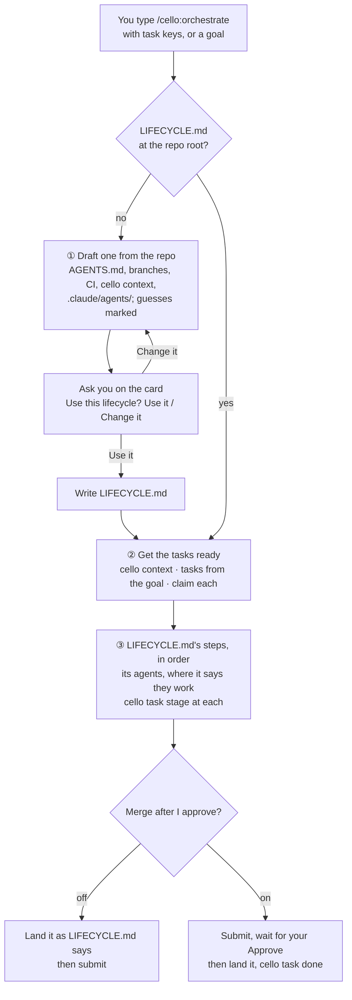
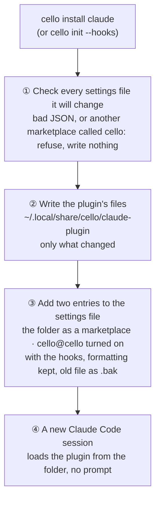
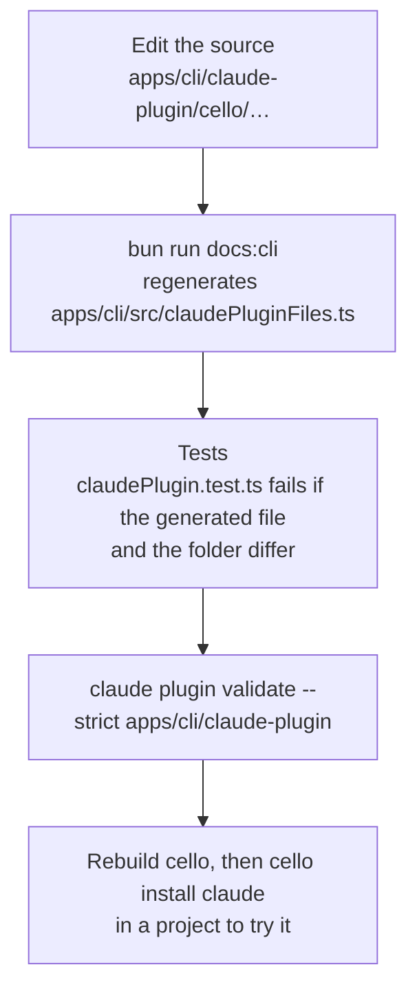

## The short version

**`cello install claude` turns on a Claude Code plugin called `cello` in the project.** A new Claude Code session there knows how to work with the board without being told: it has a command you type, a skill it loads by itself, and two agents the orchestrator can start.

| Piece | Who uses it | What it does |
| --- | --- | --- |
| **`/cello:orchestrate [keys, or a goal]`** | You, at the start of a thread | Makes the thread the **orchestrator**: it reads the repo's `LIFECYCLE.md`, hands the work to agents the way it says, and doesn't write the feature code itself |
| **The `cello` skill** | Claude, by itself, in a Cello repo | The board's rules in a few lines, and "read `cello guide`" |
| **`cello:builder`** | The orchestrator, when `LIFECYCLE.md` names it | Builds one task test first, where the brief says (its own worktree, or the main checkout), never pushes |
| **`cello:reviewer`** | The orchestrator, when `LIFECYCLE.md` names it | Reads the change (a branch's diff, or the working-tree diff of the task's files) and the task text, never the builder's report, and gives a verdict |

It's on **per project** by default, since not every project uses Cello. `cello install claude --user` turns it on everywhere.

## Each project has its own lifecycle: LIFECYCLE.md

**How a task goes from Todo to Done is the project's, not the plugin's** (CEL-168). Cello builds each task in a worktree and merges the branch after Lucas approves; ThaiLookup works on `develop` in the main checkout and commits only after he approves. So each repo writes its flow in **`LIFECYCLE.md` at its root**:

| Section | What it says |
| --- | --- |
| **Steps** | The steps in order, the stage each sets, where you approve before the next one, which small changes skip steps |
| **Agents** | Who runs each step: the repo's own agents (`.claude/agents/`) or the plugin's `cello:builder` and `cello:reviewer`, with model and effort |
| **Where agents work** | A worktree per task on its own branch, or the main checkout shared with other sessions |
| **How work lands** | A merge, a PR, or a commit straight to a branch; what's never done |
| **After it lands** | Tests, deploys, migrations, and which wait for your yes |
| **Releases** | How and when one goes out |

Cello's own is [LIFECYCLE.md](../LIFECYCLE.md). The template lives in the plugin's `commands/orchestrate.md`.

**The plugin keeps only the board's mechanics**, the same in every project: orchestrate mode, claims, stages, asking on the card, comments and the inbox, `cello task submit` and `cello task done`. **When** work lands is still the project's "Merge after I approve" setting; `LIFECYCLE.md` says **how**.

## What an orchestrator thread does

You type `/cello:orchestrate CEL-12 CEL-14`, or a goal like `/cello:orchestrate export the board as CSV`. From then on, that thread runs the work instead of doing it.

The rules it follows for the whole run:

- **It doesn't write the feature itself.** It writes briefs, starts agents, reads their reports, lands the work and submits. Only tiny changes (docs, a one-line fix) it makes directly.
- **It follows `LIFECYCLE.md`, and never guesses one.** Without the file it drafts it from the repo and asks you on the card before running any task. When the file looks out of date, it asks before changing it.
- **Independent tasks run at the same time; tasks that touch the same files run one after another.** Each agent's brief says what the others are changing, so they stay out of each other's files. In a shared checkout no two agents edit the same file.
- **The card always says where the work is**, through `cello task stage`. Submitting clears it.
- **Your decisions are asked on the card**, never in the terminal. Your comments reach the thread by themselves through the hooks, and it answers on the card.
- **The claim belongs to the orchestrator.** Subagents run inside its session, so builders and reviewers never claim, comment, stage, submit or read the inbox.

In this repo, the path is *How a feature is built, end to end*, written as instructions in LIFECYCLE.md.

### Why there's no /cello:work any more

It did one task in the thread, with the steps written into the command: a second copy of the lifecycle that couldn't follow a project's `LIFECYCLE.md`, and Lucas never used it. It was removed in CEL-168; installing a newer `cello` deletes it from the plugin folder. A session doing one task by itself follows the `cello` skill and `LIFECYCLE.md`.

## How it gets installed

- **The files live in a folder of Cello's own:** `$XDG_DATA_HOME/cello/claude-plugin`, by default `~/.local/share/cello/claude-plugin`. Never in the repo, never in `~/.cello`.
- **Turning it on is two entries in the settings file** the hooks already use (`.claude/settings.local.json` for this project on this machine): `extraKnownMarketplaces.cello` points at that folder, and `enabledPlugins["cello@cello"]` is `true`.
- **Cello writes those entries itself instead of running `claude plugin install`.** The `claude` command works too, but it rewrites the whole settings file every time, losing its formatting and keeping no backup. The catch: `claude plugin list` doesn't show the plugin. `claude plugin details cello@cello` does.
- **Safe to run again:** nothing changes when it's already there. A plugin you turned off (`"cello@cello": false`) stays off.
- **`--shared`** puts only the on-switch in the committed `.claude/settings.json`. The folder path stays in your git-ignored local file, since it only exists on your machine.
- **`cello uninstall claude`** removes both entries with the hooks. The folder stays, because other projects may still use it.

## Updating it

**A new `cello` carries a new plugin.** The plugin's files are built into the binary, so after rebuilding `cello`, run `cello install claude` in a project once: it rewrites the changed files in the folder, and the next session loads them. Every project that uses the folder gets the update at the same time.

Don't edit the files in that folder: the next install puts Cello's text back. For commands or skills of your own, use the project's `.claude/commands/` or `.claude/skills/`.

## Changing the plugin (for whoever works on Cello)

- **Source:** `apps/cli/claude-plugin/` is a local marketplace with one plugin, `cello/`:
  - `commands/orchestrate.md`, which also holds the `LIFECYCLE.md` template
  - `skills/cello/SKILL.md`
  - `agents/builder.md` and `agents/reviewer.md`
  - `.claude-plugin/plugin.json`, whose version must match Cello's (a test checks it)
- **Embedding:** `bun run docs:cli` turns the folder into `apps/cli/src/claudePluginFiles.ts`, the same way it generates `cello guide`. `bun apps/cli/scripts/docs.ts --check` and a unit test both fail when they drift.
- **Install code:** `apps/cli/src/claudePlugin.ts` writes the folder; `apps/cli/src/claudeSettings.ts` adds and removes the settings entries; `installHooks` in `apps/cli/src/cli.ts` runs both.
- **Keep it project-neutral.** The plugin runs in every repo tracked in Cello, so it names commands, not this repo's agents or paths. Anything that differs per project (steps, agents, worktrees, how work lands) belongs in that project's `LIFECYCLE.md`, never in the plugin. Point to `cello guide` instead of copying flags, so it can't drift from the CLI.
- **Keep the skill short.** It's loaded into every session in the project (about 260 tokens for the whole plugin).

The agent-facing details (every edge case of install and uninstall) are in *The cello CLI, for agents*, section "The Claude Code plugin".
