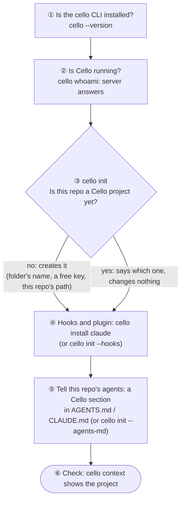

# The cello CLI, for agents

Everything an agent needs to work with Cello through the `cello` command: the ideas behind it, the workflow, copy-paste examples, what each error means, and every command with its flags. `cello guide` prints this same page, so it reads the same in any repository.

This page is kept current: any change to a command, a flag, an output or a rule updates it in the same commit. The command reference at the end is generated from the CLI's own `--help`.

## Set up a repo for Cello

When Lucas says "use Cello in this repo", or `cello context` fails here, go through these steps in order. Each one checks first, so running them again is safe.



Steps 3 to 5 in one go: `cello init --hooks --agents-md`.

1. **The CLI.** `cello --version` prints a version. If the command isn't found, stop and tell Lucas: `cello` is installed from his Cello repo (`apps/cli`, linked at `~/.local/bin/cello`). Never install it yourself.
2. **The server.** `cello whoami` prints JSON with a `server` entry. If it says Cello isn't running, ask Lucas to open the Cello desktop app or run `cello start`. Don't start it yourself, since it serves his real data.
3. **The project.** Run `cello init` inside this repo. It creates the project with this repo's path (the main checkout's when you're in a worktree), named after the repo's folder, with a key made from the name that no other project has, and prints the key and the board's URL. If the repo is already a project, it says which one and leaves the project as it is, however its path was typed in New project (`~/…`, a trailing `/`, a symlinked folder, a subfolder of the repo). It refuses a repo an archived project holds, naming it: ask Lucas then.

   ```
   $ cello init
   Created project CEL · cello for /Users/lnmunhoz/projects/cello (tasks CEL-1, CEL-2, …)
   http://127.0.0.1:4747/CEL
   ```

   - The defaults are fine unless Lucas named the project or its key: then pass `--name "Thai Lookup"` and `--key THAI`.
   - If the key is taken, it says which project has it: pick another, or leave `--key` out and Cello picks a free one (CEL, then CELL, CELLO, CEL2…).
   - `--workspace Work` puts it in another workspace, by name; the default is the first one.
4. **Hooks, so Lucas's comments reach your session.** Run `cello install claude` (or `cello init --hooks`, which does the same). It writes this machine's `.claude/settings.local.json` and makes sure git ignores it. It keeps a `.bak` of the old file; ignore that too if the repo's `.gitignore` doesn't cover it. Run it again any time; it changes nothing the second time. The same command adds two guards: in this project, Claude artifact publishes are turned away with a pointer to `cello doc publish` (see "Showing things to Lucas"), and an agent's edits in the repo are turned away until its session has claimed a task (see "Edits need a claimed task"). It also installs Cello's Claude Code plugin, which gives new sessions `/cello:orchestrate`, `/cello:work` and the `cello` skill (see "The Claude Code plugin").
5. **Tell the repo's agents.** `cello init --agents-md` adds this section, with the project's key in place of `KEY`, to the end of the AGENTS.md in the checkout you're in, or to CLAUDE.md if there's no AGENTS.md (creating it), between two markers: `<!-- cello:agents-md:start sha256:… -->` (a fingerprint of the text it wrote) and `<!-- cello:agents-md:end -->`. Run it again whenever Cello's text changes: it puts the current text between the markers and prints the lines that changed, or says it's already current. It changes nothing else in the file.
   - **Everything between the markers is Cello's and gets rewritten.** Put the repo's own notes outside them (above the start marker or below the end one). If the text between them isn't exactly what Cello wrote (someone added a note, or it names another project's key), the command still rewrites it, but keeps the old file as `AGENTS.md.bak` first and says so.
   - **A section from before the markers** (a "Tracking work in Cello" heading that mentions `cello guide` or `cello context`) runs up to the next heading of any level, a setext heading or a `---` rule, so what follows it is never touched. What happens to it depends on whether anyone changed it:
     - **An earlier snippet, untouched** (every line is one Cello's snippet has had, with this project's key): it's replaced with the marked one. The command says so, prints what changed, and keeps the old file as `AGENTS.md.bak` (or `CLAUDE.md.bak`): delete it once you've looked.
     - **Customised** (it has lines Cello didn't write: the repo's own rules, another project's key): it's left exactly as it is and nothing is appended. The command says so and prints what swapping it would change (`--json`: `"change": "customised"`). To swap it anyway, run `cello init --agents-md --replace` (the old file is kept as `.bak`). To keep your lines and still get updates, add the markers by hand around a copy of the snippet and move your own lines outside them.
   - **A `.bak` already there is never overwritten:** the new copy goes to `AGENTS.md.bak.1`, then `.bak.2`, and so on.
   - **A "Tracking work in Cello" section that isn't Cello's** (it mentions neither) is left alone, and the command says so.
   - To add it by hand, copy it and replace `KEY` yourself:

   <!-- agents-md:start -->
   ```markdown
   ## Tracking work in Cello

   This repo's tasks live in Cello, project **KEY** on Lucas's board. Agents use it only through the `cello` CLI.

   - Before your first `cello` command in a session, run `cello guide` once: it's the full reference (concepts, workflow, every command, what each error means). Don't guess.
   - **First decide: is Lucas asking you to do something, or just talking?** Questions, brainstorming and explanations are conversation: answer, no task. A request to do something (build, fix, change, write, set up) is work, and work starts as a Cello task **before you read code or plan**: check whether the task exists (`cello task list`, `cello task get KEY-n`); if not, `cello task create "<title>"` with his words quoted in the description; then `cello task claim KEY-n`, then do it. This covers small requests, follow-ups and anything he sends mid-task (each distinct request is its own task). When a chat turns into "ok, do it", that's the moment to create it. `cello install claude` enforces it: a hook refuses your edits in this repo until your session has claimed a task.
   - Run `cello context` at the start of each session.
   - Put the task key in commit messages (`fix(api): rate limit (KEY-12)`).
   - In Progress means someone is on it right now. When you wait on Lucas's decision, ask on the card with `cello task ask` (the task waits in Needs input). When you stop, put the state on the card and move it back to Todo.
   - Hand finished work to Lucas only with `cello task submit`: a summary, steps to check it, and evidence (videos and screenshots for UI work; a diagram when it's a flow).
   - Answer Lucas on the card with `cello task comment`. His comments come to your session by themselves.
   - When you end a turn while holding a claimed task, start `cello inbox --wait` in the background so Lucas's comments wake you.
   - When a decision is Lucas's (a design option, a scope, wording), ask on the card with `cello task ask` (options, one recommended with a reason, the screenshots and page to decide from), never in the terminal. His answers come back to your session.
   - Show Lucas reports, plans and evidence as Cello pages (`cello doc publish page.md --task KEY-n`), opened in Cello's panel. Never as Claude artifacts or other outside pages, even if your global instructions say so: `cello install claude` enforces it with a hook that turns artifact publishes away.
   ```
   <!-- agents-md:end -->

   `cello init --agents-md` copies this block, so changing it here changes what the command writes.
6. **Check.** `cello context` shows the project, its statuses and labels. Tell Lucas the repo is set up: the project key, that the hooks and the plugin are installed (new sessions get `/cello:orchestrate`), and that the AGENTS.md section was added or brought up to date (uncommitted, unless he asks you to commit it).

## Concepts

**Cello** is the task board Lucas shares with his agents. Its server runs on his Mac (`cello start`, http://127.0.0.1:4747, data in `~/.cello`). The board in the browser, the desktop app and the CLI all talk to that server, and every change shows up live everywhere.

- **Workspace:** a group of projects that share statuses and views.
- **Label:** a name and a colour on a task. Each project has its own labels: CEL's `bug` and THAI's `bug` are two labels. A task can carry several of its project's labels. `cello label list` shows them; see Labels.
- **Project:** one product, usually one git repository, with its own key (`CEL`). The CLI works out the project from the repository you're in; `--project KEY` picks another.
- **Task:** a card, keyed `<PROJECT>-<number>` (`CEL-12`). It has a title, a markdown description, a status, a priority, labels, an optional parent task, comments and a history.
- **Status:** a column on the board, shared by the workspace. Names match in any case. `cello context` lists a workspace's own; the defaults are:

  | Status | What it means | How a task gets there |
  | --- | --- | --- |
  | Backlog (hidden) | An idea or request that still needs discussing. Nobody builds from here. | `cello task create … --status Backlog` |
  | Todo | Agreed and ready to build. | The default for new tasks |
  | In Progress | Someone is working on it. | `cello task claim` |
  | Needs input | Waiting for Lucas to decide something an agent asked on the card. On the board it shows in In Progress with a "Needs input" badge, unless Display turns its column on. | Only `cello task ask` |
  | In Review | Waiting for Lucas, with a review packet. | Only `cello task submit` |
  | Done | Lucas approved it. | Lucas, on the Review page |
  | Canceled (hidden) | It won't be done. | Lucas |

  Hidden statuses are folded on the board and left out of `cello task list` unless you ask for them.
- **Agent session:** one agent conversation. Cello credits every change to the session that made it ("Claude Code session 2fd0505c"), from `CLAUDE_CODE_SESSION_ID`, which Claude Code sets.
- **Subagent:** an agent the session started with Claude Code's Agent tool (a builder, a reviewer, an `Explore`). It works under its parent's session, with the same `CLAUDE_CODE_SESSION_ID`, so Cello names it on its own: its type and a short id, "cello-builder · a13bfb89", with the session as its parent. The board shows which subagent is on each card and counts each one in "Agents working". Claims and Lucas's comments stay with the session. See Subagents.
- **Claim:** "this session is working on this task". `cello task claim` assigns the task to your session and moves it to In Progress.
  - While your session is alive, other agents can't claim it.
  - If your session has exited, another session can claim the task and takes the claim over.
  - Lucas always wins: when he changes a task you've claimed (moves it, approves it), your claim ends, and `cello context` lists it under "Claims you lost".
- **Stage:** where a claimed task is inside In Progress: **building**, **review** (Agent review), **fixing** (Fixing findings) or **merged**. In Progress holds a task from the claim to the packet, so without a stage a task being built and one waiting for review look the same. The session holding the claim sets it with `cello task stage`; the board shows it on the card. Asking Lucas keeps it through Needs input; any other move out of In Progress, or submitting it, clears it. See Stages.
- **Presence:** the board shows whether the session holding a claim is working right now: **active now** (it called Cello in the last 5 minutes), **seen 2h ago** (quiet, its process still running) or **ended** (its process exited). Every `cello` command and every hook run counts as a check-in; with the hooks installed that's every tool call, a subagent's included. A subagent checks in as itself too, so the card names the subagent working on it ("cello-builder · a13bfb89 active now") rather than its session. The board hears about each at most once a minute, which keeps "active now" steady without filling the history; each one plays a short motion on the card, and while you're working the card has a thin edge in your colour. You don't do anything for it.
- **Review packet:** how finished work reaches Lucas. It holds a summary, how-to-check steps and evidence (videos, screenshots, test output, links). `cello task submit` creates it and moves the task to In Review. Then Lucas decides:
  - **Approve:** the task moves to Done and your claim ends. A note he typed with it shows under Reviews in `cello task get` (`Note: …`).
  - **Send back:** the task returns to In Progress with his note, and your claim stays. The note comes to your session (see Comments from Lucas reach your session), and `cello task get` shows it under Reviews.
  - **Comment, without deciding yet:** the Review page shows the task's comments under the packet, with a comment box. A comment there leaves the task In Review and your claim in place, and comes to your session like any comment. Answer it on the card; if it asks for a change, move the task back to In Progress before you make it (that withdraws the packet), then submit again.
  - **Moved out without a decision** (`cello task move`, or Lucas dragging the card): the packet is **withdrawn** and leaves the Review page. `cello task get` shows it as withdrawn, with who moved the task and where. To hand the work over again, submit a new packet.
- **Ask (Needs input):** how you get a decision from Lucas: questions on the card, each with options (one recommended, with your reason), plus evidence. `cello task ask` moves the task to Needs input; he answers in Cello, next to the evidence; the task comes back to In Progress, still yours, and his answers reach your session. Never ask him in the terminal when the decision is his (see Questions for Lucas).
- **Documents:** markdown published into the project's Docs tab with `cello doc publish`. There are three kinds:
  - a **page** reports on finished work (a snapshot to read now)
  - a **doc** explains how something works (kept up to date)
  - a **spec** plans work before it starts

  Publishing again updates a document in place, and its old versions are kept.
- **Reaction:** an emoji on a comment (👍 ✅ 👀 ❤️ 🎉 …), Lucas's quick answer that needs no words. His reactions to your comments reach your session like his comments; `cello task react` adds yours. See Reactions.
- **History:** every change is recorded with who made it. `cello task get` shows a task's history; `cello context` shows recent activity.

## Start of every session

```bash
cello context
```

It shows the project, its statuses (hidden ones in brackets), its labels, new comments from Lucas on tasks you've claimed (shown, not taken; see Comments from Lucas reach your session), the tasks your session has claimed, claims you lost and why, and recent activity:

```
Project   CEL · Cello · /Users/lnmunhoz/projects/cello
You       Claude Code session 2fd0505c (cli)
Statuses  Todo · In Progress · Needs input · In Review · Done (hidden: Backlog, Canceled)
Labels    M2 · M3 · server · ui

New comments for you (1)
  CEL-22  Review page: collapsed rows, one packet open at a time
    Lucas N. Munhoz commented, 5m ago
      Use the same row height as the list layout.
  Answer on the card: `cello task comment CEL-22 "…"`. They stay new until the hook or `cello inbox` hands them over.

Claimed by you
  CEL-22  In Progress  Review page: collapsed rows, one packet open at a time

Recent activity
  2m ago   CEL-22  Lucas N. Munhoz commented
```

Run it first in every session, and again when you come back to a task.

## The workflow

1. **Find the work, or make it.** When Lucas asks for something that will change code, docs or anything else, it becomes a task **before you read code or plan**: `cello task list` to check it isn't there already, else `cello task create` with his words. `cello task list` shows Todo and In Progress; `cello task get CEL-12` reads one task in full, including Lucas's notes on earlier packets and every comment.
2. **Claim it.** `cello task claim CEL-12`. If it says another session holds the task, pick another one. Don't work on a task someone else holds. With the hooks installed, an edit in the repo is refused until you hold one (see "Edits need a claimed task" below).
3. **Work, test first, and put the key in every commit:** `feat(web): collapsed review rows (CEL-22)`.
4. **Comment** progress and decisions on the card (`cello task comment`). Lucas reads them there.
   - **When a decision is his** (which design, which scope, what wording), ask on the card with `cello task ask` and wait for his answers (see Questions for Lucas). Never ask him in the terminal.
5. **Hand it over** with `cello task submit` and evidence he can look at (see Review packets). The task moves to In Review.
6. **If it's sent back,** his note comes to your session (by the hook, or `cello inbox`), and `cello task get CEL-12` shows it under Reviews. Fix it, then submit again.
   **Lucas's feedback in chat counts as a Send back.** When he reviews a task in your conversation instead of on the card (a screenshot, "this should be…", "I don't like…"), do both of these before you start fixing:
   - put his words on the card as a comment, quoted as he said them and marked as his (`**Lucas, in chat (review):** "…"`), so the review lives with the task;
   - if the task is In Review, move it back with `cello task move CEL-12 "In Progress"`, so the board shows it's being worked on again. The move withdraws the open packet, so it leaves Lucas's Review page.

   Then fix, and submit a new packet. The same goes for feedback on a task in Done: comment it, and move it back to In Progress, or open a new task if it's a new request.
7. **If you run a feature through builder and reviewer agents** (the orchestrator), mark each step with `cello task stage` (see Stages), so the card says where the work is. In Claude Code, `/cello:orchestrate APP-12 APP-14` sets a session up for this (see "The Claude Code plugin").
8. **In Progress means someone is working on it right now.** When work stops before you submit, don't leave the card there: the board would show it as being built when nobody is on it.
   - **Waiting on Lucas** (a scope's options, a design choice, any decision that's his): ask on the card with `cello task ask` (see Questions for Lucas). The task moves to Needs input, your claim stays, and it comes back to In Progress when he answers.
   - **Stopping or pausing:** comment where it stands, move it back to Todo, and `cello task release CEL-12`.
   - A **scope** is part of its task. Claim the task to make the scope; once the scope is published, ask its questions with `cello task ask` (attach its screenshots, link the page): the task waits in Needs input until he picks.
   - `cello task release` alone keeps the status, so only use it on its own when another session takes over the work straight away.

Never move a task to Done or Canceled yourself: Lucas decides.

### Edits need a claimed task

`cello install claude` (and `cello init --hooks`) puts a PreToolUse hook on Claude Code's `Edit`, `Write` and `NotebookEdit` into the project's settings. Before one of them changes a file **inside this repo**, the hook asks the server whether your session holds an open task (Todo, In Progress, Needs input or In Review) in this repo's project. When it holds none, Claude Code blocks the edit and shows you this reason (with the project's key):

```
Cello: this session hasn't claimed a task in KEY. Before editing for a request, check it exists (`cello task list`), else `cello task create "<title>"` with Lucas's words, then `cello task claim KEY-n`.
```

- Do what it says, then make the edit again. Once you've claimed, the next edit goes through.
- **Only edits inside the repo** (the checkout you're in, or the main checkout) are checked. Files in your scratchpad, a temp folder or anywhere else outside the repo go through. Reading, searching and running commands are never checked.
- **Subagents share your session,** so a builder subagent working in a worktree of the repo edits under the task you claimed.
- **It never stops work it can't be sure about:** when the server is down or doesn't answer within 2 seconds, the repo isn't a Cello project, or the hook's input is broken, the edit goes through silently.
- A claim it saw is remembered for a minute (a small file under the system's temp folder), so a run of edits doesn't ask the server each time. A refusal isn't remembered: right after you claim, the edit goes through.
- **`CELLO_ALLOW_UNTRACKED=1`** in Claude Code's environment turns the check off. It's Lucas's switch, for when he wants to work without tasks (`CELLO_ALLOW_UNTRACKED=1 claude`). Agents never set it on their own, nor work around the hook another way (writing files through Bash to dodge it, say).

## Creating tasks

```bash
# Ready to build: lands in Todo
cello task create "Sidebar: collapse and resize" --label ui --priority high \
  --description "Drag the sidebar's edge to resize it; ⌘B collapses it to an icon rail."

# Still needs discussing: Backlog
cello task create "Idea: media library per project" --status Backlog --body-file - <<'EOF'
Lucas makes promo videos, icons and designs for each project. A place in Cello to keep them,
link them to tasks, and sync them later.
EOF

# A subtask, with two labels
cello task create "Restore refuses while a server runs" --parent CEL-23 --label server,M2
```

- **Todo or Backlog:** Todo means agreed and ready to build. When Lucas says "add to the backlog", use `--status Backlog`.
- **Labels must already exist.** `cello label list` lists them, and an unknown label fails with the real names. `cello label create` makes a new one (see Labels).
- **Priority:** `urgent`, `high`, `medium`, `low` or `none`.
- **Long descriptions:** use `--body-file -` with a heredoc, or `--body-file notes.md`.

## Editing tasks

```bash
cello task edit CEL-12 --title "Sidebar: collapse, resize and remember the width"
# Edited CEL-12  Sidebar: collapse, resize and remember the width

# Replace the description with markdown from stdin
cello task edit CEL-12 --body-file - <<'EOF'
Drag the sidebar's edge to resize it; ⌘B collapses it to an icon rail.
The width is kept per project.
EOF

cello task edit CEL-12 --priority urgent --description "Short and new."
```

- **Only the flags you give change.** `--title`, `--description` (or `--body-file`, a file or `-` for stdin) and `--priority` (`urgent`, `high`, `medium`, `low`, `none`), in any mix; together they're one change, one line in the history. With none of them it refuses and changes nothing. The same values again change nothing and say so ("Nothing to change on CEL-12  …").
- **The description is replaced, not added to.** To add a note, comment instead. To keep part of the old text, read it first: `cello task get CEL-12 --json | jq -r '.task.description'`.
- **Who edits:** you, on any task, claimed or not; editing isn't guarded by a claim, and another session's claim stays. When Lucas edits a task you hold, your claim ends, as with any change he makes to it (see Claim in Concepts).
- **If someone changes the task at the same moment,** it fails with "It was changed by … in the meantime"; run it again.

## Reading tasks

```bash
cello task list                          # Todo and In Progress
cello task list --status Backlog         # any status by name, hidden ones too
cello task list --status Done --label ui
cello task list --mine                   # what your session has claimed
cello task get CEL-12                    # everything about one task
cello task get CEL-12 --json | jq -r '.task.description'
```

Every command takes `--json` and prints the whole response, for scripts.

## Searching

`cello search` finds things in the project by what they say: task keys, titles and descriptions, comments, review packets, pages and docs, and project and label names. Use it before creating a task (is there one already?), to find the comment where Lucas decided something, or the page that explains a part of the system. Lucas's ⌘K bar in the app runs the same search, so you both see the same results.

```bash
cello search evidence video              # every word must match the start of a word
cello search CEL-15                      # the task, then everything that mentions it or is on it
cello search backup --kind comment,packet
cello search restore --kind page --limit 20
cello search stage --json | jq -r '.groups[] | select(.kind == "task") | .hits[].taskKey'
```

```
$ cello search evidence
Tasks (2)
  CEL-12  In Review  [Evidence] in review packets
  CEL-9   Todo       Record the flow
          The [evidence] goes in the packet.
Comments (1 of 3)
  CEL-9  Lucas N. Munhoz, 2h ago, on Record the flow
         The [evidence] video stops before the inbox shows the comment.
Pages and docs (1)
  evidence-videos  doc  How [evidence] videos are made  · Claude Code, 1d ago

More: `--limit 20` shows more per kind; `--kind comment` shows only one kind.
```

- **Words** match the start of words, so `evid` finds "evidence", and they're stemmed, so `videos` finds "video". Every word must match. Case and accents don't matter.
- **A task key** (`CEL-15`) prints that task first, then the tasks, comments, packets and docs that mention it, and the comments and packets on it. `CEL-1` never matches CEL-15.
- **Results** come grouped by kind (tasks, comments, review packets, pages and docs, projects, labels), best match first: a match in a title counts more than one in a description, and an open task ranks above a Done one. The matched words are in `[brackets]`. Each group shows 5 hits unless `--limit` says more (up to 50); the heading says how many matched in all ("1 of 3").
- **`--kind`** narrows it: `task`, `comment`, `packet`, `page` (pages, docs and specs alike), `project`, `label`, comma-separated.
- **What's left out:** archived tasks and documents, deleted comments, packets replaced by a newer one, and archived projects. It searches the working folder's project; `--project KEY` searches another.
- It sees a change the moment it's made: the index is updated in the same transaction as the change.

## Moving tasks

```bash
cello task move CEL-12 Todo
cello task move CEL-31 backlog           # any case
```

- **Moving into In Review is refused:** use `cello task submit`.
- **Moving out of In Review withdraws the open packet:** it leaves the Review page, and coming back takes a new `cello task submit`.
- **Moving into Needs input is refused,** to everyone, Lucas included: only `cello task ask` puts a task there, with your questions.
- **Don't move tasks to Done or Canceled.**
- **"It was changed by … in the meantime":** someone changed the task while you were acting. Run the command again.

## Stages

A stage says where a claimed task is inside In Progress, so Lucas can tell from the board why it's still there. The orchestrator (the session holding the claim) sets it at each step of a feature (docs/feature-lifecycle.md):

| Stage | The board says | Set it when |
| --- | --- | --- |
| `building` | Building | a builder agent starts writing the code |
| `review` | Agent review | a reviewer agent starts reading the branch |
| `fixing` | Fixing findings | the findings go back to the builder |
| `merged` | Merged | the branch is merged into main, before the packet |

```bash
cello task stage CEL-12 building
# CEL-12 is now Building  (In Progress  Sidebar: collapse and resize)
cello task stage CEL-12 review
cello task stage CEL-12 --clear      # no stage
cello task list
# CEL-12  In Progress · Agent review  Sidebar: collapse and resize  · Claude Code session 2fd0505c
```

- **Only the session holding the claim** sets it (or Lucas, with `CELLO_SESSION=me`, which keeps your claim). Claim the task first.
- **Only in In Progress.** In any other status it's refused.
- **It clears itself:** `cello task submit`, or a move to any other status, removes it. Reordering inside In Progress keeps it, and so does `cello task ask`: the stage waits in Needs input and is still there when Lucas's answers bring the task back.
- **Subagents don't run it.** Builders and reviewers work for the orchestrator's session; the orchestrator marks the steps.
- `cello task get` shows it on the Status line ("Status: In Progress · Stage: Agent review") and in the history, with who changed the task last.

## Labels

Labels say what a task is about: what kind of work, which part of the product. **Each project has its own labels**: the `cello label` commands, `cello context`, `cello task label` and `cello search` see only the current project's (the repository you're in, or `--project KEY`), and a task can only carry labels of its own project. Each label has a name (unique in its project, ignoring case), a colour and a group. Two projects can each have a label of the same name, such as `bug`; they're separate labels, and changing or archiving one leaves the other alone. Each project has its own convention for them; Cello's own board, for one, gives each task one kind (feature, bug, polish, chore, docs) and one or more areas (board, cli, agents…).

**Groups** say what a label means, so the board's filter can sort them: **kind** (the kind of work: feature, bug…), **area** (the part of the product: board, cli…), **milestone** (M2, M3) or **none** (the default; every screen calls it **Other**). The Issues tab's filter panel lists labels under Kind, Area, Milestone and Other, and matches any label within a group and every group picked: ticking `bug` and `agents` shows the bugs in agents.

```bash
cello label list                                           # the project's labels: colour, and how many of its tasks carry each, under its group
cello label list --project THAI                            # another project's labels
cello label create board --color "#5B9A74" --group area    # a new label; without --color, one is picked from the name; without --group, none
cello label update server --color "#8D7B68"                # recolour; --name renames; --group regroups
cello label update M2 --group milestone
cello label archive ui                                     # retire one

cello task label CEL-12 +board +cli -ui                    # add and remove a task's labels, in one change
```

```
$ cello label list
Kind
  feature  #3B82F6  34 tasks in CEL

Area
  board    #5B9A74  9 tasks in CEL
  server   #8D7B68  4 tasks in CEL

Archived (hidden from cards and pickers; tasks keep the link): ui (31 tasks in CEL)

$ cello label update server --group area
Updated label server  #8D7B68  Area

$ cello task label CEL-12 +board +cli -ui
CEL-12 labels: feature, board, cli (added board and cli; removed ui)
```

Until some label has a group, `cello label list` is one list without headings. `--group` takes `kind`, `area`, `milestone` or `none` (`other` works too), in any case; any other name is refused and nothing changes.

- **`+name` adds, `-name` removes,** as many as you like, in any case. It's one change to the task: one line in its history. Labels it already has (or doesn't have) are skipped, and when nothing changes it says so ("CEL-12 already has these labels: …").
- **An unknown name is refused,** every unknown one at once, with close matches, and nothing on the task changes:

  ```
  $ cello task label CEL-12 +bord -ui
  No label named "bord" (did you mean board?). Nothing was changed. Labels: board, cli, feature, server, ui. Make a new one with `cello label create <name>`.
  ```

  Labels are never made on the fly. When a label really is missing, create it first. Another project's label doesn't count: if THAI has `decks` and CEL doesn't, `cello task label CEL-12 +decks` is refused the same way.
- **A taken name is refused:** `cello label create Board` when the project has `board` fails and creates nothing, whatever the case, and archived labels keep their names too. Run `cello label list` first when you're not sure. A name another project uses is free here.
- **Who labels:** you and Lucas, on any task. A label change is an ordinary change to the task, not one a claim guards: you may relabel a task another session holds, and its claim stays. When Lucas changes the labels of a task you hold, your claim ends, as with any change he makes to it (see Claim in Concepts).
- **Archiving** retires a label: it disappears from the cards, the list, the pickers and `cello context`, and it can't be put on a task any more. Nothing is deleted: tasks keep the link underneath, out of sight. Its name stays taken, and there's no unarchive yet.
  - It applies to this project's label only: another project's label of the same name stays as it is.
  - When you replace a label (say `ui` by areas), relabel its tasks first (`cello task label CEL-12 +board -ui`), so no card is left without one, then archive it.
- **Colours:** `--color` takes `#RRGGBB`. Quote it in the shell (`"#5B9A74"`), since an unquoted `#` can start a comment.

## Comments

```bash
cello task comment CEL-12 "Found the cause: the column's min-height was missing."

cello task comment CEL-12 --body-file - <<'EOF'
## Progress
- Collapsed rows work, with j/k and Enter
- Next: open the next row after Approve
EOF

# With screenshots: shown under the text as thumbnails that open full size
cello task comment CEL-12 "The empty state, built" --attach empty-state.png --attach empty-state-dark.png
# Commented on CEL-12 with 2 images
```

Comments are markdown, rendered on the card, and links in them can be clicked. Task keys (e.g. CEL-12) link to the task, with its live status; keys of unknown tasks, and keys in backticks or code blocks, stay plain. Answer Lucas's comments and Send back notes on the card, so the conversation stays with the task. His comments come to your session by themselves (next section).

**Screenshots in comments.** `--attach` takes an image (PNG, JPEG, GIF, WebP or AVIF, up to 50 MB), relative to the folder you run it in; repeat it for more. A comment with screenshots needs no text. Anything else is refused ("notes.txt isn't an image (PNG, JPEG, GIF, WebP or AVIF)"): test output and videos go in a review packet. Lucas pastes (⌘V) or drops screenshots into the comment box in the task panel and on the Review page; they reach you as files (next section). `cello task get CEL-12` saves every comment's screenshots to temp files and prints their paths under the comment's text (`Screenshot: /var/folders/…/T/cello-comments/<comment id>/1.png`); `--json` has them as each comment's `attachments`.

A comment counts as activity on its task: adding, editing or deleting one moves the task's last change (`updatedAt`, "Last changed by" in `cello task get`) to you, and the card says "2fd0505c commented just now". It's not a status change, so it never ends anyone's claim. `cello task get CEL-12 --json` has them as `.task.commentCount` and `.task.lastCommentAt`.

## Reactions

A reaction is an emoji on a comment: a quick answer that needs no words. Lucas clicks 👍 under your "Shall I merge it?" instead of typing "yes". You can react too:

```bash
cello task react CEL-12 last 👍              # on Lucas's newest comment on CEL-12
cello task react CEL-12 01JD2X7Q8M4K5N6P7R8S9T0V1W ✅   # on one comment, by its id
cello task react CEL-12 last 👍 --remove     # take it back
```

- **Which comment:** `last` is Lucas's newest comment on the task. For any other comment, pass its id: `cello task get CEL-12` prints it after each comment's author (`Lucas · 5m ago · id 01JD2X…`), and `--json` has it as `.comments[].id`.
- **One emoji per reaction**, any emoji (skin tones and flags count as one). The board offers 👍 ✅ 👀 ❤️ 🎉 and a short picker.
- **Once per emoji:** reacting with the same emoji again changes nothing ("You had already reacted 👍 …"), and `--remove` takes yours back. Each party reacts on its own: Lucas's 👍 and your 👍 are two.
- **Not activity on the task:** a reaction doesn't move the task's last change, doesn't show in its history, and never ends a claim.
- **`cello task get` shows them** under each comment: `Reactions: 👍 Lucas · ✅ Claude Code session 2fd0505c`. In `--json` they're `.comments[].reactions`.
- **Lucas's reactions to your comments reach your session**, like his comments do (next section). Your reactions reach no one: they show on the board, that's all.

## Comments from Lucas reach your session

Lucas's comments on a task you've claimed, his Send back notes, his answers to your asks (see Questions for Lucas) and his reactions to your comments are addressed to your session: the one holding the claim (for a reaction, the one that wrote the comment). Your own comments and other agents' never come back to you, and nothing does once your claim has ended. One exception: a Send back note still reaches the session that handed in the packet.

**With the hooks (the usual way),** they arrive by themselves:

```bash
cello install claude            # this project, this machine: .claude/settings.local.json (git-ignored)
cello install claude --user     # every project on this machine: ~/.claude/settings.json
cello install claude --shared   # .claude/settings.json, committed: everyone who clones the repo gets them
cello uninstall claude          # takes them out of all three
```

- **Once per project** (or once with `--user`). From inside a worktree it writes the main checkout's settings.
- **It merges** with the hooks already there, and running it again changes nothing. The old file is kept as `<file>.bak`.
- **The same command installs the Claude Code plugin** in the same settings file (see "The Claude Code plugin" below), and `cello uninstall claude` takes it out with the hooks.
- **What runs:** Claude Code runs `cello hook claude stop` when you finish a turn, and `cello hook claude post-tool-use` after each tool call. New comments come in as context. If you were about to stop, they keep you going: the transcript shows them as "Stop hook feedback". With nothing new, a stop while you hold a claim and nothing waits for you asks you once to start `cello inbox --wait` (below).
- **A third hook, the guards:** `cello hook claude pre-tool-use` runs before each call to Claude Code's `Artifact`, `Edit`, `Write` and `NotebookEdit` tools. It turns artifact publishes away (see "Showing things to Lucas") and edits in the repo from a session that hasn't claimed a task (see "Edits need a claimed task"). It goes into the project's settings (`.claude/settings.local.json`, or `.claude/settings.json` with `--shared`), never into `~/.claude/settings.json` with `--user`, since not every project is a Cello project. Running `cello install claude` again in a project set up before the claim guard existed adds it.
- **Two more, for subagents:** `cello hook claude subagent-start` and `cello hook claude subagent-stop` run when a subagent starts and finishes (see Subagents). The start hook only goes into the project's settings, like the guards; the stop hook goes everywhere. Running `cello install claude` again in a project set up before them adds them.
- **`cello` must be on the PATH** Claude Code starts with (`~/.local/bin`). When the server is down, the hook stays silent and your session carries on.

**Without the hooks:**

```bash
cello context            # lists new comments and leaves them new
cello inbox              # hands them over and marks them read, then lists what came earlier
cello inbox --new        # only new ones; prints nothing when there are none
cello inbox --wait       # blocks until a new one arrives, then hands it over (below)
cello inbox --json
```

**Each comment arrives once.** Whichever gets it first (the Stop hook, the PostToolUse hook, `cello inbox` or `cello inbox --wait`) marks it read, so it never comes a second time, even when parallel tool calls run the hook at the same moment. `cello context` only shows them.

**Lucas sees each comment's receipt**, like a messenger's ticks, under his comment on the card:

- **Sent** while it waits in your inbox.
- **✓ Delivered to 2fd0505c · 12s** once your session takes it (the hook, `cello inbox` or `--wait`). Showing it with `cello context` doesn't count.
- **✓✓ Answered** once your session, or one of its subagents, comments on the task after it or reacts to it. So answer on the card, even with just a 👍.
- **Not delivered** when no session held the claim as he wrote it.

Under his latest comment, until you answer it, a status row in the thread (with your agent mark, like a chat's typing indicator) tells him where it stands:

- you're working and haven't taken it yet: "2fd0505c gets this at its next step"
- a `cello inbox --wait` of yours is running: "2fd0505c is waiting for you: it gets this in about a second"
- you're idle with no waiter: "2fd0505c is idle: it gets this when it next works"
- your session has ended: "2fd0505c ended: it gets this if the session is resumed"
- you took it and are working: "2fd0505c got your comment and is working on it…"
- nobody holds the claim: "No agent holds this task: nobody will get this"

The row goes away once you answer (a comment or a reaction after taking it), so a comment you took and then left unanswered keeps saying "got your comment but hasn't answered yet".

That's another reason to keep `cello inbox --wait` running when you end a turn holding a claim. What arrives looks like this:

```
New Cello comment on a task you claimed:

CEL-22  Review page: collapsed rows, one packet open at a time
  Lucas N. Munhoz sent it back, 2m ago
    The next row doesn't open by itself after Approve.

Act on it now, then answer on the card: `cello task comment CEL-22 "…"` (or `--body-file -` for markdown), so Lucas N. Munhoz sees your reply there.
For a task Lucas N. Munhoz sent back, fix what the note asks, then hand it in again with `cello task submit CEL-22`.
```

**Screenshots come as files.** When Lucas pastes screenshots into a comment or a Send back note, the hook, `cello inbox` and `cello context` save each one to a temp file and print its path under the text, so you can open it (Claude Code's Read tool shows images):

```
CEL-22  Review page: collapsed rows, one packet open at a time
  Lucas N. Munhoz commented, just now
    The rows overlap here:
    Screenshot: /var/folders/…/T/cello-comments/01JD…/1.png

Act on it now (its screenshots are files you can open), then answer on the card: `cello task comment CEL-22 "…"` (or `--body-file -` for markdown), so Lucas N. Munhoz sees your reply there.
```

One that can't be fetched (the server stopped in between) shows the path the server serves it at instead (`Screenshot: /attachments/<id>`).

**Lucas's reactions come the same way.** When he reacts to a comment your session wrote (a 👍 under "Shall I merge it?"), it reaches your session once, through the hooks, `cello inbox` or `cello inbox --wait`, even if you no longer hold the task's claim. Once your session has ended it goes to whoever holds the claim instead, and to no one when nobody does. If he takes the reaction back before it reaches you, it never arrives. It quotes the start of your comment:

```
Lucas reacted to your comment in Cello:

CEL-22  Review page: collapsed rows, one packet open at a time
  Lucas reacted 👍 to your comment, 1m ago
    "Built the collapsed rows. Shall I merge it now, or wait for the Review page tests?"

A reaction is Lucas's quick answer to your comment: take it as his reply; there's no need to answer it on the card.
```

**When you end a turn while holding a claimed task, start `cello inbox --wait` in the background so Lucas's comments wake you.** The hooks only fire while you work: after a tool call, or when you stop. Once your turn has ended and the session sits waiting for its human, nothing fires, and a comment Lucas leaves then stays unread until someone types to you. `cello inbox --wait` closes that gap:

```bash
cello inbox --wait          # in Claude Code: the Bash tool with run_in_background: true
cello inbox --wait --json   # the same as JSON: items, claimed
```

- **It blocks until something new arrives for your session** (a comment, a Send back note, answers to your ask, an ask withdrawn, a reaction), then takes it the way `cello inbox --new` does (marked read, each item once) and prints it. Run in the background, its end wakes you with the text, as if the hook had delivered it. It returns at once when something is already waiting.
- **It doesn't poll the board:** it listens on the server's event stream. When the server restarts, it reconnects and carries on; if the server stays away for 2 minutes, it exits 1 with "The Cello server on port 4747 went away and didn't come back within 2 minutes, so this stopped waiting." Start it (`cello start`) and run `--wait` again.
- **One per session.** While it waits it holds a lock file (`$TMPDIR/cello-inbox-wait/<hash of port and session>`, holding its pid and when it started) and says so on stderr: `Waiting for new comments, Send back notes and answers for this session (pid 4242)…`. A second `cello inbox --wait` for the same session leaves at once, saying on stderr ``Already waiting: a `cello inbox --wait` (pid 4242) is running for this session, and it wakes you when something new arrives.`` (with `--json`: `{"waiting": true, "pid": 4242}`). The lock goes when it ends, however it ends.
- **It never outlives your session.** It stops, taking nothing, once the Claude Code that started it is gone (it checks `CLAUDE_PID` every second), and after a day with nothing new it stops and says so: "Nothing new for this session in 24 hours, so `cello inbox --wait` stopped. If you still hold a claim, start it again in the background." A lock whose pid is dead, or that's older than a day (its pid may belong to another process by then), is ignored.
- **It shares nicely:** the hooks and `cello inbox` take from the same inbox, so whichever gets an item first hands it over and the others never see it. Answers a `cello task ask --wait` (or `cello wait`) is waiting for stay with that command.
- **Start it again after it wakes you,** when you end that turn too: it hands over one batch and exits.

**The Stop hook asks for it.** When you stop with nothing new, while you hold a claimed task and no waiter is running for your session, the Stop hook keeps you going once with:

```
Cello: you hold a claim on CEL-22, and nothing is waiting for Lucas's comments, so once this turn ends Lucas can't reach you. Start `cello inbox --wait` in the background now (the Bash tool with run_in_background: true), then end your turn. It wakes you when Lucas comments, sends a task back or answers your questions.
```

- **"A waiter is running"** means one of Claude Code's background shells runs `cello inbox --wait` (the hook reads the list Claude Code sends it), or, when Claude Code sends no list, the session's lock is held by a live process. When the list is there and has no waiter, a lock doesn't count: it belongs to a waiter that outlived its session.
- **When the stop hands comments over,** the same advice comes as a last line under them, since the stop you make after acting on them won't be nudged: "When you end this turn, start `cello inbox --wait` in the background first (the Bash tool with run_in_background: true), so Lucas's next comment wakes you."
- **It never loops:** the stop you make right after a nudge goes through whatever you did, and so does any stop it can't judge (no server, a lock it can't read, past its 2-second deadline).

**Answer on the card.** Act on the comment, then reply with `cello task comment CEL-22 "…"` (`--body-file -` for markdown), so the conversation stays with the task and Lucas sees it there.

**When a task is sent back,** it's in In Progress again and still yours. The note arrives the same way, marked "sent it back" (`cello task get` also shows it under Reviews). Fix what it asks, test, then hand the task in again with `cello task submit CEL-22` and new evidence.

**Subagents share your session.** A subagent's `CLAUDE_CODE_SESSION_ID` is its parent's. Inside a subagent the hook hands nothing over, so comments reach the main conversation; it only checks the subagent in, under your session, so the board shows who is working on your task while it runs. Don't run `cello inbox` (or `cello inbox --wait`) from a subagent: it would take the parent's comments. `cello context` is safe anywhere, since it takes nothing.


### When the session is closed

Closing the terminal (or the Claude Code thread) ends the session. Nothing is lost; delivery pauses:

1. **The waiter stops with it.** `cello inbox --wait` exits within a second once its Claude Code is gone, taking nothing.
2. **Lucas's comments wait in that session's inbox.** On the card, the status row under his latest comment says the session ended and gets it if resumed, and the presence turns grey "ended" within about 30 seconds.
3. **Resuming the session** (`claude --resume`, or reopening the thread) hands everything over at its first hook: its first tool call, or its first stop.
4. **A new session that claims the task instead** doesn't receive what was sent to the old one; it reads it in the task's history (`cello task get CEL-12` shows every comment). New comments from then on go to the new session.

## Subagents

When you run builders and reviewers with Claude Code's Agent tool, they all carry your `CLAUDE_CODE_SESSION_ID`. Cello still tells them apart: each is a **subagent** of your session, named by its type and the first 8 characters of its id ("cello-builder · a13bfb89", "general-purpose · add98dec"). The card it works on says "cello-builder · a13bfb89 active now", with your session in the hover and in the task panel; its comments and changes name it; and "Agents working" in the sidebar counts each working subagent and opens the Agents page, which lists them under your session, each with its task.

**How Cello learns about them (with the hooks installed):**

- **The launch names the task.** When the Agent tool returns, the PostToolUse hook in your conversation tells Cello the subagent's id and type, and the task the launch's **description** (else its prompt) names: of the keys there that are real tasks, the one your session has claimed, else the first. A foreground subagent's launch arrives after it finished; it links the task and leaves the subagent finished. So put the task key first in the description: `"CEL-55 which agent is on each card"`. A launch that names no task leaves the subagent under your session with no task.
- **Its tool calls check it in.** Every tool call inside the subagent runs the PostToolUse hook, which checks it in as itself, under your session.
- **SubagentStart hands it its name.** A subagent's shell can't see its own id, so `cello hook claude subagent-start` tells it, as context: "put `CELLO_AGENT=cello-builder/a13bfb89` before every `cello` command you run".
- **SubagentStop marks it finished,** so it leaves "Agents working". A resumed subagent comes back.

**Inside a subagent,** put the `CELLO_AGENT` you were given before each `cello` command, so the board credits it to you rather than to the main conversation:

```bash
CELLO_AGENT=cello-code-reviewer/b77d0e11aa22bb33 cello task comment CEL-55 "Review: two findings, see below"
CELLO_AGENT=cello-code-reviewer/b77d0e11aa22bb33 cello whoami     # "x-cello-agent" and the server's "agent" say who you are
```

A command without it is credited to the session, as before. So a subagent's comments and changes are credited to it **only where `subagent-start` is installed** (a project's settings: `cello install claude` or `--shared`, not `--user`) **and only when the subagent follows that instruction**: it's context the model reads, not something Cello enforces. Its presence and the task it was launched on don't depend on either: the PostToolUse hook reports them. Nothing else changes: **claims and Lucas's comments stay with the session.** A subagent's claim is the session's claim, the main conversation keeps holding it, and comments are delivered there (never `cello inbox` from a subagent).

**What `cello task get` shows:** the subagents launched on the task, and who did what.

```
Subagents on it (1)
  cello-builder · a13bfb89 (under Claude Code session 2fd0505c): working, seen 1m ago

Comments (1)
  cello-builder · a13bfb89 (under Claude Code session 2fd0505c) · just now
    Built; tests pass
```

## The Claude Code plugin

`cello install claude` (and `cello init --hooks`) also installs a Claude Code plugin called `cello`. It teaches Claude Code how to work with the board, so a session doesn't have to work it out from this page each time. New sessions get:

| What | How you use it | What it does |
| --- | --- | --- |
| `/cello:orchestrate [task keys, or a goal]` | You type it at the start of a thread | Makes this thread the **orchestrator**: it claims the tasks (or creates them from a goal), then runs each one through a builder agent in its own worktree, a fresh reviewer, fixes, merge and `cello task submit`, marking each step with `cello task stage`. It doesn't write the feature code itself. |
| `/cello:work <task key, or what to do>` | You type it | Does one task in this thread: find or create it, claim, test first, comment progress, submit with evidence. |
| The `cello` skill | Claude loads it by itself in a repo tracked in Cello | The core rules in a few lines (a task before work, claim, ask on the card, submit), and a pointer to `cello guide`. |
| `cello:builder` and `cello:reviewer` agents | The orchestrator starts them | A builder that works test first in its own worktree and never pushes or touches the live board; a read-only reviewer that judges the diff against the task text and gives a verdict. When the repo has its own agents in `.claude/agents/` (named like `*-builder`, `*-reviewer`), the orchestrator uses those instead. |

```
$ cello install claude
Installed Cello's Claude Code hooks in /Users/lnmunhoz/projects/app/.claude/settings.local.json (this machine only):
  …
Enabled Cello's Claude Code plugin in /Users/lnmunhoz/projects/app/.claude/settings.local.json; its files are in /Users/lnmunhoz/.local/share/cello/claude-plugin.
…
The plugin gives new sessions /cello:orchestrate (run tasks through builder and reviewer agents), /cello:work (do one task in this thread) and the cello skill.
New Claude Code sessions pick them up.
```

What `/cello:orchestrate` does, per task:


- **Where the files go.** The plugin's files are written to `$XDG_DATA_HOME/cello/claude-plugin` (by default `~/.local/share/cello/claude-plugin`), a folder of Cello's own, never inside the repo or `~/.cello`. Every install rewrites what changed there, so updating `cello` and running `cello install claude` again updates the plugin. Cello only ever removes files it wrote there itself, and refuses to write through a symlinked folder inside it.
- **Don't edit the plugin's files there:** the next install puts Cello's text back. Put your own commands in the project's `.claude/commands/` (or skills in `.claude/skills/`) instead.
- **How it's enabled.** Two entries in the same settings file as the hooks: `extraKnownMarketplaces.cello` (that folder, as a local marketplace) and `enabledPlugins["cello@cello"]: true`. Claude Code loads the plugin straight from the folder when a session starts, with no prompt, as long as you've trusted the project folder (as you have for the hooks).
- **Per project by default,** like the hooks, since not every project uses Cello. `--user` enables it for every project on this machine.
- **`--shared`** enables it in the committed `.claude/settings.json`, but the marketplace is a folder on your machine, so it's declared in your `.claude/settings.local.json` instead. Others who clone the repo get the plugin once they run `cello install claude` themselves.
- **Running it again changes nothing.** In a project set up before the plugin existed, it adds the plugin and leaves the hooks as they are.
- **A plugin you turned off stays off.** If the settings file says `"cello@cello": false`, install leaves it and says so; set it to `true`, or delete the line, to turn it on.
- **Another marketplace called `cello`** in the settings file (one that isn't Cello's folder) is never replaced: install refuses with a sentence and changes nothing, and uninstall leaves it and the `cello@cello` it enables alone. With `--shared`, both files are checked before either is written.
- **Removing it:** `cello uninstall claude` takes the plugin out of all three settings files with the hooks. The folder stays, since other projects may still enable it; delete it yourself when none do.
- **Check it:** in a new session, typing `/cello:` lists the two commands. From a shell in the project, `claude plugin details cello@cello` shows its commands, skill and agents once a session has started there. `claude plugin list` doesn't list it: that shows only plugins added with `claude plugin install`, which Cello doesn't run because it rewrites the whole settings file.

## Review packets

```bash
cello task submit CEL-22 \
  --summary "The Review page shows one packet at a time: collapsed rows, j/k to move, Enter to open." \
  --step "Open the Review page" \
  --step "Press j twice, then Enter: the third packet opens and the first closes" \
  --step "Approve it: the next packet opens by itself" \
  --attach test-results/docker/latest/web/videos/review-rows.mp4 --caption "Going through the queue with the keyboard" \
  --attach shots/review-dark.png --caption "Dark mode" \
  --link http://127.0.0.1:4747/CEL/pages/review-rows --caption "The report"
```

- **`--summary`** says what changed and why, in markdown. Use `--summary-file -` for a long one from stdin.
- **`--step`** says how Lucas checks it, one step per flag, in order.
- **`--attach`** takes images, videos (MP4, WebM, MOV) and text files (txt, log, md, json, cast), up to 50 MB each.
  - Paths are relative to your working folder.
  - The server copies each file into `~/.cello/assets`, so you can delete the original afterwards (in a worktree, say).
- **`--link`** adds a URL: a PR, or a page you published.
- **`--caption`** describes the `--attach` or `--link` right before it.
- **Submitting again** while a packet is still open replaces it.
- **A packet waits on Lucas only while its task is in In Review** (or in Needs input, when you asked from In Review). Approve and Send back close it with his decision. Any other move closes it as **withdrawn**: you or Lucas moving the task back to In Progress, to Todo or anywhere else, and his answers to an ask you made from In Review, which bring the task back to In Progress. A withdrawn packet leaves the Review page; it stays in the task's list, where `cello task get` shows it:

  ```
  Reviews (1)
    Review (withdrawn 3m ago: Claude Code session 2fd0505c moved it to In Progress), submitted by Claude Code session 2fd0505c, 20m ago
  ```

What to bring, by kind of work:

- **A flow being validated** (steps, states, systems talking to each other): add a diagram to the summary. A ```mermaid block in `--summary-file` renders as a diagram on the Review page; draw it top to bottom (`flowchart TD`). Lucas reads the diagram first.

- **UI:** MP4 videos of the flow (the Playwright e2e videos) plus screenshots, in light and dark when it matters. How they're made: `docs/evidence-videos.md` in the Cello repository, also in Cello's Docs tab.
- **CLI or server:** a terminal transcript or a test-output file (`… > vitest.log`), plus steps Lucas can run himself.
- **A report you published:** `--link <page url> --caption "The report"`.

## Questions for Lucas (Needs input)

When you need Lucas to decide something (which design option, which stages, what wording), ask **on the card**, never in the terminal. He sees your questions next to the evidence, picks options, writes what he likes and doesn't, and can paste screenshots to show what he means. His answers come back to your session.

```bash
# Anything real: a file with the questions and the evidence, waiting for the answers
cello task ask CEL-35 --file ask.yaml --wait

# One quick question, inline
cello task ask CEL-43 --title "Search layout" \
  --question "Which layout?" \
  --option "Peek: list + preview|Shows the highlighted result's text" --recommend "Peek: list + preview" --because "Most results are long text" \
  --option "Palette: one line per result" \
  --attach shots/peek-dark.png --attach shots/palette-dark.png \
  --link http://127.0.0.1:4747/CEL/pages/cel-43-scope \
  --wait
```

What happens:

1. The task moves to **Needs input** (your claim stays). It shows in the sidebar's Needs input count, first on Lucas's Review page, and in In Progress with a "Needs input" badge (or its own column, when he turns that on in Display).
2. Lucas answers each question (a pick, several, or None of these with a comment; words for a text-only one) and sends. The task goes back to **In Progress**, still yours. If you asked from In Review, the open packet is withdrawn then: submit a new one when the work is ready again.
3. The answers reach you, once:
   - **with `--wait`:** the command blocks until he sends, then prints the answers and exits. Run it in the background (Claude Code: `run_in_background`), so your session wakes when they arrive.
   - **without it:** the hook delivers them like a comment (see Comments from Lucas reach your session), or `cello wait CEL-43` waits for them later (after a restart, say).
   - `cello task answers CEL-43` prints the latest answers again any time (`--all`: every round); `--json` for scripts.

**The file** (JSON or YAML; paths are relative to it):

```yaml
title: Search layout                 # what the decision is about
intro: |                             # optional markdown, shown above the questions
  Both layouts are built; the screenshots are from the real app.
questions:
  - prompt: Which layout?
    kind: one                        # what you expect: one (the default with options), any, text (no options). He may still pick several
    options:
      - label: "Peek: list + preview"
        description: Shows the highlighted result's text   # one line, optional
        image: shots/peek-dark.png                         # optional: shown on the option, opens large
        recommended: true
        because: Most results are long text                # required with recommended
      - label: "Palette: one line per result"
        image: shots/palette-dark.png
  - prompt: Which extras?
    kind: any
    options: [Filters, Recent searches]
  - prompt: Anything else before I build it?             # text only: no options
attach:                                                   # screenshots, videos, text files
  - shots/peek-dark.png
  - { path: shots/flow.mp4, caption: Both layouts, side by side }
links:
  - { url: "http://127.0.0.1:4747/CEL/pages/cel-43-scope", caption: The scope }
```

- **Inline flags** in order: `--question` starts a question; the `--kind`, `--option "Label|description"`, `--recommend "Label"` and `--because "why"` after it belong to it. `--attach`, `--caption` and `--link` work as for `submit`; they add to a file's evidence too.
- **Recommend at most one option** of a pick-one question, and always say why (`because`). Recommended options come **picked** for Lucas; he can change them, pick several on any question, or pick **None of these** and say what instead.
- **Up to 20 questions, 9 options each** (he picks with the 1-9 keys).
- **Only the session holding the claim asks or withdraws.** Claim the task first; another session's ask on it is refused, naming the holder, so the answers never reach a session that didn't ask.
- **One ask per task at a time.** Asking again while one is open replaces it (the old one is kept, marked replaced).
- **Withdraw** an ask you no longer need: `cello task ask CEL-43 --withdraw`. The task goes back to In Progress.
- **If Lucas moves the card himself** out of Needs input, the ask is withdrawn and your claim ends, as with any move he makes. You hear it once, like a comment: "Lucas moved CEL-43 to Todo; your ask 'Search layout' was withdrawn." `--wait` then says it was withdrawn.
- **Rounds:** after his answers, ask again on the same card for a follow-up; the answered ask stays. The card shows the asks as a thread ("Round 1 · answered", "Round 2 · open"), and `cello task answers CEL-43 --all` prints every round.
- **Scopes** always attach their screenshots and link the scope page.

**What arrives** (by `--wait`, the hook, or `cello inbox`) is each question with what he picked and his comment; screenshots he pasted are saved as files you can open, and their paths printed:

```
Lucas answered "Search layout" on CEL-43, just now:

1. Which layout?
   Picked: Peek: list + preview (your recommendation)
   Comment: Yes, but make the preview narrower.
   Screenshot: /var/folders/…/T/cello-answers/01JD…/q1-1.png

2. Which extras?
   Picked: Filters

3. Anything else before I build it?
   Comment: Keep the empty state from the old page.

Note: Ship it after the e2e passes.

CEL-43 is back in progress: carry on with these answers. Reply on the card with `cello task comment CEL-43 "…"` if something is unclear.
```

A question can come back as "Picked: None of these": no option fitted, and his comment says what he wants instead. He may also pick several options on any question, even one you asked as `kind: one`.

## Pages, docs and specs

```bash
cello doc publish report.md --task CEL-13
# Published page "Billing audit" (version 1), linked to CEL-13, with 1 file
# http://127.0.0.1:4747/CEL/pages/billing-audit

cello doc publish docs/how-sync-works.md --kind doc      # explains the system, kept up to date
cello doc publish plan.md --kind spec --task CEL-15      # a plan before the work
cello doc publish - --slug m2-progress < report.md       # from stdin: pass --slug to update it later

cello doc list                       # the project's documents, newest first
cello doc list --kind spec
cello doc get billing-audit          # the markdown back, to continue from it
cello doc get billing-audit --version 1
cello doc archive billing-audit      # hidden from the Docs tab; the link keeps working
```

- **Which kind?** A page is about a moment, a doc is about the system, and a spec is a plan.
- **The title** is the frontmatter `title:`, the first `#` heading, or `--title`.
- **The summary** is the frontmatter `summary:`, the first paragraph, or `--summary`.
- **What renders:** `##` and `###` headings become the page's section list. Tables, code blocks, ```` ```mermaid ```` diagrams and images all render. A linked video plays inline, whether it's linked as an image (``) or a plain link (`[demo.mp4](demo.mp4)`); its link text is its caption.
- **Task keys** (e.g. CEL-12) link to the task, with its live status, so a progress table never goes stale. Keys of unknown tasks, and keys in backticks or code blocks, stay plain.
- **Files go up with the page:** every file the markdown links by a path (relative to the markdown file, or absolute) goes up with it, as an image or a plain link: images, videos (MP4, WebM, MOV) and text files (txt, log, md, csv, json, cast). `--asset` uploads a file the markdown doesn't link.
- **A linked file that can't go up** (it isn't there, or it's a type Cello doesn't store, like a PDF) gets a warning, and the page still publishes. The page shows that link as a missing file instead of following it, so fix the path and publish again:

  ```
  $ cello doc publish scope.md
  Warning: demo.mp4 isn't there (/Users/lnmunhoz/projects/cello/reports/demo.mp4), so the page shows that link as a missing file.
  Published page "Palette scope" (version 1), with 1 file
  http://127.0.0.1:4747/CEL/pages/palette-scope
  ```
- **Publishing the same file again** updates the page and keeps the old version, and the link never changes.
- **Publish reports, plans and summaries here,** not as Claude artifacts: Lucas reads them next to the tasks.

## Showing things to Lucas

**Everything you show Lucas goes into Cello, never into another tool's page** (a claude.ai artifact, a gist, a pastebin): reports, plans, comparisons, evidence before a packet, video and screenshot galleries. He reads them next to the task, and they're backed up with the board.

```bash
cello doc publish evidence.md --task CEL-12 --kind page   # images inline; linked videos and files go up too
open "cello://open?url=$(jq -rn --arg u 'http://127.0.0.1:4747/CEL/pages/evidence' '$u|@uri')"   # opens it in the board's side panel
open "cello://CEL-12"                    # focuses the app on a task
```

- **Where it opens.** A Cello page or doc (`/KEY/pages/<slug>`) opens in the board's own side panel, docked on the right like the task panel, in the page reader, with buttons to expand it to a full page and to close it. So does a text file on the board (a transcript, a test log, `.md`, `.json`, `.csv`: shown as text, with Copy and Download). The app's built-in browser panel is only for outside sites (claude.ai, GitHub, a dev server). In a plain browser tab, Cello pages open in the same side panel.
- This holds even when your own global instructions say to use artifacts: in a Cello project, the project's rule wins.
- Use his browser only when the desktop app isn't running.

**A hook enforces it.** `cello install claude` (and `cello init --hooks`) adds a PreToolUse hook on Claude Code's `Artifact` tool to the project's settings. When you try to publish an artifact (no `action`, or `action: "publish"`, which covers uploading files and assets and creating one from a type), Claude Code blocks the call and shows you this reason:

```
This project uses Cello. Show it as a Cello page: `cello doc publish page.md --task KEY-n` (images inline, videos with --asset), then open it in Cello's panel: open "cello://open?url=<url-encoded page link>". Claude artifacts are only for when Lucas asks for one by name; if he did, tell him this project's Cello hook stopped it (he can allow them by starting Claude Code with CELLO_ALLOW_ARTIFACTS=1).
```

- Do what it says: publish a Cello page and open it in the panel. Don't retry the artifact.
- Every other action (`read`, `list`, `open`, `delete`, `pin`, `unpin`, `quickstart`) goes through, so you can still read an artifact link someone gives you.
- The hook needs no server, and anything it can't read (broken input, another tool) goes through, so it never gets in the way of other work.
- **`CELLO_ALLOW_ARTIFACTS=1`** in Claude Code's environment lets every artifact call through. It's for when Lucas explicitly asks for a claude.ai artifact; he sets it by starting Claude Code with it (`CELLO_ALLOW_ARTIFACTS=1 claude`). Agents never set it on their own, nor work around the hook any other way.
- `cello uninstall claude` takes it out with the other hooks.

## Backups

The server backs up its data folder every day: the database and every evidence file (videos, screenshots, page images), into `~/.cello/backups/<YYYYMMDD-HHMMSS>/`.

```bash
cello backup                     # take one now: prints the folder, its size, files linked vs copied
cello backup --json              # the same as JSON
cello backup list                # id, when, kind, size and file count, newest first
cello restore 20261115-120000    # only when Lucas asks, with Cello stopped
```

- **When:** when the server starts, if the newest daily backup is 24 hours old (or there's none), then every 24 hours. Take one by hand before something risky.
- **Small:** files unchanged since the previous backup are hard links to it, so a backup only adds what changed.
- **With or without a server:** `cello backup` and `cello backup list` ask the server on `CELLO_PORT`. When none answers, they work on `CELLO_DATA_DIR` (`~/.cello` by default) directly; `cello backup` then holds the data folder's lock while it copies, as a server would.
- **What's kept:** the newest 14 of each kind, counted apart: **auto** (the daily ones), **manual** (`cello backup`) and **safety** (the copy of the current state that restore takes first). Taking many manual backups never pushes out the daily history or the undo for a restore. Only Cello's own folders (a `YYYYMMDD-HHMMSS` name and a manifest.json) are ever pruned; anything else in `backups/` is left alone.
- **Restore** replaces the database and evidence files with a backup's. Stop Cello first (Ctrl-C where `cello start` runs, or quit the desktop app): it refuses while a server runs. It takes a safety backup of the current state first ("before restoring <id>" in the list), so restoring that one undoes it. **Agents run `cello restore` only when Lucas asks.**

## Which build is running

Each build of Cello knows the commit it was built from. When Lucas asks whether his Cello has a change yet, compare that commit with the merge:

```bash
cello --version        # the CLI: 0.2.0 (build c602f25)
cello whoami | jq '.server.build'
# {
#   "version": "0.2.0",
#   "commit": "c602f25",              the commit the server was built from
#   "startedAt": 1763230740000,        when it started
#   "web": { "commit": "c602f25", "builtAt": …, "changes": ["merge: … (CEL-38, CEL-39)", …] }
# }
git merge-base --is-ancestor <merge commit> c602f25 && echo "it's in"
```

- `web` is the web app the server serves; `changes` lists the commit subjects merged since the build before it. The sidebar's footer shows the same line, "Cello 0.2.0 · build c602f25 · live since 18:19", and a click lists those changes.
- After a new build is started, open tabs and the desktop app notice it the next time they reconnect: they show "Cello was updated · Reload" and reload by themselves after a few seconds, unless Lucas is typing.
- `build dev` means the commit is unknown: a build made outside a git checkout without `CELLO_BUILD_COMMIT`.

### Every build so far

The server records each build the first time it starts on it, so the board keeps a history of every deploy. `cello builds` lists it, newest first; Lucas sees the same on the **Builds** page (Settings → Builds, or "See all builds →" in the footer's popover).

```bash
cello builds
# #14  build 9afd602  Cello 0.2.0  live since 2026-11-15 18:19, for 2 h 41 min  running
#     merge: needs input on a task (CEL-47)
#     merge: build history, one click from the footer (CEL-50)
# #13  build c602f25  Cello 0.2.0  live since 2026-11-15 12:02, for 6 h 17 min
#     merge: the task panel's layout (CEL-49)
```

- Each build has a number (#1 is the first one this data folder recorded), its commit, when it went live and how long it was live (until the next build went live). `running` marks the one the server runs now.
- Under each build are the commits merged since the build before it: the first-parent subjects, so merges, which name their tasks. Use it to answer "is CEL-47 deployed yet?" or "what did the last deploy bring in?".
- Restarting the same build adds nothing; a rebuild at the same commit is a new build with no changes.
- The changes come from git when the server can read the checkout it was built from; otherwise from the list the web build carries (what changed since the build before it in the same folder).
- A dev server (Vite serving the app) records no builds. `--limit` and `--before` page through a long history; `--json` gives `builds`, `running` and `next`.

## Identity and environment

| Variable | What it does |
| --- | --- |
| `CLAUDE_CODE_SESSION_ID` | Set by Claude Code. Your agent session: your changes are credited to it, your claims belong to it, and Lucas's comments on them come to it. Subagents get their parent's. |
| `CELLO_AGENT` | Which subagent of the session is calling, as `<type>/<id>` (`cello-builder/a13bfb89`) or just the id. The SubagentStart hook tells each subagent its value; put it before your `cello` commands. Your changes and comments are then credited to that subagent, under the session; claims stay with the session. See Subagents. |
| `CLAUDE_PID` | Set by Claude Code. Lets Cello tell whether your session is still alive, so a dead session's claim can be taken over. |
| `CELLO_SESSION` | Overrides the session. An agent that isn't Claude Code sets a stable id for its conversation here. `CELLO_SESSION=me` acts as Lucas: only when he asks you to. |
| `CELLO_PORT` | The server's port, 4747 by default. Dev servers and tests use other ports. |
| `CELLO_DATA_DIR` | `cello start`'s data folder, `~/.cello` by default. |
| `CELLO_WEB_DIR` | A built web app (`vite build`'s folder) for `cello start` to serve instead of its own. It serves **every file in that folder** to anything that can reach the port, so point it only at a build. Without an `index.html` there, `cello start` says so on stderr and serves its own app. Tests use it to serve two builds. |
| `CELLO_BUILD_COMMIT` | The commit a build records, when it's made outside a git checkout (Docker): a commit hash (7 to 40 lowercase hex characters); anything else is ignored. `vite build`, `bun run build` and `cello` from source otherwise read the checkout's HEAD. |

With no session at all, changes are recorded as Lucas. When something gets credited to the wrong person, `cello whoami` prints what Cello sees.

Agents never open, copy or change anything in `~/.cello` directly. Everything goes through `cello`.

## When something fails

Every error is one sentence that says what to do next. The usual ones:

| The message says | What it means | What to do |
| --- | --- | --- |
| Cello isn't running on 127.0.0.1:4747 | Lucas's server is down. | Tell him. Don't start one against `~/.cello` yourself unless he asks. |
| Cello on 127.0.0.1:4747 closed the connection before answering | The server stopped or restarted (a deploy) while your command ran. A change it had started still went through. | Look before you redo it: `cello task get CEL-12` shows whether the claim, move, comment or submit landed. A rerun is a new command, so running it blindly can do it twice. |
| CEL-12 is claimed by Claude Code session 1a2b3c4d (active now) | Another live session is working on it. | Pick another task. |
| No task CEL-99 · No status named … · No label named … | A typo, or something that doesn't exist. | The message lists the real names. |
| No label named "bord" (did you mean board?). Nothing was changed. | `cello task label` named a label that doesn't exist; the task wasn't touched. | Use the right name, or make the label with `cello label create` first. |
| There's already a label named "board" · …an archived label named "ui" | Label names are unique in a project, ignoring case, and archived labels keep theirs. | Use the label that's there; `cello label list` shows them all. |
| It was changed by … in the meantime | Someone changed the task while you were acting. | Run the command again. |
| CEL-12 isn't claimed: claim it first | `cello task stage` on a task nobody holds. | `cello task claim CEL-12`, then set the stage. |
| CEL-12 is claimed by another session: only the session holding the claim sets its stage | Someone else holds it. | Leave its stage alone. |
| CEL-12 is in Todo; a stage is only for tasks in In Progress | Stages live inside In Progress. | Claim it (which moves it to In Progress), or leave it. |
| No stage "deploying" | Not one of the stages. | Use building, review, fixing or merged. |
| A reaction must be one emoji, like 👍 | `cello task react` got text, or several emoji. | Pass one emoji. |
| No comment 01JD… on CEL-12 · Lucas hasn't commented on CEL-12 yet | The comment id isn't on that task, or `last` found no comment from Lucas. | `cello task get CEL-12` shows each comment with its id. |
| CEL-12 needs a review packet before it goes to In Review | You used `move` to hand work over. | Use `cello task submit`. |
| Only Lucas can approve a review | Approving and sending back are his. | Leave the task in In Review. |
| CEL-12 goes to Needs input only with questions for Lucas | You used `move` to wait on him. | Ask with `cello task ask` (see Questions for Lucas). |
| Say why you recommend "…" (because) · question 2 needs options… | The ask's questions can't be answered well as written. | Fix what it says; nothing was asked. |
| CEL-12 has no open ask to withdraw | It was answered, withdrawn or replaced already. | `cello task answers CEL-12` shows what happened. |
| claim CEL-12 first (cello task claim CEL-12): only the session working on a task asks on it | You asked on a task nobody holds. | Claim it, then ask. Asking on a task another session holds is refused like a claim (it names the holder). |
| This folder isn't in a git repository | The CLI can't work out the project. | Pass `--project KEY`. |
| No project is linked to /path | This repository isn't a Cello project yet. | Set it up: `cello init` (see Set up a repo for Cello), or pass `--project KEY`. |
| The key THAI is taken by ThaiLookup | `cello init --key` named a key another project has. | Pick another key, or leave `--key` out and Cello picks a free one. |
| --key builds won't do: a key can't be BUILDS, the address of Cello's Builds page | The key is a word the board uses for its own pages (BUILDS, SETTINGS, REVIEW, AGENTS, ASSETS, ICONS, ATTACHMENTS, RPC), so the project's board would be hidden. | Pick another key, or leave `--key` out. |
| … is already used by Old Cello (archived), so it can't be linked again | An archived project holds this repo's folder. | Ask Lucas. |
| Several projects use this folder (A, B) | More than one project was linked to this repo. | Pass `--project KEY`, and tell Lucas. |
| Project CEL is set up, but the next step failed: … | `cello init` made or found the project; `--hooks` or `--agents-md` then failed. | Fix what the message says, then run the same `cello init` again: it skips what's done. |
| Cello is running for …, and restore only runs while it's stopped | `cello restore` runs only while no server does. Nothing was changed. | Lucas stops Cello, then runs it again. |
| No backup 20261115-120000 in … | That backup id doesn't exist. | `cello backup list` shows the real ones. |
| The backup failed (…) | The disk is full, or a file in `assets/` can't be read. Nothing was saved. | Tell Lucas, with the message. |
| The restore of … failed while … | The disk or a file got in the way. The sentence says whether anything changed, the safety backup's id and, if needed, where the data was kept. | Tell Lucas, with the message. Don't start Cello if it says not to. |

## Command reference

<!-- cli-reference:start -->
Generated from the CLI's own `--help` by `bun run docs:cli`. Don't edit it by hand: change the command's descriptions in `apps/cli/src/cli.ts` and run that.

### cello context

Start here: the project, its statuses and labels, new comments for you, your claims and recent activity.

```
cello context [flags]
```

| | |
| --- | --- |
| `--project string` | Project key, instead of the working folder's. |
| `--json` | Print JSON for scripts. |

### cello init

Make the git repository you're in a Cello project: creates it with this repo's path (the main checkout's, from a worktree), named after the folder, with a free key made from the name, and prints its key and board URL. In a repo that's already a project it says which one and changes nothing. --hooks and --agents-md do the rest of the setup; each is safe to run again.

```
cello init [flags]
```

| | |
| --- | --- |
| `--name string` | The project's name. Default: the repository's folder name. |
| `--key string` | Its task key: 2 to 10 letters or digits, starting with a letter (THAI gives THAI-1, THAI-2…). Default: one made from the name that no project has. |
| `--workspace string` | The workspace to put it in, by name. Default: the first one. |
| `--hooks` | Also install the Claude Code hooks and plugin for this machine, as `cello install claude` does. |
| `--agents-md` | Also add the "Tracking work in Cello" section to this checkout's AGENTS.md (CLAUDE.md when there's no AGENTS.md), or bring the one there up to date. |
| `--replace` | With --agents-md: swap an old "Tracking work in Cello" section that has lines Cello didn't write for Cello's current one (the old file is kept as .bak). Without it, such a section is left as it is. |
| `--json` | Print JSON: created, project, url, hooks ({ file, changed, pluginFolder }) and agentsMd ({ file, changed, change: added, updated, replaced, unchanged, customised or foreign, backup, diff }), each null when not asked for or not reached, and error when --hooks or --agents-md failed. |

### cello task list

Tasks in the current project: Todo and In Progress unless --status picks another.

```
cello task list [flags]
```

| | |
| --- | --- |
| `--project string` | Project key, instead of the working folder's. |
| `--json` | Print JSON for scripts. |
| `--status string` | Only this status, by name (e.g. Backlog, Done). Without it: Todo and In Progress. |
| `--label string` | Only tasks with this label. |
| `--mine` | Only tasks you've claimed. |

### cello task get

One task in full: description, labels, claim, pages, review packets with Lucas's notes, comments, history.

```
cello task get [flags] <key>
```

| | |
| --- | --- |
| `key string` | A task key, e.g. CEL-3. |
| `--json` | Print JSON for scripts. |

### cello task create

Create a task in the current project (Todo unless --status says otherwise).

```
cello task create [flags] <title>
```

| | |
| --- | --- |
| `title string` | The task's title, in quotes. |
| `--project string` | Project key, instead of the working folder's. |
| `--json` | Print JSON for scripts. |
| `--description string` | The description, in markdown. |
| `--body-file string` | Read the description from a file; - is stdin. |
| `--status string` | Status by name. Default: the first visible one (Todo). Backlog for ideas that still need discussing. |
| `--priority string` | urgent, high, medium, low or none. |
| `--label string` | A label name; repeat it, or separate names with commas. |
| `--parent string` | Parent task key. |

### cello task edit

Change a task's title, description or priority; only the flags you give change. Any task, claimed or not; Lucas's edits end a claim as his other changes do.

```
cello task edit [flags] <key>
```

| | |
| --- | --- |
| `key string` | A task key, e.g. CEL-3. |
| `--title string` | A new title. |
| `--description string` | A new description, in markdown; replaces the old one. |
| `--body-file string` | Read the new description from a file; - is stdin. |
| `--priority string` | urgent, high, medium, low or none. |
| `--json` | Print JSON for scripts. |

### cello task claim

Start working on a task: it's assigned to your session and moves to In Progress. Refused while another live session holds it.

```
cello task claim [flags] <key>
```

| | |
| --- | --- |
| `key string` | A task key, e.g. CEL-3. |
| `--json` | Print JSON for scripts. |

### cello task release

Give up your claim without finishing the task; its status stays.

```
cello task release [flags] <key>
```

| | |
| --- | --- |
| `key string` | A task key, e.g. CEL-3. |
| `--json` | Print JSON for scripts. |

### cello task stage

Say where your claimed task is inside In Progress, so the board shows it: building, agent review, fixing findings, merged. Only the session holding the claim (or Lucas), only in In Progress. Asking Lucas (Needs input) keeps it; any other move out of In Progress, or submitting it, clears it.

```
cello task stage [flags] <key> [<stage>]
```

| | |
| --- | --- |
| `key string` | A task key, e.g. CEL-3. |
| `stage string` | Where the work is: building (a builder agent is writing the code), review (a reviewer agent is reading the branch), fixing (the builder is fixing what the review found), merged (merged into main; the packet comes next). (optional) |
| `--clear` | Remove the stage instead. |
| `--json` | Print JSON for scripts. |

### cello task move

Move a task to a status by name. Into In Review is refused: hand work over with `cello task submit`.

```
cello task move [flags] <key> <status>
```

| | |
| --- | --- |
| `key string` | A task key, e.g. CEL-3. |
| `status string` | The status's name, e.g. Todo or Backlog; any case. |
| `--json` | Print JSON for scripts. |

### cello task label

Add and remove a task's labels by name in one change: `cello task label CEL-12 +board -ui`. Unknown names are refused with close matches; nothing is created.

```
cello task label [flags] <key> [<changes...>]
```

| | |
| --- | --- |
| `key string` | A task key, e.g. CEL-3. |
| `changes... string` | +name adds a label, -name removes one; as many as you like, e.g. +board +cli -ui. Names match in any case. (optional) |
| `--json` | Print JSON for scripts. |

### cello task comment

Add a markdown comment to a task: progress, a question, an answer to Lucas. --attach adds screenshots.

```
cello task comment [flags] <key> [<text>]
```

| | |
| --- | --- |
| `key string` | A task key, e.g. CEL-3. |
| `text string` | The comment, in quotes; markdown renders on the card. (optional) |
| `--body-file string` | Read the comment from a file; - is stdin. |
| `--attach string` | An image (PNG, JPEG, GIF, WebP or AVIF) shown under the comment as a thumbnail; repeatable. |
| `--json` | Print JSON for scripts. |

### cello task react

React to a comment with an emoji: a quick answer that needs no words (👍 to Lucas's "go ahead"). Once per emoji; --remove takes it back. Lucas's reactions to your comments reach your session like his comments do.

```
cello task react [flags] <key> <comment> <emoji>
```

| | |
| --- | --- |
| `key string` | A task key, e.g. CEL-3. |
| `comment string` | The comment's id (`cello task get` shows it after each comment's author), or `last` for Lucas's newest comment on the task. |
| `emoji string` | One emoji, e.g. 👍 ✅ 👀 ❤️ 🎉. |
| `--remove` | Take your reaction with that emoji back instead. |
| `--json` | Print JSON for scripts. |

### cello task submit

Hand finished work to Lucas: a review packet (summary, steps, evidence) that moves the task to In Review.

```
cello task submit [flags] <key>
```

| | |
| --- | --- |
| `key string` | A task key, e.g. CEL-3. |
| `--json` | Print JSON for scripts. |
| `--summary string` | What changed, in markdown. |
| `--summary-file string` | Read the summary from a file; - is stdin. |
| `--step string` | How to check the work, one step each; repeat in order. |
| `--attach string` | A video (MP4), a screenshot, or a text file such as test output or a terminal recording; repeatable. |
| `--caption string` | Describes the --attach or --link right before it. |
| `--link string` | A link, e.g. the PR; repeatable. |

### cello task ask

Ask Lucas to decide something, on the card: questions with options (one recommended, with a reason) and evidence. The task moves to Needs input until he answers; then it's back in In Progress and the answers reach you (hook, --wait or `cello wait`).

```
cello task ask [flags] <key>
```

| | |
| --- | --- |
| `key string` | A task key, e.g. CEL-3. |
| `--json` | Print JSON for scripts. |
| `--file string` | Read the title, intro, questions and evidence from a JSON or YAML file (the format is in `cello guide`); paths in it are relative to the file. |
| `--title string` | What the decision is about, e.g. "Search layout". Overrides the file's. |
| `--intro string` | Context in markdown, shown above the questions. |
| `--question string` | A question; the --kind, --option, --recommend and --because after it belong to it. |
| `--kind string` | one (Lucas picks one option; the default with options), any (any number) or text (no options; the default without). |
| `--option string` | An option: "Label" or "Label\|one-line description"; repeat in order. |
| `--recommend string` | The label of the option you recommend; --because must follow. |
| `--because string` | Why you recommend it, right after --recommend. |
| `--attach string` | A screenshot, video or text file to decide from; repeatable. |
| `--caption string` | Describes the --attach or --link right before it. |
| `--link string` | A link to decide from, e.g. the scope page; repeatable. |
| `--wait` | Block until Lucas answers (or the ask is withdrawn), then print the answers. Run it in the background. |
| `--withdraw` | Take back the open ask instead: the task returns to In Progress. |

### cello task answers

Print Lucas's latest answers on a task again (--all: every round of questions); screenshots he pasted are saved to files and their paths printed.

```
cello task answers [flags] <key>
```

| | |
| --- | --- |
| `key string` | A task key, e.g. CEL-3. |
| `--json` | Print JSON for scripts. |
| `--all` | Every round of questions on the task, oldest first, not only the latest answers. |

### cello label list

The project's labels: each one's colour and how many of its tasks carry it, under its group, then the archived ones. Other projects' labels aren't listed.

```
cello label list [flags]
```

| | |
| --- | --- |
| `--project string` | Project key, instead of the working folder's. |
| `--json` | Print JSON for scripts. |

### cello label create

Make a label in the project (each project has its own labels). A name already taken in the project, in any case and by archived labels too, is refused; another project may use the same name.

```
cello label create [flags] <name>
```

| | |
| --- | --- |
| `name string` | The label's name; any case. |
| `--color string` | A colour like "#3B82F6" (quoted, so the shell keeps the #). Default: one picked from the name. |
| `--group string` | What the label says about a task: kind, area, milestone, none (none is shown as Other; "other" works too). The Issues tab's filter groups labels by it. |
| `--project string` | Project key, instead of the working folder's. |
| `--json` | Print JSON for scripts. |

### cello label update

Recolour, rename or regroup a label. Every task carrying it shows the change.

```
cello label update [flags] <name>
```

| | |
| --- | --- |
| `name string` | The label's name; any case. |
| `--color string` | A colour like "#3B82F6" (quoted, so the shell keeps the #). |
| `--name string` | A new name for the label. |
| `--group string` | What the label says about a task: kind, area, milestone, none (none is shown as Other; "other" works too). The Issues tab's filter groups labels by it. |
| `--project string` | Project key, instead of the working folder's. |
| `--json` | Print JSON for scripts. |

### cello label archive

Archive a label: it disappears from cards, pickers and `cello context`, and can't be added to tasks any more. Tasks keep the link underneath, out of sight, and its name stays taken. Only this project's label: another project's label of the same name stays.

```
cello label archive [flags] <name>
```

| | |
| --- | --- |
| `name string` | The label's name; any case. |
| `--project string` | Project key, instead of the working folder's. |
| `--json` | Print JSON for scripts. |

### cello wait

Wait for Lucas to answer the task's open ask (after a restart, say), then print the answers. Returns at once when it's already answered.

```
cello wait [flags] <key>
```

| | |
| --- | --- |
| `key string` | A task key, e.g. CEL-3. |
| `--json` | Print JSON for scripts. |

### cello inbox

Show the comments Lucas left on tasks this session claimed (Send back notes and answers to your asks too) and mark them read; each one arrives once. Use it when `cello context` lists new ones, or to reread what he said. With `cello install claude` they arrive by themselves while you work; `--wait` in the background wakes you with them when you've ended your turn. Not from a subagent: it shares its parent's session and would take the parent's comments.

```
cello inbox [flags]
```

| | |
| --- | --- |
| `--new` | Only new comments, and print nothing (exit 0) when there are none. For scripts and hooks. |
| `--wait` | Block until something new arrives for this session (a comment, a Send back note, answers, a withdrawn ask), then take it and print it, as --new does. Run it in the background when you end a turn holding a claim, so comments wake you. A second one for the same session leaves at once. Rides out a server restart; exits 1 if the server stays away for 2 minutes, or when the Claude Code that started it (CLAUDE_PID) is gone; stops after a day with nothing new. |
| `--json` | Print JSON: `items` (new, handed over now and marked read), `earlier` (read before; empty with --new and --wait) and `claimed` (the keys of the tasks this session holds). With --wait: `{ waiting, pid }` when another waiter runs, `{ stopped, afterMs }` after a day with nothing new. |

### cello doc publish

Publish a markdown report, plan or summary as a page in Cello and print its URL.

```
cello doc publish [flags] <file>
```

| | |
| --- | --- |
| `file string` | The markdown file, or - to read it from stdin. |
| `--project string` | Project key, instead of the working folder's. |
| `--json` | Print JSON for scripts. |
| `--title string` | Default: the frontmatter title:, the first # heading, or the file name. |
| `--slug string` | The page's slug (its URL); publishing to it again updates it. Default: the page this file went to before, else one from the title. |
| `--kind string` | page (the default), doc or spec. |
| `--summary string` | Default: the frontmatter summary:, else the first paragraph. |
| `--task string` | Link the page to a task, e.g. CEL-12; repeat it, or separate keys with commas. |
| `--asset string` | Another file to upload with it (files the markdown links go up by themselves); repeatable. |

### cello doc list

The project's docs, specs and pages, newest first.

```
cello doc list [flags]
```

| | |
| --- | --- |
| `--project string` | Project key, instead of the working folder's. |
| `--json` | Print JSON for scripts. |
| `--kind string` | page (the default), doc or spec. |

### cello doc get

Print a page's markdown, to read it back or continue from it.

```
cello doc get [flags] <slug>
```

| | |
| --- | --- |
| `slug string` | The page's slug, e.g. billing-audit. |
| `--project string` | Project key, instead of the working folder's. |
| `--json` | Print JSON for scripts. |
| `--version integer` | An older version, by number. |

### cello doc archive

Hide a page from the Docs tab; its link keeps working, and publishing it again brings it back.

```
cello doc archive [flags] <slug>
```

| | |
| --- | --- |
| `slug string` | The page's slug, e.g. billing-audit. |
| `--project string` | Project key, instead of the working folder's. |
| `--json` | Print JSON for scripts. |

### cello search

Search the project: task keys, titles and descriptions, comments, review packets, pages and docs, and project and label names. Each word matches the start of a word, stemmed (videos finds video), and all of them must match; a task key (CEL-15) prints that task, then everything that mentions it or is on it. Results come grouped by kind, best match first, with the matched words in [brackets]. The ⌘K bar in the app runs the same search.

```
cello search [flags] <query...>
```

| | |
| --- | --- |
| `query... string` | Words to find (each matches the start of a word, all of them required), or a task key like CEL-15. |
| `--kind string` | Only these kinds, comma-separated: task, comment, packet, page (docs and specs too), project, label. |
| `--limit integer` | How many hits to print per kind, best first (1 to 50). |
| `--project string` | Project key, instead of the working folder's. |
| `--json` | Print the results as JSON for scripts: query, terms, key, jump (the task a key names) and groups of hits with their matched ranges. |

### cello whoami

Print, as JSON, who Cello thinks is calling, and which build the CLI and the server are.

```
cello whoami [flags]
```

| | |
| --- | --- |
| `--project string` | Project key, instead of the working folder's. |

### cello guide

Print the full guide for agents: concepts, workflow, examples, errors and every command (docs/cli.md).

```
cello guide [flags]
```

### cello install claude

Connect Claude Code to Cello. Adds hooks that deliver new comments into the agent session holding the task (Stop and PostToolUse), and one that turns Claude artifact publishes away in favour of Cello pages and edits away until the session has claimed a task (PreToolUse on Artifact, Edit, Write and NotebookEdit; not with --user), all running `cello hook claude`. Installs Cello's Claude Code plugin too (/cello:orchestrate, /cello:work, the cello skill, and builder and reviewer agents): writes its files to $XDG_DATA_HOME/cello/claude-plugin (default ~/.local/share/cello/claude-plugin), rewritten on every run so a new Cello updates it, and enables it. Writes this project's .claude/settings.local.json (this machine, git-ignored; from a worktree, the main checkout's), merged with what's already there; running it again changes nothing. The old file is kept as .bak.

```
cello install claude [flags]
```

| | |
| --- | --- |
| `--user` | Write ~/.claude/settings.json instead: every project on this machine gets the comment hooks (not the guards) and the plugin. |
| `--shared` | Write this project's .claude/settings.json instead, committed with the repo: everyone who clones it gets the hooks and needs cello. The plugin is enabled there too; its marketplace, a folder on this machine, goes into .claude/settings.local.json. |

### cello uninstall claude

Take Cello's hooks and plugin out of Claude Code's settings: this project's .claude/settings.local.json and .claude/settings.json, and ~/.claude/settings.json. Every other hook, plugin and setting stays as it was. The plugin's files stay in their folder, since other projects may still enable it.

```
cello uninstall claude [flags]
```

### cello hook claude

Run by the hooks `cello install claude` adds, not by hand: reads Claude Code's hook JSON on stdin. stop and post-tool-use hand new comments for its session back to the agent as context (on Stop it keeps the agent going); every run checks the session in, so the board shows it working; they print nothing when there are none, inside a subagent (which only checks in), or when the server doesn't answer within 2 seconds. With nothing new, stop keeps a session that holds a claim going once to start `cello inbox --wait` in the background, unless one is running for it (its lock file, or Claude Code's background_tasks) or Claude is already continuing because of a Stop hook (stop_hook_active). pre-tool-use turns a Claude artifact publish away with a pointer to `cello doc publish`, and lets every other Artifact call through (all of them with CELLO_ALLOW_ARTIFACTS=1); this artifact guard needs no server. For Edit, Write and NotebookEdit on a file inside this repo, pre-tool-use asks the server and denies the edit while the session holds no open task in the repo's project, saying to create or claim one; this claim guard lets the edit through when the server doesn't answer, the repo isn't a Cello project, or CELLO_ALLOW_UNTRACKED=1, and remembers a claim for a minute. Subagents (they share the session): inside one, every run checks that agent in under the session, so the board names it; post-tool-use on the Agent tool tells the board which subagent was launched and the task its description names; subagent-start prints context telling the new subagent to put CELLO_AGENT=<type>/<id> before its cello commands, and subagent-stop marks it finished. Always exits 0.

```
cello hook claude [flags] <event>
```

| | |
| --- | --- |
| `event choice` | The hook event Claude Code runs it for: stop (Stop), post-tool-use (PostToolUse), pre-tool-use (PreToolUse: the artifact and claim guards), subagent-start (SubagentStart) or subagent-stop (SubagentStop). |

### cello start

Run the Cello server on 127.0.0.1:4747 with data in ~/.cello (CELLO_PORT, CELLO_DATA_DIR), serving its built-in web app, or every file in CELLO_WEB_DIR when that folder has an index.html.

```
cello start [flags]
```

### cello backup

Back up the database and every evidence file (videos, screenshots, page images) now, into <data folder>/backups/<YYYYMMDD-HHMMSS>/, and print the folder, its size and how many files were linked or copied. The server already takes one a day and keeps 14 of those; take one by hand before something risky, like a bulk change or trying a new build on your real board. Files unchanged since the previous backup become hard links to it, so a backup only adds what changed. Talks to the running server on CELLO_PORT; with none running, it backs up CELLO_DATA_DIR (default ~/.cello) itself.

```
cello backup <subcommand> [flags]
```

| | |
| --- | --- |
| `--json` | Print the backup as JSON (id, path, sizes, file counts) for scripts. |

### cello backup list

List the backups, newest first: the id (the folder name, which `cello restore` takes), when it was taken, its kind (auto: the daily one; manual: `cello backup`; safety: the copy of the current state `cello restore` takes first, which undoes that restore), its size (the database plus its files, counting files shared with other backups in each) and how many evidence files it holds. The newest 14 of each kind are kept. Use it to pick a backup to restore. Only Cello's own backups are listed; other folders in backups/ are left alone. Works whether or not Cello is running.

```
cello backup list [flags]
```

| | |
| --- | --- |
| `--json` | Print the backups as a JSON array, newest first, for scripts. |

### cello restore

Put a backup's database and evidence files back in place of the current ones, in CELLO_DATA_DIR (default ~/.cello). Use it when the board's data is lost or damaged. Stop Cello first (Ctrl-C where `cello start` runs, or quit the desktop app): restore refuses while a server holds the data folder. It first takes a safety backup of the current state (kind safety, "before restoring <id>"), so restoring that one undoes it. Agents run it only when Lucas asks.

```
cello restore [flags] <id>
```

| | |
| --- | --- |
| `id string` | The backup to restore: its id from `cello backup list`, e.g. 20261115-120000. |
| `--json` | Print what was restored, and the safety backup, as JSON. |

### cello builds

List the builds of Cello the server has run, newest first: each build's number, commit and version, when it went live and for how long (until the next build went live), which one is running now, and the commits merged since the build before it (merge subjects name their tasks). The server records a build the first time it starts on it; restarting the same build adds nothing. Use it to tell whether a merged task is deployed yet, or what a deploy brought in.

```
cello builds [flags]
```

| | |
| --- | --- |
| `--limit integer` | How many builds to list, newest first (1 to 200). |
| `--before integer` | List the builds older than this build number: the number the previous list's "Older builds" line gives. |
| `--json` | Print the page as JSON (builds, running, next) for scripts. |

### Flags every command takes

| | |
| --- | --- |
| `--help, -h` | Show help information |
| `--version, -v` | Show version information |
| `--wizard` | Start wizard mode for a command |
| `--completions <bash\|zsh\|fish\|powershell\|sh\|pwsh>` | Print shell completion script (choices: bash, zsh, fish, powershell, sh, pwsh) |
| `--log-level <all\|trace\|debug\|info\|warn\|warning\|error\|fatal\|none>` | Sets the minimum log level (choices: all, trace, debug, info, warn, warning, error, fatal, none) |
<!-- cli-reference:end -->
