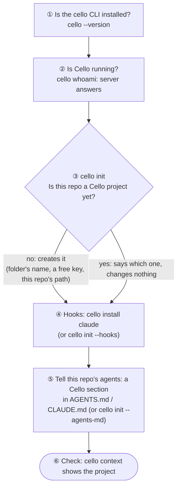

# The cello CLI, for agents

Everything an agent needs to work with Cello through the `cello` command: the ideas behind it, the workflow, copy-paste examples, what each error means, and every command with its flags. `cello guide` prints this same page, so it reads the same in any repository.

This page is kept current: any change to a command, a flag, an output or a rule updates it in the same commit. The command reference at the end is generated from the CLI's own `--help`.

## Set up a repo for Cello

When Lucas says "use Cello in this repo", or `cello context` fails here, go through these steps in order. Each one checks first, so running them again is safe.



Steps 3 to 5 in one go: `cello init --hooks --agents-md`.

1. **The CLI.** `cello --version` prints a version. If the command isn't found, stop and tell Lucas: `cello` is installed from his Cello repo (`apps/cli`, linked at `~/.local/bin/cello`). Never install it yourself.
2. **The server.** `cello whoami` prints JSON with a `server` entry. If it says Cello isn't running, ask Lucas to open the Cello desktop app or run `cello start`. Don't start it yourself, since it serves his real data.
3. **The project.** Run `cello init` inside this repo. It creates the project with this repo's path (the main checkout's when you're in a worktree), named after the repo's folder, with a key made from the name that no other project has, and prints the key and the board's URL. If the repo is already a project, it says which one and leaves the project as it is, however its path was typed in New project (`~/…`, a trailing `/`, a symlinked folder, a subfolder of the repo). It refuses a repo an archived project holds, naming it: ask Lucas then.

   ```
   $ cello init
   Created project CEL · cello for /Users/lnmunhoz/projects/cello (tasks CEL-1, CEL-2, …)
   http://127.0.0.1:4747/CEL
   ```

   - The defaults are fine unless Lucas named the project or its key: then pass `--name "Thai Lookup"` and `--key THAI`.
   - If the key is taken, it says which project has it: pick another, or leave `--key` out and Cello picks a free one (CEL, then CELL, CELLO, CEL2…).
   - `--workspace Work` puts it in another workspace, by name; the default is the first one.
4. **Hooks, so Lucas's comments reach your session.** Run `cello install claude` (or `cello init --hooks`, which does the same). It writes this machine's `.claude/settings.local.json` and makes sure git ignores it. It keeps a `.bak` of the old file; ignore that too if the repo's `.gitignore` doesn't cover it. Run it again any time; it changes nothing the second time.
5. **Tell the repo's agents.** `cello init --agents-md` adds this section, with the project's key in place of `KEY`, to the end of the AGENTS.md in the checkout you're in, or to CLAUDE.md if there's no AGENTS.md (creating it). It changes nothing else in the file, and nothing at all when the file already has a "Tracking work in Cello" heading. To add it by hand, copy it and replace `KEY` yourself:

   <!-- agents-md:start -->
   ```markdown
   ## Tracking work in Cello

   This repo's tasks live in Cello, project **KEY** on Lucas's board. Agents use it only through the `cello` CLI.

   - Before your first `cello` command in a session, run `cello guide` once: it's the full reference (concepts, workflow, every command, what each error means). Don't guess.
   - Run `cello context` at the start of each session.
   - Claim a task before working on it (`cello task claim KEY-n`), and put the key in commit messages (`fix(api): rate limit (KEY-12)`).
   - Hand finished work to Lucas only with `cello task submit`: a summary, steps to check it, and evidence (videos and screenshots for UI work; a diagram when it's a flow).
   - Answer Lucas on the card with `cello task comment`. His comments come to your session by themselves.
   ```
   <!-- agents-md:end -->

   `cello init --agents-md` copies this block, so changing it here changes what the command writes.
6. **Check.** `cello context` shows the project, its statuses and labels. Tell Lucas the repo is set up: the project key, that the hooks are installed, and that the AGENTS.md section was added (uncommitted, unless he asks you to commit it).

## Concepts

**Cello** is the task board Lucas shares with his agents. Its server runs on his Mac (`cello start`, http://127.0.0.1:4747, data in `~/.cello`). The board in the browser, the desktop app and the CLI all talk to that server, and every change shows up live everywhere.

- **Workspace:** a group of projects that share statuses, labels and views.
- **Project:** one product, usually one git repository, with its own key (`CEL`). The CLI works out the project from the repository you're in; `--project KEY` picks another.
- **Task:** a card, keyed `<PROJECT>-<number>` (`CEL-12`). It has a title, a markdown description, a status, a priority, labels, an optional parent task, comments and a history.
- **Status:** a column on the board, shared by the workspace. Names match in any case. `cello context` lists a workspace's own; the defaults are:

  | Status | What it means | How a task gets there |
  | --- | --- | --- |
  | Backlog (hidden) | An idea or request that still needs discussing. Nobody builds from here. | `cello task create … --status Backlog` |
  | Todo | Agreed and ready to build. | The default for new tasks |
  | In Progress | Someone is working on it. | `cello task claim` |
  | In Review | Waiting for Lucas, with a review packet. | Only `cello task submit` |
  | Done | Lucas approved it. | Lucas, on the Review page |
  | Canceled (hidden) | It won't be done. | Lucas |

  Hidden statuses are folded on the board and left out of `cello task list` unless you ask for them.
- **Agent session:** one agent conversation. Cello credits every change to the session that made it ("Claude Code session 2fd0505c"), from `CLAUDE_CODE_SESSION_ID`, which Claude Code sets.
- **Claim:** "this session is working on this task". `cello task claim` assigns the task to your session and moves it to In Progress.
  - While your session is alive, other agents can't claim it.
  - If your session has exited, another session can claim the task and takes the claim over.
  - Lucas always wins: when he changes a task you've claimed (moves it, approves it), your claim ends, and `cello context` lists it under "Claims you lost".
- **Review packet:** how finished work reaches Lucas. It holds a summary, how-to-check steps and evidence (videos, screenshots, test output, links). `cello task submit` creates it and moves the task to In Review. Then Lucas decides:
  - **Approve:** the task moves to Done and your claim ends.
  - **Send back:** the task returns to In Progress with his note, and your claim stays. The note comes to your session (see Comments from Lucas reach your session), and `cello task get` shows it under Reviews.
- **Documents:** markdown published into the project's Docs tab with `cello doc publish`. There are three kinds:
  - a **page** reports on finished work (a snapshot to read now)
  - a **doc** explains how something works (kept up to date)
  - a **spec** plans work before it starts

  Publishing again updates a document in place, and its old versions are kept.
- **History:** every change is recorded with who made it. `cello task get` shows a task's history; `cello context` shows recent activity.

## Start of every session

```bash
cello context
```

It shows the project, its statuses (hidden ones in brackets), its labels, new comments from Lucas on tasks you've claimed (shown, not taken; see Comments from Lucas reach your session), the tasks your session has claimed, claims you lost and why, and recent activity:

```
Project   CEL · Cello · /Users/lnmunhoz/projects/cello
You       Claude Code session 2fd0505c (cli)
Statuses  Todo · In Progress · In Review · Done (hidden: Backlog, Canceled)
Labels    M2 · M3 · server · ui

New comments for you (1)
  CEL-22  Review page: collapsed rows, one packet open at a time
    Lucas N. Munhoz commented, 5m ago
      Use the same row height as the list layout.
  Answer on the card: `cello task comment CEL-22 "…"`. They stay new until the hook or `cello inbox` hands them over.

Claimed by you
  CEL-22  In Progress  Review page: collapsed rows, one packet open at a time

Recent activity
  2m ago   CEL-22  Lucas N. Munhoz commented
```

Run it first in every session, and again when you come back to a task.

## The workflow

1. **Find the work.** `cello task list` shows Todo and In Progress. `cello task get CEL-12` reads one task in full, including Lucas's notes on earlier packets and every comment.
2. **Claim it.** `cello task claim CEL-12`. If it says another session holds the task, pick another one. Don't work on a task someone else holds.
3. **Work, test first, and put the key in every commit:** `feat(web): collapsed review rows (CEL-22)`.
4. **Comment** progress, decisions and questions on the card (`cello task comment`). Lucas reads them there.
5. **Hand it over** with `cello task submit` and evidence he can look at (see Review packets). The task moves to In Review.
6. **If it's sent back,** his note comes to your session (by the hook, or `cello inbox`), and `cello task get CEL-12` shows it under Reviews. Fix it, then submit again.
   **Lucas's feedback in chat counts as a Send back.** When he reviews a task in your conversation instead of on the card (a screenshot, "this should be…", "I don't like…"), do both of these before you start fixing:
   - put his words on the card as a comment, quoted as he said them and marked as his (`**Lucas, in chat (review):** "…"`), so the review lives with the task;
   - if the task is In Review, move it back with `cello task move CEL-12 "In Progress"`, so the board shows it's being worked on again.

   Then fix, and submit a new packet (it replaces the open one). The same goes for feedback on a task in Done: comment it, and move it back to In Progress, or open a new task if it's a new request.
7. **If you stop without finishing,** `cello task release CEL-12`. The task keeps its status, and someone else can claim it.

Never move a task to Done or Canceled yourself: Lucas decides.

## Creating tasks

```bash
# Ready to build: lands in Todo
cello task create "Sidebar: collapse and resize" --label ui --priority high \
  --description "Drag the sidebar's edge to resize it; ⌘B collapses it to an icon rail."

# Still needs discussing: Backlog
cello task create "Idea: media library per project" --status Backlog --body-file - <<'EOF'
Lucas makes promo videos, icons and designs for each project. A place in Cello to keep them,
link them to tasks, and sync them later.
EOF

# A subtask, with two labels
cello task create "Restore refuses while a server runs" --parent CEL-23 --label server,M2
```

- **Todo or Backlog:** Todo means agreed and ready to build. When Lucas says "add to the backlog", use `--status Backlog`.
- **Labels must already exist.** `cello context` lists them, and an unknown label fails with the real names.
- **Priority:** `urgent`, `high`, `medium`, `low` or `none`.
- **Long descriptions:** use `--body-file -` with a heredoc, or `--body-file notes.md`.

## Reading tasks

```bash
cello task list                          # Todo and In Progress
cello task list --status Backlog         # any status by name, hidden ones too
cello task list --status Done --label ui
cello task list --mine                   # what your session has claimed
cello task get CEL-12                    # everything about one task
cello task get CEL-12 --json | jq -r '.task.description'
```

Every command takes `--json` and prints the whole response, for scripts.

## Moving tasks

```bash
cello task move CEL-12 Todo
cello task move CEL-31 backlog           # any case
```

- **Moving into In Review is refused:** use `cello task submit`.
- **Don't move tasks to Done or Canceled.**
- **"It was changed by … in the meantime":** someone changed the task while you were acting. Run the command again.

## Comments

```bash
cello task comment CEL-12 "Found the cause: the column's min-height was missing."

cello task comment CEL-12 --body-file - <<'EOF'
## Progress
- Collapsed rows work, with j/k and Enter
- Next: open the next row after Approve
EOF
```

Comments are markdown, rendered on the card, and links in them can be clicked. Task keys (e.g. CEL-12) link to the task, with its live status; keys of unknown tasks, and keys in backticks or code blocks, stay plain. Answer Lucas's comments and Send back notes on the card, so the conversation stays with the task. His comments come to your session by themselves (next section).

## Comments from Lucas reach your session

Lucas's comments on a task you've claimed, and his Send back notes, are addressed to your session: the one holding the claim. Your own comments and other agents' never come back to you, and nothing does once your claim has ended. One exception: a Send back note still reaches the session that handed in the packet.

**With the hooks (the usual way),** they arrive by themselves:

```bash
cello install claude            # this project, this machine: .claude/settings.local.json (git-ignored)
cello install claude --user     # every project on this machine: ~/.claude/settings.json
cello install claude --shared   # .claude/settings.json, committed: everyone who clones the repo gets them
cello uninstall claude          # takes them out of all three
```

- **Once per project** (or once with `--user`). From inside a worktree it writes the main checkout's settings.
- **It merges** with the hooks already there, and running it again changes nothing. The old file is kept as `<file>.bak`.
- **What runs:** Claude Code runs `cello hook claude stop` when you finish a turn, and `cello hook claude post-tool-use` after each tool call. New comments come in as context. If you were about to stop, they keep you going: the transcript shows them as "Stop hook feedback".
- **`cello` must be on the PATH** Claude Code starts with (`~/.local/bin`). When the server is down, the hook stays silent and your session carries on.

**Without the hooks:**

```bash
cello context            # lists new comments and leaves them new
cello inbox              # hands them over and marks them read, then lists what came earlier
cello inbox --new        # only new ones; prints nothing when there are none
cello inbox --json
```

**Each comment arrives once.** Whichever gets it first (the Stop hook, the PostToolUse hook or `cello inbox`) marks it read, so it never comes a second time, even when parallel tool calls run the hook at the same moment. `cello context` only shows them. What arrives looks like this:

```
New Cello comment on a task you claimed:

CEL-22  Review page: collapsed rows, one packet open at a time
  Lucas N. Munhoz sent it back, 2m ago
    The next row doesn't open by itself after Approve.

Act on it now, then answer on the card: `cello task comment CEL-22 "…"` (or `--body-file -` for markdown), so Lucas N. Munhoz sees your reply there.
For a task Lucas N. Munhoz sent back, fix what the note asks, then hand it in again with `cello task submit CEL-22`.
```

**Answer on the card.** Act on the comment, then reply with `cello task comment CEL-22 "…"` (`--body-file -` for markdown), so the conversation stays with the task and Lucas sees it there.

**When a task is sent back,** it's in In Progress again and still yours. The note arrives the same way, marked "sent it back" (`cello task get` also shows it under Reviews). Fix what it asks, test, then hand the task in again with `cello task submit CEL-22` and new evidence.

**Subagents share your session.** A subagent's `CLAUDE_CODE_SESSION_ID` is its parent's, so Cello can't tell them apart. The hook skips tool calls made inside a subagent, so comments reach the main conversation. Don't run `cello inbox` from a subagent: it would take the parent's comments. `cello context` is safe anywhere, since it takes nothing.

## Review packets

```bash
cello task submit CEL-22 \
  --summary "The Review page shows one packet at a time: collapsed rows, j/k to move, Enter to open." \
  --step "Open the Review page" \
  --step "Press j twice, then Enter: the third packet opens and the first closes" \
  --step "Approve it: the next packet opens by itself" \
  --attach test-results/docker/latest/web/videos/review-rows.mp4 --caption "Going through the queue with the keyboard" \
  --attach shots/review-dark.png --caption "Dark mode" \
  --link http://127.0.0.1:4747/CEL/pages/review-rows --caption "The report"
```

- **`--summary`** says what changed and why, in markdown. Use `--summary-file -` for a long one from stdin.
- **`--step`** says how Lucas checks it, one step per flag, in order.
- **`--attach`** takes images, videos (MP4, WebM, MOV) and text files (txt, log, md, json, cast), up to 50 MB each.
  - Paths are relative to your working folder.
  - The server copies each file into `~/.cello/assets`, so you can delete the original afterwards (in a worktree, say).
- **`--link`** adds a URL: a PR, or a page you published.
- **`--caption`** describes the `--attach` or `--link` right before it.
- **Submitting again** while a packet is still open replaces it.

What to bring, by kind of work:

- **A flow being validated** (steps, states, systems talking to each other): add a diagram to the summary. A ```mermaid block in `--summary-file` renders as a diagram on the Review page; draw it top to bottom (`flowchart TD`). Lucas reads the diagram first.

- **UI:** MP4 videos of the flow (the Playwright e2e videos) plus screenshots, in light and dark when it matters. How they're made: `docs/evidence-videos.md` in the Cello repository, also in Cello's Docs tab.
- **CLI or server:** a terminal transcript or a test-output file (`… > vitest.log`), plus steps Lucas can run himself.
- **A report you published:** `--link <page url> --caption "The report"`.

## Pages, docs and specs

```bash
cello doc publish report.md --task CEL-13
# Published page "Billing audit" (version 1), linked to CEL-13, with 1 file
# http://127.0.0.1:4747/CEL/pages/billing-audit

cello doc publish docs/how-sync-works.md --kind doc      # explains the system, kept up to date
cello doc publish plan.md --kind spec --task CEL-15      # a plan before the work
cello doc publish - --slug m2-progress < report.md       # from stdin: pass --slug to update it later

cello doc list                       # the project's documents, newest first
cello doc list --kind spec
cello doc get billing-audit          # the markdown back, to continue from it
cello doc get billing-audit --version 1
cello doc archive billing-audit      # hidden from the Docs tab; the link keeps working
```

- **Which kind?** A page is about a moment, a doc is about the system, and a spec is a plan.
- **The title** is the frontmatter `title:`, the first `#` heading, or `--title`.
- **The summary** is the frontmatter `summary:`, the first paragraph, or `--summary`.
- **What renders:** `##` and `###` headings become the page's section list. Tables, code blocks, ```` ```mermaid ```` diagrams and images all render.
- **Task keys** (e.g. CEL-12) link to the task, with its live status, so a progress table never goes stale. Keys of unknown tasks, and keys in backticks or code blocks, stay plain.
- **Images:** images the markdown links by a relative path go up with the page. `--asset` uploads other files.
- **Publishing the same file again** updates the page and keeps the old version, and the link never changes.
- **Publish reports, plans and summaries here,** not as Claude artifacts: Lucas reads them next to the tasks.

## Showing things to Lucas

Open pages, videos and links **inside Cello**, in the desktop app's browser panel. Claude artifact pages work there too.

```bash
open "cello://open?url=$(jq -rn --arg u 'https://claude.ai/artifact/abc' '$u|@uri')"
open "cello://CEL-12"                    # focuses the app on a task
```

Use his browser only when the desktop app isn't running.

## Backups

The server backs up its data folder every day: the database and every evidence file (videos, screenshots, page images), into `~/.cello/backups/<YYYYMMDD-HHMMSS>/`.

```bash
cello backup                     # take one now: prints the folder, its size, files linked vs copied
cello backup --json              # the same as JSON
cello backup list                # id, when, kind, size and file count, newest first
cello restore 20261115-120000    # only when Lucas asks, with Cello stopped
```

- **When:** when the server starts, if the newest daily backup is 24 hours old (or there's none), then every 24 hours. Take one by hand before something risky.
- **Small:** files unchanged since the previous backup are hard links to it, so a backup only adds what changed.
- **With or without a server:** `cello backup` and `cello backup list` ask the server on `CELLO_PORT`. When none answers, they work on `CELLO_DATA_DIR` (`~/.cello` by default) directly; `cello backup` then holds the data folder's lock while it copies, as a server would.
- **What's kept:** the newest 14 of each kind, counted apart: **auto** (the daily ones), **manual** (`cello backup`) and **safety** (the copy of the current state that restore takes first). Taking many manual backups never pushes out the daily history or the undo for a restore. Only Cello's own folders (a `YYYYMMDD-HHMMSS` name and a manifest.json) are ever pruned; anything else in `backups/` is left alone.
- **Restore** replaces the database and evidence files with a backup's. Stop Cello first (Ctrl-C where `cello start` runs, or quit the desktop app): it refuses while a server runs. It takes a safety backup of the current state first ("before restoring <id>" in the list), so restoring that one undoes it. **Agents run `cello restore` only when Lucas asks.**

## Which build is running

Each build of Cello knows the commit it was built from. When Lucas asks whether his Cello has a change yet, compare that commit with the merge:

```bash
cello --version        # the CLI: 0.2.0 (build c602f25)
cello whoami | jq '.server.build'
# {
#   "version": "0.2.0",
#   "commit": "c602f25",              the commit the server was built from
#   "startedAt": 1763230740000,        when it started
#   "web": { "commit": "c602f25", "builtAt": …, "changes": ["merge: … (CEL-38, CEL-39)", …] }
# }
git merge-base --is-ancestor <merge commit> c602f25 && echo "it's in"
```

- `web` is the web app the server serves; `changes` lists the commit subjects merged since the build before it. The sidebar's footer shows the same line, "Cello 0.2.0 · build c602f25 · live since 18:19", and a click lists those changes.
- After a new build is started, open tabs and the desktop app notice it the next time they reconnect: they show "Cello was updated · Reload" and reload by themselves after a few seconds, unless Lucas is typing.
- `build dev` means the commit is unknown: a build made outside a git checkout without `CELLO_BUILD_COMMIT`.

### Every build so far

The server records each build the first time it starts on it, so the board keeps a history of every deploy. `cello builds` lists it, newest first; Lucas sees the same on the **Builds** page (Settings → Builds, or "See all builds →" in the footer's popover).

```bash
cello builds
# #14  build 9afd602  Cello 0.2.0  live since 2026-11-15 18:19, for 2 h 41 min  running
#     merge: needs input on a task (CEL-47)
#     merge: build history, one click from the footer (CEL-50)
# #13  build c602f25  Cello 0.2.0  live since 2026-11-15 12:02, for 6 h 17 min
#     merge: the task panel's layout (CEL-49)
```

- Each build has a number (#1 is the first one this data folder recorded), its commit, when it went live and how long it was live (until the next build went live). `running` marks the one the server runs now.
- Under each build are the commits merged since the build before it: the first-parent subjects, so merges, which name their tasks. Use it to answer "is CEL-47 deployed yet?" or "what did the last deploy bring in?".
- Restarting the same build adds nothing; a rebuild at the same commit is a new build with no changes.
- The changes come from git when the server can read the checkout it was built from; otherwise from the list the web build carries (what changed since the build before it in the same folder).
- A dev server (Vite serving the app) records no builds. `--limit` and `--before` page through a long history; `--json` gives `builds`, `running` and `next`.

## Identity and environment

| Variable | What it does |
| --- | --- |
| `CLAUDE_CODE_SESSION_ID` | Set by Claude Code. Your agent session: your changes are credited to it, your claims belong to it, and Lucas's comments on them come to it. Subagents get their parent's. |
| `CLAUDE_PID` | Set by Claude Code. Lets Cello tell whether your session is still alive, so a dead session's claim can be taken over. |
| `CELLO_SESSION` | Overrides the session. An agent that isn't Claude Code sets a stable id for its conversation here. `CELLO_SESSION=me` acts as Lucas: only when he asks you to. |
| `CELLO_PORT` | The server's port, 4747 by default. Dev servers and tests use other ports. |
| `CELLO_DATA_DIR` | `cello start`'s data folder, `~/.cello` by default. |
| `CELLO_WEB_DIR` | A built web app (`vite build`'s folder) for `cello start` to serve instead of its own. It serves **every file in that folder** to anything that can reach the port, so point it only at a build. Without an `index.html` there, `cello start` says so on stderr and serves its own app. Tests use it to serve two builds. |
| `CELLO_BUILD_COMMIT` | The commit a build records, when it's made outside a git checkout (Docker): a commit hash (7 to 40 lowercase hex characters); anything else is ignored. `vite build`, `bun run build` and `cello` from source otherwise read the checkout's HEAD. |

With no session at all, changes are recorded as Lucas. When something gets credited to the wrong person, `cello whoami` prints what Cello sees.

Agents never open, copy or change anything in `~/.cello` directly. Everything goes through `cello`.

## When something fails

Every error is one sentence that says what to do next. The usual ones:

| The message says | What it means | What to do |
| --- | --- | --- |
| Cello isn't running on 127.0.0.1:4747 | Lucas's server is down. | Tell him. Don't start one against `~/.cello` yourself unless he asks. |
| Cello on 127.0.0.1:4747 closed the connection before answering | The server stopped or restarted (a deploy) while your command ran. A change it had started still went through. | Look before you redo it: `cello task get CEL-12` shows whether the claim, move, comment or submit landed. A rerun is a new command, so running it blindly can do it twice. |
| CEL-12 is claimed by Claude Code session 1a2b3c4d (active now) | Another live session is working on it. | Pick another task. |
| No task CEL-99 · No status named … · No label named … | A typo, or something that doesn't exist. | The message lists the real names. |
| It was changed by … in the meantime | Someone changed the task while you were acting. | Run the command again. |
| CEL-12 needs a review packet before it goes to In Review | You used `move` to hand work over. | Use `cello task submit`. |
| Only Lucas can approve a review | Approving and sending back are his. | Leave the task in In Review. |
| This folder isn't in a git repository | The CLI can't work out the project. | Pass `--project KEY`. |
| No project is linked to /path | This repository isn't a Cello project yet. | Set it up: `cello init` (see Set up a repo for Cello), or pass `--project KEY`. |
| The key THAI is taken by ThaiLookup | `cello init --key` named a key another project has. | Pick another key, or leave `--key` out and Cello picks a free one. |
| … is already used by Old Cello (archived), so it can't be linked again | An archived project holds this repo's folder. | Ask Lucas. |
| Several projects use this folder (A, B) | More than one project was linked to this repo. | Pass `--project KEY`, and tell Lucas. |
| Project CEL is set up, but the next step failed: … | `cello init` made or found the project; `--hooks` or `--agents-md` then failed. | Fix what the message says, then run the same `cello init` again: it skips what's done. |
| Cello is running for …, and restore only runs while it's stopped | `cello restore` runs only while no server does. Nothing was changed. | Lucas stops Cello, then runs it again. |
| No backup 20261115-120000 in … | That backup id doesn't exist. | `cello backup list` shows the real ones. |
| The backup failed (…) | The disk is full, or a file in `assets/` can't be read. Nothing was saved. | Tell Lucas, with the message. |
| The restore of … failed while … | The disk or a file got in the way. The sentence says whether anything changed, the safety backup's id and, if needed, where the data was kept. | Tell Lucas, with the message. Don't start Cello if it says not to. |

## Command reference

<!-- cli-reference:start -->
Generated from the CLI's own `--help` by `bun run docs:cli`. Don't edit it by hand: change the command's descriptions in `apps/cli/src/cli.ts` and run that.

### cello context

Start here: the project, its statuses and labels, new comments for you, your claims and recent activity.

```
cello context [flags]
```

| | |
| --- | --- |
| `--project string` | Project key, instead of the working folder's. |
| `--json` | Print JSON for scripts. |

### cello init

Make the git repository you're in a Cello project: creates it with this repo's path (the main checkout's, from a worktree), named after the folder, with a free key made from the name, and prints its key and board URL. In a repo that's already a project it says which one and changes nothing. --hooks and --agents-md do the rest of the setup; each is safe to run again.

```
cello init [flags]
```

| | |
| --- | --- |
| `--name string` | The project's name. Default: the repository's folder name. |
| `--key string` | Its task key: 2 to 10 letters or digits, starting with a letter (THAI gives THAI-1, THAI-2…). Default: one made from the name that no project has. |
| `--workspace string` | The workspace to put it in, by name. Default: the first one. |
| `--hooks` | Also install the Claude Code hooks for this machine, as `cello install claude` does. |
| `--agents-md` | Also add the "Tracking work in Cello" section to this checkout's AGENTS.md (CLAUDE.md when there's no AGENTS.md), once. |
| `--json` | Print JSON: created, project, url, hooks and agentsMd ({ file, changed }, or null when not asked for or not reached), and error when --hooks or --agents-md failed. |

### cello task list

Tasks in the current project: Todo and In Progress unless --status picks another.

```
cello task list [flags]
```

| | |
| --- | --- |
| `--project string` | Project key, instead of the working folder's. |
| `--json` | Print JSON for scripts. |
| `--status string` | Only this status, by name (e.g. Backlog, Done). Without it: Todo and In Progress. |
| `--label string` | Only tasks with this label. |
| `--mine` | Only tasks you've claimed. |

### cello task get

One task in full: description, labels, claim, pages, review packets with Lucas's notes, comments, history.

```
cello task get [flags] <key>
```

| | |
| --- | --- |
| `key string` | A task key, e.g. CEL-3. |
| `--json` | Print JSON for scripts. |

### cello task create

Create a task in the current project (Todo unless --status says otherwise).

```
cello task create [flags] <title>
```

| | |
| --- | --- |
| `title string` | The task's title, in quotes. |
| `--project string` | Project key, instead of the working folder's. |
| `--json` | Print JSON for scripts. |
| `--description string` | The description, in markdown. |
| `--body-file string` | Read the description from a file; - is stdin. |
| `--status string` | Status by name. Default: the first visible one (Todo). Backlog for ideas that still need discussing. |
| `--priority string` | urgent, high, medium, low or none. |
| `--label string` | A label name; repeat it, or separate names with commas. |
| `--parent string` | Parent task key. |

### cello task claim

Start working on a task: it's assigned to your session and moves to In Progress. Refused while another live session holds it.

```
cello task claim [flags] <key>
```

| | |
| --- | --- |
| `key string` | A task key, e.g. CEL-3. |
| `--json` | Print JSON for scripts. |

### cello task release

Give up your claim without finishing the task; its status stays.

```
cello task release [flags] <key>
```

| | |
| --- | --- |
| `key string` | A task key, e.g. CEL-3. |
| `--json` | Print JSON for scripts. |

### cello task move

Move a task to a status by name. Into In Review is refused: hand work over with `cello task submit`.

```
cello task move [flags] <key> <status>
```

| | |
| --- | --- |
| `key string` | A task key, e.g. CEL-3. |
| `status string` | The status's name, e.g. Todo or Backlog; any case. |
| `--json` | Print JSON for scripts. |

### cello task comment

Add a markdown comment to a task: progress, a question, an answer to Lucas.

```
cello task comment [flags] <key> [<text>]
```

| | |
| --- | --- |
| `key string` | A task key, e.g. CEL-3. |
| `text string` | The comment, in quotes; markdown renders on the card. (optional) |
| `--body-file string` | Read the comment from a file; - is stdin. |
| `--json` | Print JSON for scripts. |

### cello task submit

Hand finished work to Lucas: a review packet (summary, steps, evidence) that moves the task to In Review.

```
cello task submit [flags] <key>
```

| | |
| --- | --- |
| `key string` | A task key, e.g. CEL-3. |
| `--json` | Print JSON for scripts. |
| `--summary string` | What changed, in markdown. |
| `--summary-file string` | Read the summary from a file; - is stdin. |
| `--step string` | How to check the work, one step each; repeat in order. |
| `--attach string` | A video (MP4), a screenshot, or a text file such as test output or a terminal recording; repeatable. |
| `--caption string` | Describes the --attach or --link right before it. |
| `--link string` | A link, e.g. the PR; repeatable. |

### cello inbox

Show the comments Lucas left on tasks this session claimed (Send back notes too) and mark them read; each one arrives once. Use it when `cello context` lists new ones, or to reread what he said. With `cello install claude` they arrive by themselves. Not from a subagent: it shares its parent's session and would take the parent's comments.

```
cello inbox [flags]
```

| | |
| --- | --- |
| `--new` | Only new comments, and print nothing (exit 0) when there are none. For scripts and hooks. |
| `--json` | Print JSON: `items` (new, handed over now and marked read) and `earlier` (read before). |

### cello doc publish

Publish a markdown report, plan or summary as a page in Cello and print its URL.

```
cello doc publish [flags] <file>
```

| | |
| --- | --- |
| `file string` | The markdown file, or - to read it from stdin. |
| `--project string` | Project key, instead of the working folder's. |
| `--json` | Print JSON for scripts. |
| `--title string` | Default: the frontmatter title:, the first # heading, or the file name. |
| `--slug string` | The page's slug (its URL); publishing to it again updates it. Default: the page this file went to before, else one from the title. |
| `--kind string` | page (the default), doc or spec. |
| `--summary string` | Default: the frontmatter summary:, else the first paragraph. |
| `--task string` | Link the page to a task, e.g. CEL-12; repeat it, or separate keys with commas. |
| `--asset string` | Another file to upload with it (images the markdown links go up by themselves); repeatable. |

### cello doc list

The project's docs, specs and pages, newest first.

```
cello doc list [flags]
```

| | |
| --- | --- |
| `--project string` | Project key, instead of the working folder's. |
| `--json` | Print JSON for scripts. |
| `--kind string` | page (the default), doc or spec. |

### cello doc get

Print a page's markdown, to read it back or continue from it.

```
cello doc get [flags] <slug>
```

| | |
| --- | --- |
| `slug string` | The page's slug, e.g. billing-audit. |
| `--project string` | Project key, instead of the working folder's. |
| `--json` | Print JSON for scripts. |
| `--version integer` | An older version, by number. |

### cello doc archive

Hide a page from the Docs tab; its link keeps working, and publishing it again brings it back.

```
cello doc archive [flags] <slug>
```

| | |
| --- | --- |
| `slug string` | The page's slug, e.g. billing-audit. |
| `--project string` | Project key, instead of the working folder's. |
| `--json` | Print JSON for scripts. |

### cello whoami

Print, as JSON, who Cello thinks is calling, and which build the CLI and the server are.

```
cello whoami [flags]
```

| | |
| --- | --- |
| `--project string` | Project key, instead of the working folder's. |

### cello guide

Print the full guide for agents: concepts, workflow, examples, errors and every command (docs/cli.md).

```
cello guide [flags]
```

### cello install claude

Add Claude Code hooks that deliver new comments into the agent session holding the task (Stop and PostToolUse, running `cello hook claude`). Writes this project's .claude/settings.local.json (this machine, git-ignored; from a worktree, the main checkout's), merged with the hooks already there; running it again changes nothing. The old file is kept as .bak.

```
cello install claude [flags]
```

| | |
| --- | --- |
| `--user` | Write ~/.claude/settings.json instead: every project on this machine. |
| `--shared` | Write this project's .claude/settings.json instead, committed with the repo: everyone who clones it gets the hooks and needs cello. |

### cello uninstall claude

Take Cello's hooks out of Claude Code's settings: this project's .claude/settings.local.json and .claude/settings.json, and ~/.claude/settings.json. Every other hook and setting stays as it was.

```
cello uninstall claude [flags]
```

### cello hook claude

Run by the hooks `cello install claude` adds, not by hand: reads Claude Code's hook JSON on stdin and hands new comments for its session back to the agent as context (on Stop it keeps the agent going). Prints nothing when there are none, inside a subagent, or when the server doesn't answer within 2 seconds; always exits 0.

```
cello hook claude [flags] <event>
```

| | |
| --- | --- |
| `event choice` | The hook event Claude Code runs it for: stop (Stop) or post-tool-use (PostToolUse). |

### cello start

Run the Cello server on 127.0.0.1:4747 with data in ~/.cello (CELLO_PORT, CELLO_DATA_DIR), serving its built-in web app, or every file in CELLO_WEB_DIR when that folder has an index.html.

```
cello start [flags]
```

### cello backup

Back up the database and every evidence file (videos, screenshots, page images) now, into <data folder>/backups/<YYYYMMDD-HHMMSS>/, and print the folder, its size and how many files were linked or copied. The server already takes one a day and keeps 14 of those; take one by hand before something risky, like a bulk change or trying a new build on your real board. Files unchanged since the previous backup become hard links to it, so a backup only adds what changed. Talks to the running server on CELLO_PORT; with none running, it backs up CELLO_DATA_DIR (default ~/.cello) itself.

```
cello backup <subcommand> [flags]
```

| | |
| --- | --- |
| `--json` | Print the backup as JSON (id, path, sizes, file counts) for scripts. |

### cello backup list

List the backups, newest first: the id (the folder name, which `cello restore` takes), when it was taken, its kind (auto: the daily one; manual: `cello backup`; safety: the copy of the current state `cello restore` takes first, which undoes that restore), its size (the database plus its files, counting files shared with other backups in each) and how many evidence files it holds. The newest 14 of each kind are kept. Use it to pick a backup to restore. Only Cello's own backups are listed; other folders in backups/ are left alone. Works whether or not Cello is running.

```
cello backup list [flags]
```

| | |
| --- | --- |
| `--json` | Print the backups as a JSON array, newest first, for scripts. |

### cello restore

Put a backup's database and evidence files back in place of the current ones, in CELLO_DATA_DIR (default ~/.cello). Use it when the board's data is lost or damaged. Stop Cello first (Ctrl-C where `cello start` runs, or quit the desktop app): restore refuses while a server holds the data folder. It first takes a safety backup of the current state (kind safety, "before restoring <id>"), so restoring that one undoes it. Agents run it only when Lucas asks.

```
cello restore [flags] <id>
```

| | |
| --- | --- |
| `id string` | The backup to restore: its id from `cello backup list`, e.g. 20261115-120000. |
| `--json` | Print what was restored, and the safety backup, as JSON. |

### cello builds

List the builds of Cello the server has run, newest first: each build's number, commit and version, when it went live and for how long (until the next build went live), which one is running now, and the commits merged since the build before it (merge subjects name their tasks). The server records a build the first time it starts on it; restarting the same build adds nothing. Use it to tell whether a merged task is deployed yet, or what a deploy brought in.

```
cello builds [flags]
```

| | |
| --- | --- |
| `--limit integer` | How many builds to list, newest first (1 to 200). |
| `--before integer` | List the builds older than this build number: the number the previous list's "Older builds" line gives. |
| `--json` | Print the page as JSON (builds, running, next) for scripts. |

### Flags every command takes

| | |
| --- | --- |
| `--help, -h` | Show help information |
| `--version, -v` | Show version information |
| `--wizard` | Start wizard mode for a command |
| `--completions <bash\|zsh\|fish\|powershell\|sh\|pwsh>` | Print shell completion script (choices: bash, zsh, fish, powershell, sh, pwsh) |
| `--log-level <all\|trace\|debug\|info\|warn\|warning\|error\|fatal\|none>` | Sets the minimum log level (choices: all, trace, debug, info, warn, warning, error, fatal, none) |
<!-- cli-reference:end -->
