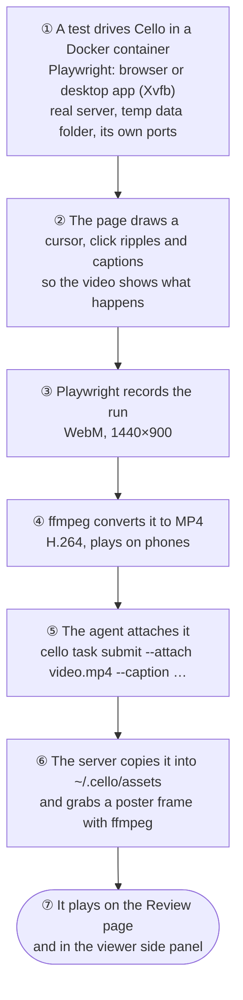

## The short version

The videos and screenshots in review packets aren't screen recordings of someone's desktop. They come from **automated end-to-end tests**: a headless browser (or the desktop app) drives the real Cello against a real server with a throwaway data folder, and records what it sees. The tests run in a **throwaway Linux container** (Docker, through OrbStack), so nothing opens a window on Lucas's Mac. ffmpeg turns the recording into an MP4 that plays everywhere, and the agent attaches it to the task with `cello task submit`.



## Tools

| Tool | Version | What it does here |
| --- | --- | --- |
| Playwright (`@playwright/test`) | 1.65.1 | Drives the browser and the desktop app, records video, takes screenshots |
| Chromium headless shell | from Playwright | The browser the web tests run in, with no window on screen |
| Electron + Playwright `_electron` | Electron 44 | Launches and drives the desktop app in its own tests |
| ffmpeg | 8.1.2 | Converts recordings to MP4, burns in captions for desktop videos, grabs poster frames |
| Bun | 1.4.4 | Runs the test servers, the build and the `cello` CLI |
| Docker (OrbStack) | `docker/test.Dockerfile` | The container the tests run in: Playwright's Ubuntu image for 1.65.1, plus Bun, ffmpeg, Xvfb and the Inter font |
| Xvfb | from Ubuntu | A virtual screen for the desktop app inside the container |
| `cello` CLI | this repo | `cello task submit` attaches the files to a task as a review packet |

Every run (`bun run test:docker`, `test:docker:e2e`, `test:docker:desktop`) writes to its own folder, `test-results/docker/<time>-<label>-<pid>/`, and `test-results/docker/latest` points at the newest:

```
test-results/docker/latest/
  summary.txt            what ran, what passed, how long it took
  logs/<step>.log        each step's full output
  web/videos/            web e2e videos (MP4) and the screenshots the tests take (PNG)
  web/playwright/        Playwright's output (error context of failed tests)
  desktop/videos/*.mp4   desktop app videos
  desktop/screenshots/   desktop app screenshots
```

## 1. Web end-to-end videos (most review evidence)

- **Where:** `e2e/*.spec.ts`, settings in `playwright.config.ts`.
- **Setup per run:** Playwright starts a real Cello server (`apps/server`) with a temporary data folder, plus `vite preview` serving the built web app. Each run uses its own ports (`CELLO_E2E_SERVER_PORT`, `CELLO_WEB_PORT`), so it never touches your board on 4747.
- **Recording:** every test is recorded (`video: { mode: "on", size: 1440×900 }`), as a WebM per browser tab.
- **What makes it readable:** `e2e/fixtures.ts` injects a small overlay into every page:
  - a dot that follows the mouse (headless browsers draw no cursor)
  - a ripple on every click
  - a caption box at the bottom; tests call `caption(page, "Open it")` before each step
- **Slow motion for review videos:** `CELLO_E2E_SLOWMO=400` slows every browser action by 400 ms, so each step is visible. Tests never depend on it; it's only for recording.
- **After the run:** `e2e/teardown.ts` converts each WebM to MP4 with ffmpeg (`-c:v libx264 -pix_fmt yuv420p -movflags +faststart -an`) into `e2e/videos/`, and deletes the temporary data folder.

```bash
CELLO_E2E_SLOWMO=400 bun run test:docker:e2e -- e2e/review.spec.ts
# → test-results/docker/latest/web/videos/<test name>.mp4
```

- The container has its own network, so the default ports (server 4791, web 5199) are its own and never meet the Mac's.
- These tests open no window, so `bun run test:e2e:local` can run them on the Mac too (headless Chromium, videos in `e2e/videos/`) when Docker isn't an option. Use free ports there: `CELLO_WEB_PORT=5491 CELLO_E2E_SERVER_PORT=4791`.

## 2. Desktop app videos

- **Where:** `apps/desktop/e2e/desktop.spec.ts`, recorder in `apps/desktop/e2e/recorder.ts`.
- **Why a custom recorder:** the app window is three web views side by side (the board, the panel's toolbar, the panel's page), and Playwright records one page at a time. The recorder captures each visible view, puts them together into one frame of the whole window, and saves JPEG frames with timestamps.
- **Encoding:** ffmpeg joins the frames into an MP4 and burns the step captions into the picture.
- **Limits:** no cursor or click ripples in these videos, and the screen itself is never recorded, so other windows can't leak in.
- **Only in Docker:** the app runs under Xvfb in the container, never on the Mac (its Playwright config refuses there). Keys use the platform's CommandOrControl, so the panel toggle is Ctrl+\ in these videos where the Mac uses ⌘\. In the container Electron also gets:
  - `--no-sandbox`, because the container runs as root, which Chromium's sandbox refuses
  - `--force-device-scale-factor=2`, so screenshots are 2× like a Retina Mac's (2880 px wide)
  - `--hide-scrollbars`, as headless Chromium does, since Linux would draw classic scrollbars in every frame
- **Pace:** each step's result is held for 1.2 s, so these videos are watchable without `CELLO_E2E_SLOWMO` (which only slows the web tests).

```bash
bun run test:docker:desktop
# → test-results/docker/latest/desktop/videos/<test name>.mp4 and desktop/screenshots/*.png
```

## 3. Screenshots and demo recordings

- **Screenshots** come from Playwright's `page.screenshot`, usually at 2× scale, in both themes (`colorScheme: "dark" | "light"`). Before-and-after pairs are taken against your real board on 4747, **view only**: the script opens pages and clicks nothing that changes data.
- **Demo walkthroughs** (like "setting up the Cello project") are one-off Playwright scripts with the same cursor, ripple and caption overlay, recorded the same way and converted with the same ffmpeg command.

## 4. From a file to evidence on the task

```bash
cello task submit CEL-12 \
  --summary "What changed, in a sentence or two" \
  --step "How to check it, step 1" \
  --attach test-results/docker/latest/web/videos/<test>.mp4 --caption "What the video shows" \
  --attach shots/after.png --caption "After"
```

- The CLI passes the local file paths; the server **copies** each file into `~/.cello/assets/<task>/` (up to 50 MB each; images, videos and text files only).
- For each video the server grabs a **poster frame** with ffmpeg, if ffmpeg is installed.
- Files are served at `/attachments/<id>` with seeking support, and play on the Review page, in the task panel and in the viewer side panel.
- The copy in `~/.cello/assets` is the one that's kept. The raw recordings in `test-results/docker/` (the last five runs of each mode) and in agents' worktrees are temporary.

## Rendered in Linux

Videos and screenshots from the container are drawn by Chromium on Linux, so they're close to the app on the Mac but not identical:

- **Fonts:** the board asks for Inter first, then the system font, but doesn't ship Inter as a web font. The Mac has no Inter installed, so the real app shows San Francisco. The image installs Inter, so container shots show Inter, a close match, instead of a Linux fallback like DejaVu Sans. Bundling Inter with the web app would make the two identical.
- **Other text:** pages with no font of their own (the desktop tests' local page) show DejaVu Sans, monospace is DejaVu Sans Mono instead of SF Mono or Menlo, and emoji are Noto Color Emoji instead of Apple's.
- **Glyph rendering:** FreeType draws the text, not Core Text, so weight and antialiasing differ slightly.
- **Scrollbars:** none, where the Mac shows overlay scrollbars while scrolling.
- **Keys:** Ctrl where the Mac has ⌘, in desktop videos and captions.

Checks that only macOS can do (the Dock icon, `cello://` through LaunchServices, the app menu) aren't in the e2e suite; `CELLO_ALLOW_LOCAL_DESKTOP=1` runs the desktop tests on the Mac for one, only when Lucas asks.

## Known limits

- **Headless runs:** frame rates are measured in a headless browser, not on a real display.
- **Short videos:** at full speed a test finishes in seconds; use `CELLO_E2E_SLOWMO` when recording for review.
- **First frame:** some posters show a white frame because recording starts while the page is still loading.
- **Codecs:** Playwright's Chromium can't play H.264, so the one test that plays a video in the browser attaches a VP9 file; everything else is H.264.
- **Backups:** evidence lives only in `~/.cello` on this Mac (CEL-23 adds automatic local backups).
