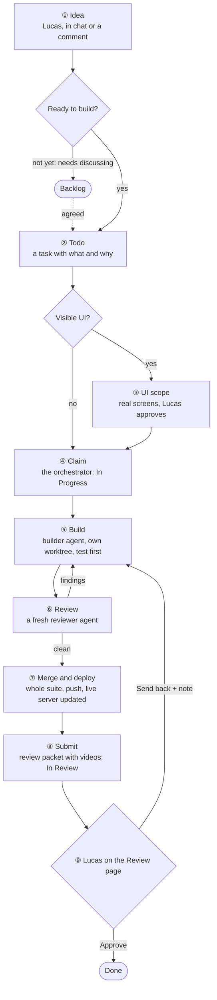
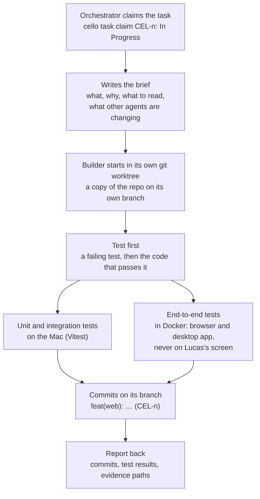
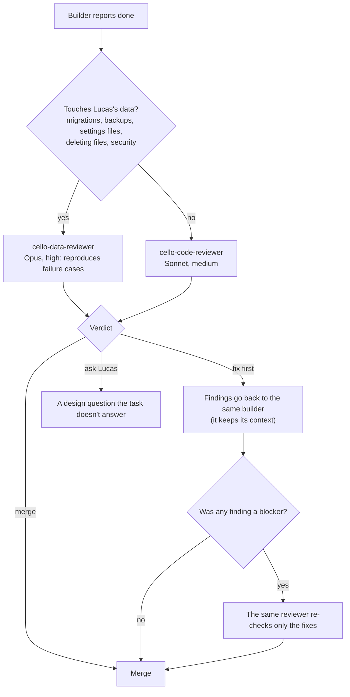
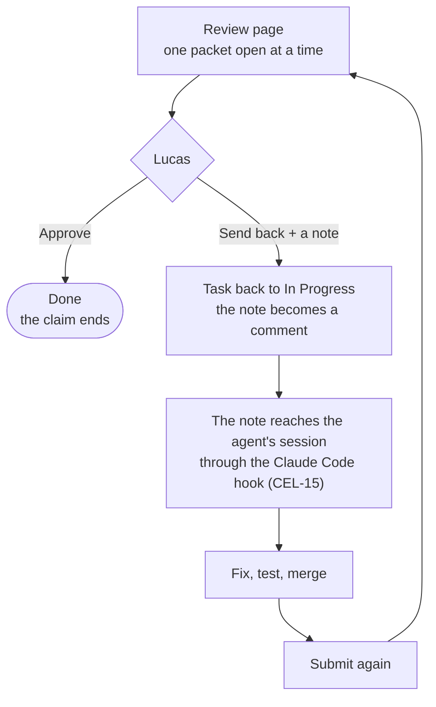

## The short version

Every feature goes through the same path. **Lucas says what he wants, agents build and review it, and Lucas decides on the Review page.** Nothing reaches him without tests and visual evidence, and nothing reaches main without a review.



## What each column means for your version

| Column | Where the code is | Can you try it? |
| --- | --- | --- |
| **Todo** | Nowhere yet | No |
| **In Progress** | In an agent's worktree: being built, reviewed or fixed | No |
| **In Review** | **Merged into main and live on your board** (server restarted with it) | **Yes**: reload Cello (⌘R) and follow the packet's "How to check" |
| **Done** | Same as In Review; you signed it off | Yes |

So anything in In Review or Done is already in the Cello you're running, once you've reloaded. Two parts update differently:

- **The board, the Review page, every screen** come from the server: a reload (⌘R) after a deploy shows them. CEL-37 makes the app say when a reload is needed, and shows the running build.
- **The desktop app's own shell** (its icon, the side panel's browser) only changes when the app is repackaged. That happens only for desktop changes, and the packet says so.

## Who does what

| Who | What they do | Model |
| --- | --- | --- |
| **Lucas** | Asks for features, approves UI scopes, approves or sends back on the Review page | |
| **The orchestrator** (the main Claude session) | Turns requests into tasks, writes briefs, starts agents, merges, deploys, submits packets | Opus 5.5 |
| **Builder** (`cello-builder`) | Writes the code and tests in its own git worktree, records the evidence | Opus 5.5, high |
| **Code reviewer** (`cello-code-reviewer`) | Reads the diff against the task and AGENTS.md, checks the videos | Sonnet 5.5, medium |
| **Data reviewer** (`cello-data-reviewer`) | The same, plus failure cases, for anything touching Lucas's data | Opus 5.5, high |

Models and effort are explained in *When to use which model and effort* (docs/models.md).

## ① Idea, and ② Todo or Backlog

Lucas says what he wants, in chat or as a comment on a card. The orchestrator turns it into a task with `cello task create`, says where it went, and doesn't start building until Lucas says so.

- **Todo:** agreed and ready to build. "Add a task" lands here.
- **Backlog:** an idea that still needs discussing ("add to the backlog", "brainstorm"). Nothing is built from Backlog; it moves to Todo once it's agreed.

The task's description holds what Lucas said, why, and what "done" looks like.

## ③ UI scope, for anything he'll see

For a visible change, the first step is a scope, not code: where it shows up and what it looks like, built as **real screens in the app** (rough sketches are labelled as mocks). It's published as a page and opened in Cello's side panel. Building starts only after Lucas approves it.

## ④ Claim, and ⑤ Build



Rules the builder follows (from AGENTS.md):

- **Its own worktree, its own branch.** It never pushes, never touches main, and never changes the live board. Several builders work at once without stepping on each other.
- **Never touches Lucas's data.** Tests use temp folders and their own ports, never `~/.cello` or port 4747.
- **Write it once.** A helper that exists already gets reused; a second copy moves to a shared module.
- **CLI changes update `docs/cli.md`** in the same commit, so agents never have to guess.

## ⑥ Review



- The reviewer gets the **diff and the task**, never the builder's report, so it judges the code rather than echoing the builder.
- For UI work it also checks the **videos and screenshots** frame by frame: does the evidence, on its own, show the task is done?
- This is where the expensive mistakes get caught. This week reviews found a settings write that could be cut short, a comment delivered three times, and a restore that failed silently.

## ⑦ Merge and deploy

The orchestrator merges the branch into main and checks everything together:

1. **The whole suite:** unit and integration tests, typecheck, the CLI-docs check, and the full Docker run (browser and desktop end-to-end).
2. **Push** to GitHub.
3. **Deploy to Lucas's board** when the server or web app changed: back up with `cello backup`, rebuild the `cello` binary, restart the server on 4747. A database migration runs at that restart, which is why the backup comes first.

## ⑧ Submit the review packet

```bash
cello task submit CEL-n --summary "…" --step "…" \
  --attach test-results/docker/latest/web/videos/<test>.mp4 --caption "…" \
  --attach shots/after-dark.png --caption "…"
```

The packet moves the task to **In Review**. It holds:

- **A summary:** what changed and why, what the review found and what was fixed, which models built and reviewed it.
- **Steps** Lucas can follow to check it himself.
- **Evidence:** videos recorded once, at the end, in review mode (each step held about 1.5 s, the cursor and clicks drawn), screenshots in light and dark, or a terminal transcript for CLI work. How they're made: *How evidence videos and screenshots are made*.

## ⑨ Lucas decides



Approve is sign-off, not a gate: the code is already merged and tested. It moves the task to Done.

## Where everything lives

| What | Where |
| --- | --- |
| The tasks, comments, review packets, pages | Lucas's board: `~/.cello`, served on port 4747. Agents use it only through the `cello` CLI. |
| Work in progress | Each builder's git worktree under `.claude/worktrees/` |
| End-to-end test runs, videos | Docker containers; results in `test-results/docker/latest` |
| Evidence after submit | Copied into `~/.cello/assets`, backed up daily (CEL-23) |
| The code | `main` on GitHub |
| The rules | AGENTS.md, `.claude/agents/`, `docs/cli.md`, `docs/models.md` |

## A real example: CEL-23, backups

- **Idea:** Lucas asked where review videos are kept; they lived only in `~/.cello`. He chose local backups.
- **Build:** a builder added daily backups, `cello backup` and `cello restore`, with 31 tests.
- **Review (data reviewer):** found a blocker. A failed restore printed nothing, even when Lucas's data was left in a recovery folder. Plus four should-fix items.
- **Fix and re-check:** clear error messages, safety backups that can't be pruned, tests that can't reach `~/.cello`. The re-check found five tests that failed in Docker (it runs as root); one more fix.
- **Merge:** 602 tests green on main, pushed.
- **Next:** deploy, then the packet on Lucas's Review page.
