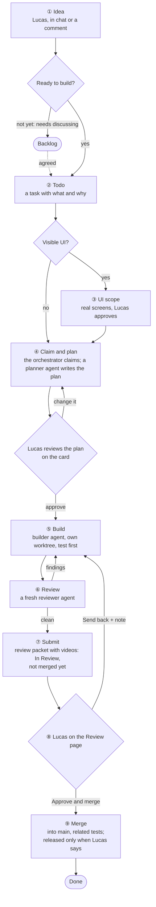
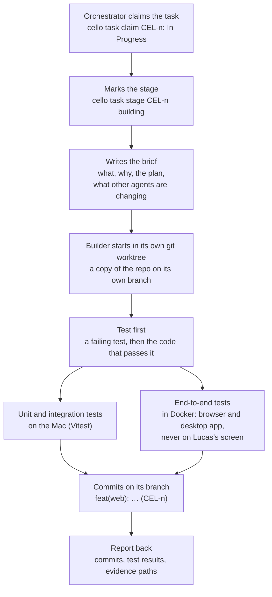
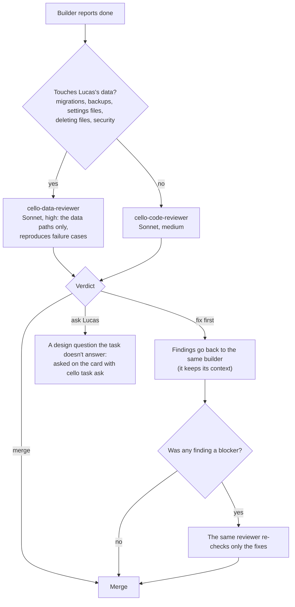
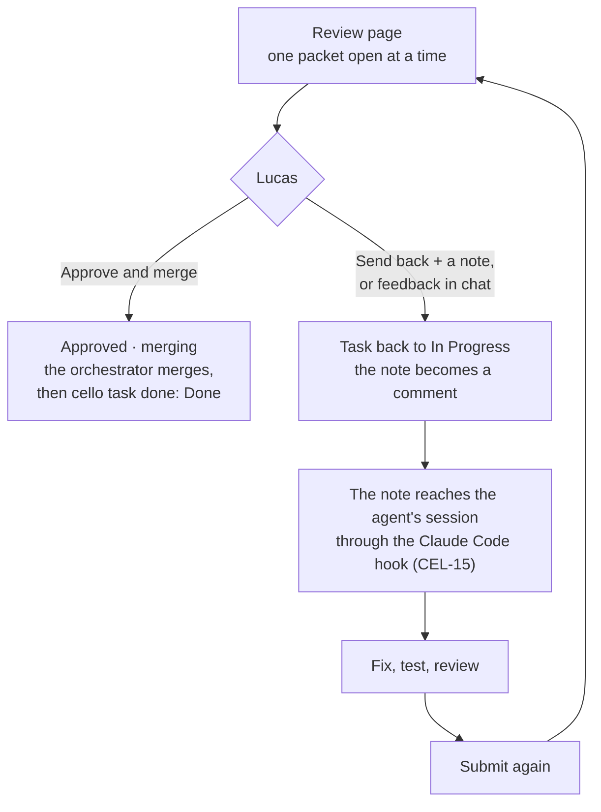
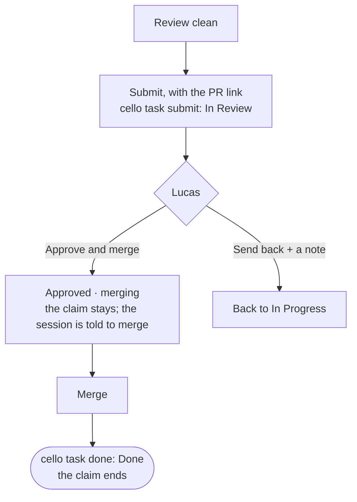

## The short version

Every feature goes through the same path. **Lucas says what he wants, agents build and review it, and Lucas decides on the Review page.** Nothing reaches him without tests and visual evidence, and nothing reaches main without a review.

**The steps are written down in [LIFECYCLE.md](../LIFECYCLE.md)** at the repo root, as instructions, in two workflows: `feature` (this page) and `small` (docs or a one-line fix, which skips the plan, the build agent and the review). `/cello:orchestrate` reads it first, picks a task's workflow and follows it (CEL-168). This page explains `feature` with diagrams. Change both together.



## What each column means for your version

| Column | Where the code is | Can you try it? |
| --- | --- | --- |
| **Todo** | Nowhere yet | No |
| **In Progress** | In an agent's worktree: being built, reviewed or fixed | No |
| **In Review** | **Still on the agent's branch**: Cello merges after you approve (below) | From the packet's videos and screenshots |
| **Approved · merging** | Being merged into main after your Approve | Not yet |
| **Done** | **Merged into main**, not released yet | **After the next release**: you say when (below) |

**Cello merges after you approve** (the project's Settings tab → "Merge after I approve", on since Nov 18; `cello context` prints it): agents submit before they merge, and your "Approve and merge" tells them to merge. **Releases happen only when you say so** (Nov 18): nothing goes live on your board until you ask for a release. Then everything merged since the last one goes out together. After that, two parts update differently:

- **The board, the Review page, every screen** come from the server. After a deploy, open tabs and the desktop app notice the new build when they reconnect: "Cello was updated · Reload", and they reload by themselves after 5 seconds unless you're typing (CEL-37). The sidebar's footer shows the build you're running ("Cello 0.2.0 · build c602f25 · live since 18:19"); a click lists what that build changed.
- **The desktop app's own shell** (its icon, the side panel's browser) only changes when the app is repackaged. That happens only for desktop changes, and the packet says so.

## Who does what

| Who | What they do | Model |
| --- | --- | --- |
| **Lucas** | Asks for features, approves UI scopes, approves or sends back on the Review page | |
| **The orchestrator** (the main Claude session) | Turns requests into tasks, writes briefs, starts agents, merges, submits packets, and releases when Lucas says | Opus 5.5 |
| **Planner** (`cello-planner`) | Reads the task and the code, writes the step-by-step plan, test first; never writes code | Opus 5.5, high |
| **Builder** (`cello-builder`) | Follows the plan: writes the code and tests in its own git worktree, records the evidence | Sonnet 5.5, high |
| **Code reviewer** (`cello-code-reviewer`) | Reads the diff against the task and AGENTS.md, and for UI work every video and screenshot | Sonnet 5.5, medium |
| **Data reviewer** (`cello-data-reviewer`) | Only the data paths (migrations, deletes, settings writes), reproducing failure cases | Sonnet 5.5, high |

Models and effort are explained in *When to use which model and effort* (docs/models.md).

## ① Idea, and ② Todo or Backlog

Lucas says what he wants, in chat or as a comment on a card. The orchestrator turns it into a task with `cello task create`, says where it went, and doesn't start building until Lucas says so.

- **Todo:** agreed and ready to build. "Add a task" lands here.
- **Backlog:** an idea that still needs discussing ("add to the backlog", "brainstorm"). Nothing is built from Backlog; it moves to Todo once it's agreed.

The task's description holds what Lucas said, why, and what "done" looks like.

## ③ UI scope, for anything he'll see

For a visible change, the first step is a scope, not code: where it shows up and what it looks like, built as **real screens in the app** (rough sketches are labelled as mocks). It's published as a page and opened in Cello's side panel, and the decisions are asked on the card (`cello task ask`). Building starts only after Lucas approves it.

Making the scope is work on the task, so the task is claimed (In Progress) while the scope is built. **Once the scope is published, its questions are asked on the card with `cello task ask`**, and the task waits in Needs input until Lucas picks: In Progress only ever means someone is working on it right now.

## ④ Claim and plan

The orchestrator claims the task, sets the stage to `planning` and starts a `cello-planner` agent. The planner reads the task, the rules and the code, and returns a plan: the goal in Lucas's words, what exists (`file:line`), ordered steps each with its failing test first, the files to touch and to stay out of, the risks (`risk: data` brings in the data reviewer), the checks and evidence to record, and open questions.

- The orchestrator publishes the plan on the task as a spec (`cello doc publish plan.md --task CEL-n --kind spec`), so Lucas can read it.
- **Lucas reviews the plan before any code** (Nov 18). The orchestrator asks on the card with `cello task ask`: "Approve the plan?" (Approve / Change it, with notes), plus the plan's open questions, with the plan page linked. The task waits in Needs input.
- **Change it:** his notes go back to the same planner, which revises the plan; the orchestrator publishes the new version and asks again.
- **Approve:** only then does a builder start. The builder's brief and the reviewer's both get the approved plan.

## ⑤ Build



**The stage shows where the task is inside In Progress.** In Progress holds a task from the claim to the packet, so on its own it can't tell building from waiting for review. The orchestrator says which step it's on, and the card shows it as a word (Planning, Building, Agent review, Fixing findings, Merged), or as lanes when Lucas turns on Display → "Group In Progress by stage":

| When | The orchestrator runs |
| --- | --- |
| It starts the planner | `cello task stage CEL-n planning` |
| It starts the builder | `cello task stage CEL-n building` |
| It starts the reviewer | `cello task stage CEL-n review` |
| Findings go back to the builder | `cello task stage CEL-n fixing` |
| The branch is merged, before the packet | `cello task stage CEL-n merged` |

Submitting the packet (or moving the task out of In Progress) clears it. Builders and reviewers never run it: they don't hold the claim.

Rules the builder follows (from AGENTS.md and LIFECYCLE.md):

- **Its own worktree, its own branch.** It never pushes, never touches main, and never changes the live board. Several builders work at once without stepping on each other.
- **Never touches Lucas's data.** Tests use temp folders and their own ports, never `~/.cello` or port 4747.
- **Write it once.** A helper that exists already gets reused; a second copy moves to a shared module.
- **CLI changes update `docs/cli.md`** in the same commit, so agents never have to guess.

## ⑥ Review



- The reviewer gets the **diff and the task**, never the builder's report, so it judges the code rather than echoing the builder.
- For UI work it also checks the **videos and screenshots** frame by frame: does the evidence, on its own, show the task is done?
- This is where the expensive mistakes get caught. This week reviews found a settings write that could be cut short, a comment delivered three times, and a restore that failed silently.

## ⑦ Submit the review packet

```bash
cello task submit CEL-n --summary "…" --step "…" \
  --attach test-results/docker/latest/web/videos/<test>.mp4 --caption "…" \
  --attach shots/after-dark.png --caption "…"
```

The packet moves the task to **In Review**. It holds:

- **A summary:** what changed and why, what the review found and what was fixed, which models built and reviewed it.
- **Steps** Lucas can follow to check it himself.
- **Evidence:** videos recorded once, at the end, in review mode (each step held about 1.5 s, the cursor and clicks drawn), screenshots in light and dark, or a terminal transcript for CLI work. How they're made: *How evidence videos and screenshots are made*.

## ⑧ Lucas decides



**Feedback in chat works the same as Send back.** If Lucas reviews a task in the conversation instead of on the Review page, the orchestrator puts his words on the card as a comment ("Lucas, in chat (review): …"), moves the task back to In Progress, and the fix goes through build, review and a new packet like any Send back.

**Approve is the gate:** nothing reaches main before it. Each project chooses (the project's Settings tab → "Merge after I approve", CEL-143), and Cello's own has it on. The packet comes before the merge, with the PR link when the project uses PRs, and Approve is the gate: the button reads "Approve and merge", the card stays in In Review as **Approved · merging**, and the orchestrator's session is told to merge. It merges, then `cello task done CEL-n` moves the task to Done. With the setting off (some other projects), the order is reversed: the orchestrator merges before it submits, and Approve only moves the task to Done.



## ⑨ Merge, after Lucas approves

His "Approve and merge" reaches the orchestrator's session (the card shows **Approved · merging**). Only then the orchestrator merges the branch into main (`cello task stage CEL-n merged`) with a `merge: <what> (CEL-n)` subject (that's the task's line in the changelog), and runs **the related e2e specs** only (AGENTS.md, "Pick the e2e specs"). The full Docker run (`bun run test:docker`) only before a minor or major release, when the change touches what every screen shares, or when Lucas asks. Then `cello task done CEL-n` moves the task to Done and ends the claim. A merge that fails: stage `fixing` and a comment on the card. **No release.**

### Releasing, only when Lucas says

Lucas decides when a release goes out (Nov 18: "We only release when I say so"). It ships everything merged since the last one. **Every deploy is a release** (CEL-36): nobody rebuilds or restarts the live board by hand.

**`bun run release`**, on main in the main checkout. One command, in order:
- refuses unless it's on main with a clean tree
- runs the typecheck and the unit and integration tests (the CLI-docs check is one of them)
- bumps the version (patch; `-- minor` or `-- major` when Lucas says) and writes the CHANGELOG.md section from main's merges and commits since the last tag
- commits `chore(release): vX.Y.Z` and tags it
- builds this Mac's own `cello` binary (into `release/stage`, not over the live one), for the deploy
- pushes main and the tag to GitHub, which starts the **Release workflow on GitHub Actions**: it builds the `cello` zip and Cello.app (DMG and zip) for Apple silicon and Intel, then creates the GitHub release with the changelog as notes and every file attached. The release prints the run's link
- **deploys to Lucas's board:** `cello backup`, then the new `cello` goes live, then `cello service restart`. A database migration runs at that restart, which is why the backup comes first.

`bun run release -- --dry-run` previews all of it without changing anything. The steps, the flags, what to do when a step fails and how to roll back: [Releases](releases.md).

## Where everything lives

| What | Where |
| --- | --- |
| The tasks, comments, review packets, pages | Lucas's board: `~/.cello`, served on port 4747. Agents use it only through the `cello` CLI. |
| Work in progress | Each builder's git worktree under `.claude/worktrees/` |
| End-to-end test runs, videos | Docker containers; results in `test-results/docker/latest` |
| Evidence after submit | Copied into `~/.cello/assets`, backed up daily (CEL-23) |
| The code | `main` on GitHub |
| The rules | AGENTS.md, LIFECYCLE.md (the steps), `.claude/agents/`, `docs/cli.md`, `docs/models.md` |

## A real example: CEL-23, backups

- **Idea:** Lucas asked where review videos are kept; they lived only in `~/.cello`. He chose local backups.
- **Build:** a builder added daily backups, `cello backup` and `cello restore`, with 31 tests.
- **Review (data reviewer):** found a blocker. A failed restore printed nothing, even when Lucas's data was left in a recovery folder. Plus four should-fix items.
- **Fix and re-check:** clear error messages, safety backups that can't be pruned, tests that can't reach `~/.cello`. The re-check found five tests that failed in Docker (it runs as root); one more fix.
- **Merge:** 602 tests green on main, pushed.
- **Next:** deploy, then the packet on Lucas's Review page.
