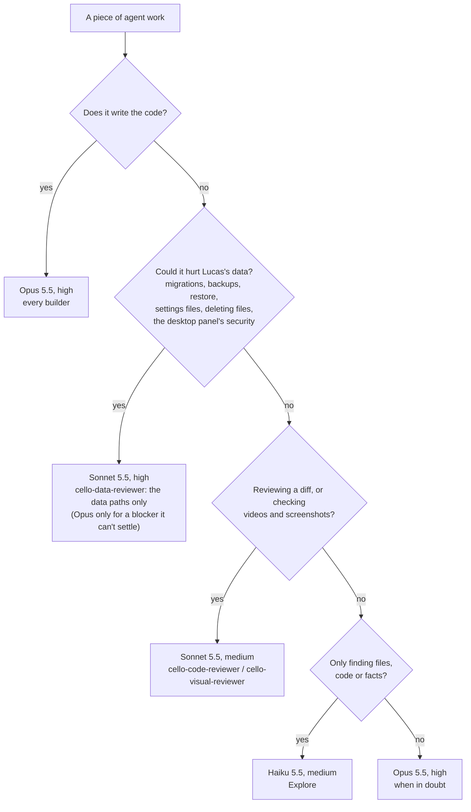

## The short version

Two dials decide what an agent costs and how well it works:

- **The model:** which Claude does the work. A bigger model is better at hard, judgment-heavy work, and costs more per token.
- **The effort:** how long it thinks before and between actions. Higher effort means more careful work and more tokens, on the same model.

In Cello every agent has both pinned in its definition (`.claude/agents/*.md`), so nobody has to remember them:

| Agent | Model | Effort | In one line |
| --- | --- | --- | --- |
| `cello-builder` (every build) | Opus 5.5 | high | Writes the code, so quality comes first |
| `cello-data-reviewer` | Sonnet 5.5 | high | Only the risky part (migrations, deletes, settings writes): it reproduces failure cases; Opus takes a second look only at a blocker it can't settle |
| `cello-code-reviewer` | Sonnet 5.5 | medium | Checks a diff against the task and the rules |
| `cello-visual-reviewer` | Sonnet 5.5 | medium | Checks videos and screenshots against the task |
| Search and exploration (`Explore`) | Haiku 5.5 | medium | Finds files and code, fast and cheap |
| Fable 5.2 | only when Lucas asks | | For the hardest open-ended problems |

**Effort is never below medium.** Lucas decided this on Nov 15: low effort saves little on short jobs and risks sloppy work.

**Data reviews moved from Opus to Sonnet (Nov 15).** Lucas asked for leaner reviews. The data reviewer now checks only the risky part of a branch and reproduces its failure cases, which is terminal work where Sonnet is as strong as Opus at half the price. Opus is asked only for a second opinion on a blocker Sonnet can't settle.

## Which model for which work

## The four models

| | Haiku 5.5 | Sonnet 5.5 | Opus 5.5 | Fable 5.2 |
| --- | --- | --- | --- | --- |
| What Anthropic says it's for | Lookups, sub-agent search, summaries, classification. Not complex coding. | Well-scoped everyday tasks, fixing bugs, fast iteration | Complex work that needs careful judgment, long migrations and audits; "our strongest daily driver" | The most ambitious, open-ended technical work; can act as an advisor or orchestrator |
| Terminal-Bench 4.0 (agentic coding in a terminal) | 39.2% | 70.6% | 66.4% (at xhigh) | not reported |
| FrontierCode v1.1 (hard coding) | | 46.2% (at max) | 54.4% (54.6% even at medium) | 49.1% vs Opus 45.5% on the newer FrontierCode 2.0 |
| Price per 1M tokens, in / out | $0.10 / $0.50 | $2 / $10 | $4 / $20 | $8 / $40 |
| Default effort | medium | medium in Claude Code | medium | start at high |

What the numbers mean for Cello:

- **Sonnet 5.5 is as good as Opus 5.5 at well-specified terminal work,** for half the price. That makes it the right reviewer: a review is a well-specified job (this diff, this task, these rules).
- **Opus 5.5 leads on hard, judgment-heavy work.** The subtle bugs found this week were all of that kind: a comment delivered three times, a settings file that could be cut short, a restore that failed silently. Builders write that kind of code, so they run Opus.
- **Haiku 5.5 is 40 times cheaper than Opus per token** and built for sub-agent lookups. It's not for writing code.
- **Fable 5.2 costs twice as much as Opus.** Anthropic itself recommends Opus 5.5 for most work and Fable only when the scope calls for it.

## Effort levels

| Effort | What it does | When to use it in Cello |
| --- | --- | --- |
| low | Fewest tokens, terse, fewer tool calls | Never (Lucas's rule) |
| medium | The default for Opus, Sonnet and Haiku in Claude Code | Reviews, visual checks, search |
| high | Thinks longer before and between steps | Every build, and data-risk reviews |
| xhigh | Longer still; the best setting for long agentic coding runs on some models | A build that keeps failing review at high, or a large refactor |
| max | The ceiling: maximum thinking, maximum tokens | Only when Lucas asks, for a problem where correctness matters more than cost |

Two things to know:

- **On the newest models, lower effort often matches older models at high.** Opus 5.5 scored the same on FrontierCode at medium as at max. Higher effort pays off on hard, long tasks, not on routine ones.
- **Effort barely changes how long the answer is.** Length comes from the prompt and the brief, not the effort.

## When to move up or down

Judge by **cost per finished task**, not cost per call. A cheap agent that needs an extra fix round isn't cheap.

Move **up** (Sonnet to Opus, or high to xhigh) when:

- a reviewer finds a blocker the builder should have seen
- a task needs a second fix round
- the work touches data, security, concurrency or the sync engine

Move **down** (Opus to Sonnet for a review, or skip a separate visual review) when:

- the change is small and well-specified, with tests that prove it
- reviews of that kind of change keep coming back clean

Each review packet says which models built and reviewed the work, so these patterns show up on the board.

## How it's set

- **Agent definitions:** `model:` and `effort:` in the frontmatter of `.claude/agents/cello-builder.md`, `cello-code-reviewer.md`, `cello-data-reviewer.md` and `cello-visual-reviewer.md`. Claude Code reads these when a session starts.
- **When starting an agent another way** (a general-purpose agent, or `Explore`), the orchestrator passes the same model and effort.
- **AGENTS.md** has the table under "How a task flows". This page explains it; change both together.

## Sources

- [Claude Sonnet 5.5](https://www.anthropic.com/news/claude-sonnet-5-5) (Anthropic)
- [Claude Opus 5.5](https://www.anthropic.com/news/claude-opus-5-5) (Anthropic)
- [Claude Haiku 5.5](https://www.anthropic.com/news/claude-haiku-5-5) (Anthropic)
- [Claude Fable and Mythos 5.2](https://www.anthropic.com/news/claude-fable-and-mythos-5-2) (Anthropic)

The benchmark numbers are Anthropic's own, from those pages (checked Nov 15, 2026). Third-party trackers disagree even on which Terminal-Bench version they report, so they're left out.
