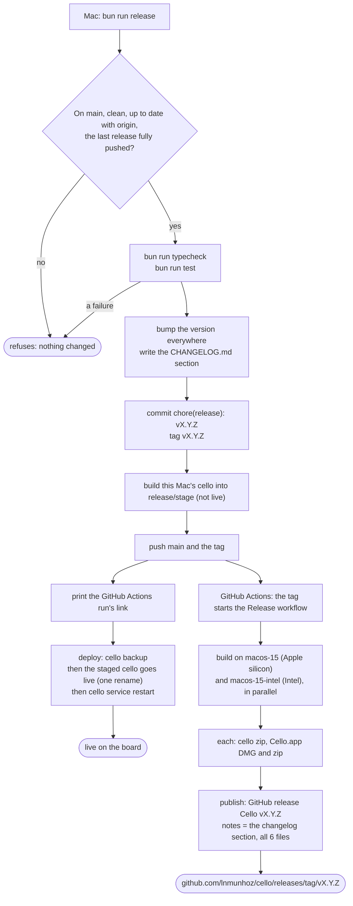
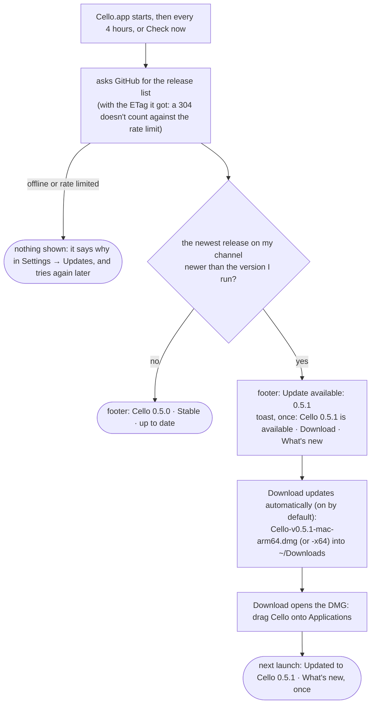

## Every deploy is a release

Cello ships **only when the human says so** (Nov 18). Merging a task doesn't release it (step ⑦ in [How a feature is built](feature-lifecycle.md)); a release ships everything merged since the last one. It's one command, run on `main` in the main checkout:

```bash
bun run release                 # picks the version from what ships: minor with any feature, else patch
bun run release -- patch        # or minor: override what it picked
bun run release -- major        # 0.4.0 -> 1.0.0, when the human says so
bun run release -- --dry-run    # preview everything; writes, pushes and deploys nothing
```

**The version follows the commits** (CEL-174; the human: "if there is any feat we should bump the minor"). With no version given, the release reads the changelog section it's about to write: any line under Features (a merged task whose branch has a `feat` commit, or a direct `feat:` commit) makes it a **minor**; only Fixes and Other changes make it a **patch**. The first release is always minor. Its first line says what it picked and why: `Cello release: 0.4.17 -> 0.5.0 (minor: it ships 1 feature)`. A version you name wins.

It uses [release-it](https://github.com/release-it/release-it) (pinned in the root package.json, configured in `.release-it.json`); the steps that are ours are small TypeScript modules with tests in `scripts/release/`.

## What runs where

The release is split between two machines (CEL-139):

- **This Mac** cuts the release and updates the board: checks, version, changelog, commit, tag, push, and its **own** `cello` (one `bun build`, about 20 s), deployed right away. The board never waits for GitHub.
- **GitHub Actions** builds what other people download, once the tag arrives: the `cello` zip and Cello.app (a DMG and a zip) for **Apple silicon and Intel**, each on a Mac runner of its own kind, then the GitHub release. The workflow is `.github/workflows/release.yml`.



## Two flavors: Cello and Cello Dev

Every build of Cello is one of two flavors, set when it's built (`--flavor release|dev`, CEL-149), so the Cello
people download and the one built from this repo live side by side on the human's Mac:

| | **Cello** (`release`) | **Cello Dev** (`dev`) |
| --- | --- | --- |
| Who builds it | GitHub Actions: the release's downloads | this Mac: `bun run release`'s `cello`, `bun run package` in apps/desktop |
| The app | `Cello.app`, `app.cello.desktop` | `Cello Dev.app`, `app.cello.desktop.dev`, a DEV badge on the icon |
| Links `cello` prints and the app opens | `cello://` | `cello-dev://` |
| Updates | the app checks GitHub (below) | none: `bun run release` deploys its `cello` (and so its board); `bun run package -- --install` its app |
| Its board | Settings → Board in the app: ~/.cello on 4747 until pointed elsewhere | ~/.cello on 4747, the live board |

- **Defaults:** a build on the Mac is dev unless it says otherwise (`apps/cli`'s `bun run build`, `bun run package`,
  `--install`); `--artifacts` packages the release. `scripts/release/artifacts.ts` passes the flavor explicitly
  either way: `--flavor dev` for the `cello` the Mac deploys (`release/stage/cello`), `--flavor release` for the
  downloads (`release/download/cello`, zipped and bundled into Cello.app). The workflow then checks the DMG's
  app is `app.cello.desktop` with the `cello` scheme.
- **Trying the download on this Mac:** install Cello.app from the release's DMG, open Settings → Board, and point it
  at a test board once (`~/.cello-release` on 4757). It starts its own server there with the `cello` inside it,
  empty like a new user's board. Until then it joins whatever answers on 4747, your live board.
- **An older Cello can't open a newer board.** A server refuses a database with a migration it doesn't know, before
  it writes anything: "This board (…) was opened by a newer Cello (migration 0028_x); this cello is v0.4.2. Update
  Cello, or use another board. Nothing was changed." The app shows it in its window with Try Again, Use Another
  Board… and Quit.
- **Once, on the human's Mac:** `bun run package -- --install` in apps/desktop installs `/Applications/Cello Dev.app` (it refuses `--install` for the release flavor, so it can never replace the downloaded Cello.app).
  The `/Applications/Cello.app` an earlier local install left (v0.1.0) stays; nothing deletes an app. Drag it to
  the Trash, then install the downloaded Cello.app from a release's DMG if you want it.

## What one release does on the Mac, in order

1. **Refuses** unless all of these hold (a dry run lists the ones that fail as "a real release would refuse"):
   - it's on `main`, with no uncommitted changes to tracked files (untracked files never reach the release commit)
   - `main` isn't behind `origin/main` (it fetches first)
   - the last release was fully pushed: the latest tag is on origin, and HEAD isn't an unpushed `chore(release)` commit. Otherwise an earlier release stopped halfway, and it prints the `git tag -d` / `git reset --hard HEAD~1` that undo it
   - the root package.json's version matches the latest tag (nobody bumped it by hand)
   - the first release (no tag yet) is `minor` or an exact version, never a patch: 0.2.0 must become 0.3.0, not 0.2.1
   - when it will deploy: the `cello` on your PATH is this checkout's `apps/cli/dist/cello`
2. **Checks:** `bun run typecheck`, then `bun run test`. A failure stops it before anything is written.
3. **Bumps** the version everywhere it lives (`scripts/release/version.ts`). The root `package.json` is the one source of truth; the release writes the same version to `APP_VERSION` in `packages/release/src/version.ts` (what `cello --version`, the sidebar footer and backup manifests report) and to every workspace `package.json` that has a `version` (today `apps/desktop`, which electron-builder stamps into Cello.app), to the Claude Code plugin's `apps/cli/claude-plugin/cello/.claude-plugin/plugin.json` (then it regenerates the copy the binary embeds with `bun run docs:cli`), and to `bun.lock`'s record of the workspace versions. A unit test fails if they ever disagree.
4. **Writes the changelog** section at the top of `CHANGELOG.md` (below).
5. **Commits** `chore(release): vX.Y.Z` and **tags** `vX.Y.Z` (annotated).
6. **Builds its own `cello`** (the web build inside it runs Vite under Bun, so the shell's Node version doesn't matter, CEL-175) into `release/stage/cello` (`bun run build --outfile … --target bun-darwin-arm64 --flavor dev` in `apps/cli`: Cello Dev's `cello`, whose links are `cello-dev://`). It builds after the tag, so the binary embeds the release commit and the new version. If the build fails, it deletes `release/stage`, so a half-built binary can't be deployed. **It never builds over `apps/cli/dist/cello`**: that's the live cello (`~/.local/bin/cello` and the background service run it), and only the deploy replaces it, after its backup.
7. **Pushes** `main` and the tag together (`git push --atomic`), only once the build worked: a failed build leaves the commit and tag local, easy to undo.
8. **Prints the GitHub Actions run** the tag started (`gh run list --workflow release.yml --branch vX.Y.Z`), or the workflow's page when GitHub doesn't list the run yet, and the release page the downloads will be on.
9. **Deploys**, in this order. First it checks, before touching anything, that the staged build is this release's: `release/stage/cello` exists and is executable, its `--version` says package.json's version and HEAD's commit, and `vX.Y.Z` is on origin. A leftover from an undone release, or a build cut short by a full disk, is refused. Then `cello backup` (the old cello, against the running server), then the staged build goes live with one rename of `release/stage/cello` onto `apps/cli/dist/cello` (same filesystem, so that path holds the old build or the new one, never a half-written file), then `cello service restart`. The service runs the new build, and a migration runs at that restart, after the backup. If the backup fails, nothing goes live and nothing restarts.

### After the deploy: reload open boards

Board windows that were open during the deploy (the browser, the desktop app) still run the old web app. The ReloadBar sees the new build: an idle tab reloads by itself after a short notice, and a tab with something being edited shows the bar until it's clicked. Reload any window that still shows the bar, so no old board reads data only the new build knows (CEL-143's `approved` items and wake reasons broke older boards and `cello` binaries before this build learned to skip values it doesn't know).

## What GitHub Actions does

The Release workflow (`.github/workflows/release.yml`) starts when a `vX.Y.Z` tag is pushed:

1. **Build**, two jobs in parallel, one per Mac architecture, each on a runner of that kind: `macos-15` (Apple silicon) and `macos-15-intel` (Intel; GitHub's last Intel Mac image, supported until August 2027). Each checks out the tag, refuses when the tag and package.json's version disagree, selects the newest Xcode 26 on the runner (the app icon, `apps/desktop/resources/Cello.icon`, is an Icon Composer icon only Xcode 26's `actool` compiles; the macOS 15 images default to Xcode 16.4 but also ship 26.x, and the log prints `xcodebuild -version` and the `actool` version), installs Bun 1.4.4 and the dependencies (`bun install --frozen-lockfile`, with Bun's and Electron's downloads cached), then runs **`bun scripts/release/hooks.ts artifacts <version>`**, the same code `--local-artifacts` runs on the Mac:
   - `cello`, the release flavor (`--flavor release`, `cello://` links) built for the runner's architecture (`--target bun-darwin-arm64` or `bun-darwin-x64`) into `release/download/cello`, zipped as `cello-vX.Y.Z-darwin-<arch>.zip`
   - Cello.app packaged with that same binary (`bun run package --cli … --arch <arch> --artifacts --flavor release`) as `Cello-vX.Y.Z-mac-<arch>.dmg` (drag it to Applications) and `Cello-vX.Y.Z-mac-<arch>.zip` (what the app's own updates will use, CEL-140)
   - `codesign --verify --deep --strict` on the packaged app, then again on the copy inside the DMG: a broken seal (a file changed after signing) is what macOS calls "damaged" on a downloaded copy, so it fails the build instead

   The three files are kept on the run's page for 14 days.
2. **Publish**, once both builds passed: creates the GitHub release `Cello vX.Y.Z` on the tag, its notes the version's CHANGELOG.md section (`bun scripts/release/publish.ts`), with all six files. If the release already exists (say `--local-artifacts` made it first), it updates it instead: same-named files are replaced, the others added.

A release takes about 10 to 15 minutes on GitHub; the Mac doesn't wait for it.

### Checking a release's run

- the link `bun run release` printed, or `gh run list --workflow release.yml --limit 3`, then `gh run watch <id>`
- once it's green, `gh release view vX.Y.Z --json assets --jq '.assets[].name'` lists six files: the `cello` zip, the DMG and the app zip, for `arm64` and for `x64`
- a red build job: open its log. "Re-run failed jobs" redoes only the one that failed, and publishing waits for it

### Running it by hand: build only, or publish again

Actions → **Release** → **Run workflow**, or with gh:

```bash
gh workflow run release.yml -f tag=v0.4.0 -f ref=main     # build main, build only: test the workflow and build scripts
gh workflow run release.yml -f tag=v0.5.0                 # build the v0.5.0 tag, build only: nothing is published
gh workflow run release.yml -f tag=v0.5.0 -f publish=true # build the tag, then create or update the v0.5.0 release
```

The tag must exist. **Build only** is how to try the workflow without releasing anything: the files land on the run's page.

- **`ref`** (a branch, `main`, or a commit) builds that instead of the tag, with its own copy of the workflow's scripts, and names the files after its package.json's version. Use it to test a change to the workflow or the build scripts: a tag builds with the scripts it was cut with, so an old tag can't test new ones (v0.4.0's own `hooks.ts` refuses to package Cello.app on Intel, for one). The tag-and-version check only applies when building the tag itself. A run with `ref` never publishes: turning publish on with it fails at once.
- **No `ref`** builds the tag itself, as a tag push does; `publish=true` then (re)publishes that release.

Pull requests that change the build scripts (the workflow, `scripts/release/artifacts.ts`, `hooks.ts`, `publish.ts`, `apps/cli/scripts/build.ts`, `apps/desktop/scripts/`, `electron-builder.json`) run the build jobs too, on the pull request's own commit, and never publish.

### Signing and notarizing Cello.app

Today Cello.app is **signed ad hoc** (`"identity": "-"` in `apps/desktop/electron-builder.json`): sealed, every helper and `Resources/cello` included, but with no developer named and not notarized. What someone who downloads it sees, on the **first launch only**:

1. Opening it, macOS says it "can't verify the developer" (or that Apple "could not verify Cello is free of malware") and offers only Done or Move to Trash. Click Done.
2. **System Settings → Privacy & Security**, scroll to Security: "Cello was blocked…" → **Open Anyway**, then confirm with Touch ID or the password.
3. From then on it opens normally.

If macOS says the app "is damaged" instead (it shouldn't, since the build checks the seal), the fallback is to clear the quarantine flag once: `xattr -dr com.apple.quarantine /Applications/Cello.app`. Apps built on this Mac and never downloaded aren't affected by any of this.

The downside of ad hoc: its identity is the build's own hash, so it changes with every release. macOS ties permissions it asked about (folders, notifications, automation) to that identity, so after installing an update those prompts may come back once. One-click updates (CEL-140) need a real Developer ID: macOS only installs an update over an app signed by the same developer.

Developer ID signing turns on by itself once the repository has these **five secrets** (Settings → Secrets and variables → Actions), which need an Apple Developer account:

| Secret | What it is |
| --- | --- |
| `CSC_LINK` | the "Developer ID Application" certificate with its private key, exported as a `.p12` and base64-encoded |
| `CSC_KEY_PASSWORD` | the password of that `.p12` |
| `APPLE_API_KEY` | the contents of an App Store Connect API key (`AuthKey_XXXX.p8`), for notarizing |
| `APPLE_API_KEY_ID` | that key's ID |
| `APPLE_API_ISSUER` | its issuer ID |

With all five, each build job signs Cello.app with the Developer ID and the hardened runtime (`apps/desktop/resources/entitlements.mac.plist` gives Electron and the bundled Bun binary the JIT they need) and notarizes it through electron-builder, so it opens with no warning. With none, it's signed ad hoc, as above. With only some, the build fails instead of quietly shipping the wrong thing. Pull requests never get them. The standalone `cello` zip isn't signed either way (Terminal downloads with curl aren't quarantined; a browser download needs the `xattr` line above, on `cello`).

**Before the first signed release is trusted**, prove it with a build-only run of main once the secrets are set: `gh workflow run release.yml -f tag=<the latest tag> -f ref=main` (publish off). Check that both build jobs log "Signing Cello.app with the certificate in CSC_LINK, and notarizing it", that notarization succeeded, and that the DMG check shows `Authority=Developer ID Application: …` and a `TeamIdentifier`. Then download a DMG from the run's page on a Mac and open it: no prompt at all. Only after that does the next `bun run release` ship signed builds. Signing and notarization have never run in this workflow until then, and the entitlements may need adjusting.

## The changelog

`CHANGELOG.md` holds one section per release, newest first, written from **main's own history** since the previous tag (`git log --first-parent`):

- A task lands on main as one `merge: <what> (CEL-n)` commit, so it's **one line**, not one per commit on its branch. The merge is filed by what its branch brought: any `feat` makes it a **Feature**, otherwise any `fix` makes it a **Fix**, otherwise it's an **Other change**.
- Commits made straight on main are filed by their type: `feat` under Features, `fix` under Fixes, everything else (docs, test, chore, ci, build, art…) under Other changes. A scope shows in bold (`**web:** …`).
- Release commits and merges of main into a branch are left out. Subjects keep their own words and CEL keys; each line links its commit on GitHub, and the heading links the compare view from the previous tag.
- The first release, v0.3.0 (`bun run release -- minor`, from 0.2.0), covers the whole history since the first commit (Nov 14): it's only days old, so there's nothing to cut off. Builds before it said 0.1.0 (the desktop app) or 0.2.0 (the CLI) and weren't tagged.

Write subjects for the reader of the changelog: the merge subject is the line the human reads. The GitHub release's notes are the same section, read back from CHANGELOG.md at the tag.

## Previewing: the dry run

`bun run release -- --dry-run` (add `minor` or `major` to preview those) does everything that doesn't change anything:

- prints the version change and every step, marking the ones it skips
- runs `git fetch --tags origin`: the one thing it changes, your remote-tracking refs and any tags origin has, so it can tell whether main is up to date. Then it says what a real release would refuse (another branch, uncommitted changes, behind origin, a live cello that isn't this checkout's), but carries on so you can see the rest
- **runs** the typecheck and the tests
- prints the CHANGELOG.md section the release would add, and release-it's own preview: the commands and hooks it would run

Apart from that fetch, it writes, commits, tags, pushes, releases and deploys nothing, and doesn't build. To try the GitHub side without releasing, run the workflow by hand on main in build-only mode (`gh workflow run release.yml -f tag=v0.4.0 -f ref=main`, above).

## Flags

| Flag | What it does |
| --- | --- |
| `patch` / `minor` / `major` / `1.2.3` | The new version. Without one, the release picks minor when any feature ships, else patch (above); give one to override it. Major only when the human asks. |
| `prepatch` / `preminor` / `premajor` / `prerelease`, `--preid <id>` | A preview release (`0.6.0-beta.1`), published as a GitHub prerelease for the app's Preview channel; see [Preview releases](#preview-releases). Only when the human asks. |
| `--dry-run`, `-d` | The preview above. |
| `--no-deploy` | Release (tag, push; GitHub Actions still builds and publishes) but leave the live board alone: no backup, `apps/cli/dist/cello` untouched, no restart. The build waits in `release/stage/cello`; `bun scripts/release/deploy.ts` deploys it later (backup, rename, restart). Tests and builder agents never deploy. |
| `--local-artifacts` | For when GitHub Actions is down or broken: this Mac builds the downloads itself (the `cello` zip, Cello.app's DMG and zip, Apple silicon only, the release flavor; the `cello` it deploys stays Cello Dev's) into `release/` and creates the GitHub release with them (`bun scripts/release/publish.ts`, with gh, which must be logged in; gh uses a `GH_TOKEN` or `GITHUB_TOKEN` in the environment first, when one is set, before its own login, so unset a stale one). The tag still starts the workflow; if it runs later, it adds the Intel files and replaces the Apple silicon ones with its own. |
| `--skip-desktop` | Only with `--local-artifacts`: leave Cello.app out, when packaging it can't work on this machine (electron-builder's error is printed). The `cello` zip is still attached. |

## When a release fails

When release-it fails, `bun run release` looks at how far it got (the release commit, the tag here and on GitHub, edited files) and prints exactly what to undo or finish. When it can't tell (git or the network failed), it says so and gives both ways, never "nothing was pushed". release-it's own rollback is off (`requireCleanWorkingDir: false` in `.release-it.json`; the clean-tree check is ours): it runs on process exit and would reset main and delete the tag even after they were pushed. Whatever fails before the deploy, the live `cello` and server are untouched: the new build only ever sits in `release/stage`.

- **Refused, or the typecheck or tests failed:** nothing changed. Fix it and run it again.
- **Stopped after the bump, before the commit:** `git checkout -- <the files it names>` drops the version and changelog edits.
- **Stopped after the commit and tag, before the push** (the build failed, or the push was rejected): nothing reached GitHub. `git tag -d vX.Y.Z && git reset --hard HEAD~1 && rm -rf release`, then fix it and release again. The next release refuses until this is undone, and the deploy refuses a staged build that isn't a pushed release's. With `--local-artifacts`, when packaging Cello.app was what failed, the advice also offers `--skip-desktop`.
- **Stopped after the push:** the tag is on GitHub, so don't undo it. GitHub Actions builds and publishes the release by itself; finish the deploy with `bun scripts/release/deploy.ts`. With `--local-artifacts` (the GitHub release from the Mac failed), first `bun scripts/release/publish.ts X.Y.Z`, which attaches every zip and DMG in `release/`.
- **The GitHub Actions run failed:** the release is cut and the board runs it; only the downloads are missing. Read the failed job's log, fix the cause on main, and check the fix with a build-only run of main (`gh workflow run release.yml -f tag=vX.Y.Z -f ref=main`). A failure that came and went (a flaky download) is fixed by rebuilding the tag's files: `gh workflow run release.yml -f tag=vX.Y.Z -f publish=true`, which builds with the tag's own copy of the scripts. A fix to the workflow or the scripts can't reach a tag that's already cut: it ships with the next release, whose tag the workflow builds and publishes. If GitHub is down, `bun scripts/release/hooks.ts artifacts X.Y.Z` on the Mac at that tag, then `bun scripts/release/publish.ts X.Y.Z`.
- **The deploy failed:** the release is out. If the backup failed, nothing went live: fix it and run `bun scripts/release/deploy.ts`. If the restart failed, the new cello is in place: `cello service status` says why, then `cello service restart`.

## Rolling back

To go back to an earlier release, say v0.3.0 after v0.3.1 misbehaved:

1. **Put the old binary back.** Either download `cello-v0.3.0-darwin-arm64.zip` from the GitHub release and unzip it over `apps/cli/dist/cello` in the main checkout (the service and `~/.local/bin/cello` run that file), or rebuild it: `git checkout v0.3.0 && (cd apps/cli && bun run build) && git checkout main`.
2. **If the bad release ran a migration, or wrote data the old build doesn't know, restore the backup; don't just swap the binary back.** The old binary can't read the new database, and data the new build wrote can break it even without a migration: after CEL-143, once an approval exists (an `approved` inbox item, a run woken for an approval, a project switched to merge after approval), an older `cello` fails on it and an older board loses its snapshot. Restore the backup the release took right before it went live: stop the server (`cello service uninstall` stops it and removes the plist; data and log stay), `cello backup list` (the manual backup taken at the release), `cello restore <id>` (it takes a safety backup first), then `cello service install` again with `~/.local/bin/cello`. Agents run `cello restore` only when the human asks.
3. **Restart** (if you didn't reinstall the service in step 2): `cello service restart`, and check `cello --version` says 0.3.0.
4. Fix forward: the next `bun run release` ships the fix as a new patch. Tags and GitHub releases are never deleted or reused.

Cello.app is rolled back the same way: open `Cello-v0.3.0-mac-arm64.dmg` (or `-x64` on Intel) and drag the app over `/Applications/Cello.app`.

## Preview releases

A **preview** is a version like `v0.6.0-beta.1`, for trying the next version before it's a release. Cut one only when the human asks for a preview (or beta):

```bash
bun run release -- preminor --preid beta   # 0.5.1 -> 0.6.0-beta.1   (prepatch: 0.5.2-beta.1, premajor: 1.0.0-beta.1)
bun run release -- prerelease              # the next preview: 0.6.0-beta.1 -> 0.6.0-beta.2
bun run release -- minor                   # from a preview, release what it previewed: 0.6.0-beta.2 -> 0.6.0
```

- `--preid` names the preview (`beta` by default; `rc`, `alpha`…). A preview starts at `.1`.
- It's a release like any other: the same checks, version bump, tag, push, deploy to the board, and GitHub Actions build. The workflow still refuses a tag that doesn't match package.json's version.
- `scripts/release/publish.ts` publishes it as a GitHub **prerelease** (`gh release create --prerelease`), so GitHub never marks it the latest release, and only Cello.app's **Preview** channel offers it.
- Its CHANGELOG.md section covers what came since the last tag, preview or not. The stable release after a run of previews covers everything since the last **stable** tag, so Stable users read every change they get, the previews' included.

## How the app updates

Cello.app checks GitHub for newer releases and tells you in the app (CEL-140). It works unsigned: it reads GitHub's release list (`api.github.com/repos/lnmunhoz/cello/releases`, no token), not electron-updater's update files. Code: `apps/desktop/src/update/` (the check, the downloads) and `packages/release/src/updates.ts` (the rules); the board's side is `apps/web/src/updates/`.



**The channels**, picked in Settings → Updates:

- **Stable** (the default): releases only (`v0.5.1`).
- **Preview**: previews too (`v0.6.0-beta.1`), and every stable release that's newer than them.
- Moving from Preview back to Stable while running a preview offers the newest stable release even though it's older: a downgrade on purpose, so you can leave the previews.

**What you see**, only in Cello.app (the board in a browser shows none of it, and neither Cello Dev nor a dev run of the app checks anything):

- **The sidebar's footer**, above the server's build line: "Cello 0.5.0 · Stable · up to date", or "Update available: 0.5.1". Before a check has worked, or while offline, it just says "Cello 0.5.0 · Stable". It opens the Releases page.
- **A toast, once per new version**: "Cello 0.5.1 is available", with **Download** and **What's new**. However it closes, it doesn't come back for that version.
- **What's new**: the release's notes (its CHANGELOG.md section, as the GitHub release has them) in the side panel.
- **Settings → Releases** (`/releases`), next to Builds: every release on GitHub with its notes, newest first; the one running is marked Running, newer ones on the channel Available, with Download.
- **Settings → Updates**: the channel, Check now, "Download updates automatically", and when it last checked (or why it couldn't).
- **After an update**: "Updated to Cello 0.5.1", with What's new, once, on the first launch of the newer version.

**Download** opens the downloaded DMG in Finder (downloading it first when automatic downloads are off); you drag Cello onto Applications, over the old one. A release without a DMG for this Mac opens its GitHub page instead. The app keeps its choices in `~/Library/Application Support/Cello/updates.json` (the channel, automatic downloads, which version's toast was shown, the version that ran last).

**The one-click install waits.** Installing in place (quit, swap the app, reopen) needs one of two routes, the human's pick:

- **A Developer ID** (the five signing secrets above): then electron-updater's `quitAndInstall` can install an update, since macOS only installs an update signed by the same developer. The release workflow would also publish the app zip's update files (`latest-mac.yml`).
- **Cello's own swap**: unzip the release's app zip beside `/Applications/Cello.app`, quit, move it over, relaunch. Works with ad hoc signing.

Either is one `Installer` in `apps/desktop/src/update/Updater.ts`: its `install` takes the downloaded file, and Download's label comes from it ("Restart to update"). Nothing else changes.

**What it trusts:** a release's page and its downloads must be under `https://github.com/lnmunhoz/cello/`; a release or file anywhere else in GitHub's answer is dropped, so Download never fetches from, or opens, another host or scheme. A download is written to `<name>.part` and renamed only once its size matches what the server or GitHub said, so a failure never touches a file of yours with the same name, and a file that's already there counts as the DMG only when GitHub gave a size and it matches.

**Testing it:** a dev build of the app (what the e2e tests run, never the packaged app) reads `CELLO_UPDATE_FEED` (a fake release list, whose own origin it then also trusts for downloads; the desktop e2e tests serve one, `apps/desktop/test/fakeReleaseFeed.ts`), `CELLO_APP_VERSION` (the version it says it runs) and `CELLO_UPDATE_DOWNLOADS` (in place of ~/Downloads). The packaged app ignores all three. `bun run test:docker:desktop -- e2e/updates.spec.ts` runs those tests in Docker.

## Later

Linux builds in the same workflow (CEL-139 phase 2), signing once the secrets exist, and the one-click install above.
