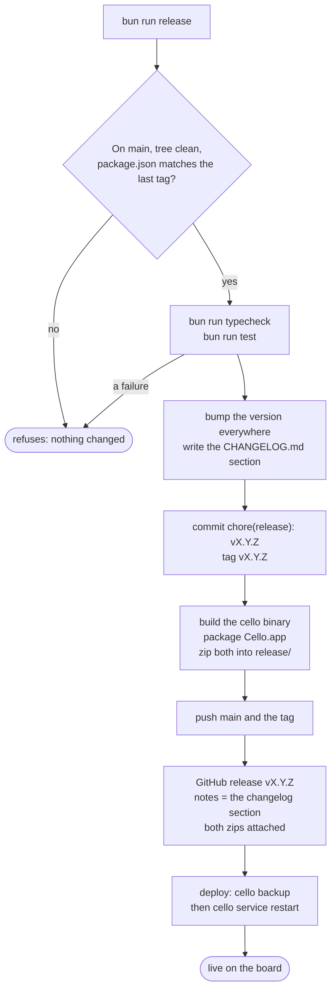

## Every deploy is a release

Cello ships when the orchestrator merges a task (step ⑦ in [How a feature is built](feature-lifecycle.md)). That merge step is one command, run on `main` in the main checkout:

```bash
bun run release                 # patch: 0.3.0 -> 0.3.1, the default for every merge
bun run release -- minor        # 0.3.1 -> 0.4.0, when Lucas says so
bun run release -- major        # 0.4.0 -> 1.0.0, when Lucas says so
bun run release -- --dry-run    # preview everything; writes, pushes and deploys nothing
```

It uses [release-it](https://github.com/release-it/release-it) (pinned in the root package.json, configured in `.release-it.json`); the steps that are ours are small TypeScript modules with tests in `scripts/release/`.

## What one release does, in order



1. **Refuses** unless it's on `main` with no uncommitted changes to tracked files (untracked files never reach the release commit), and the root package.json's version matches the latest tag (so nobody bumped it by hand).
2. **Checks:** `bun run typecheck`, then `bun run test`. A failure stops it before anything is written.
3. **Bumps** the version everywhere it lives (`scripts/release/version.ts`). The root `package.json` is the one source of truth; the release writes the same version to `APP_VERSION` in `packages/shared/src/version.ts` (what `cello --version`, the sidebar footer and backup manifests report) and to every workspace `package.json` that has a `version` (today `apps/desktop`, which electron-builder stamps into Cello.app). A unit test fails if they ever disagree.
4. **Writes the changelog** section at the top of `CHANGELOG.md` (below).
5. **Commits** `chore(release): vX.Y.Z` and **tags** `vX.Y.Z` (annotated).
6. **Builds** `cello` (`bun run build` in `apps/cli`) and **packages** Cello.app (`bun run package --skip-cli` in `apps/desktop`, unsigned, Apple silicon), then zips them into `release/` as `cello-vX.Y.Z-darwin-arm64.zip` and `Cello-vX.Y.Z-mac-arm64.zip`. It builds after the tag, so the binary embeds the release commit and the new version. It never installs or opens the app.
7. **Pushes** `main` and the tag together (`git push --atomic`), only once the build worked: a failed build leaves the commit and tag local, easy to undo.
8. **Creates the GitHub release** `Cello vX.Y.Z` on lnmunhoz/cello with the changelog section as its notes and both zips attached. The token comes from `gh auth token` (or `GITHUB_TOKEN`).
9. **Deploys:** `cello backup`, then `cello service restart`. `~/.local/bin/cello` links to the main checkout's `apps/cli/dist/cello`, so step 6 already put the new binary in place; the restart runs it, and a migration runs then, after the backup. It refuses to restart if the `cello` on your PATH isn't this checkout's build, and never restarts when the backup failed.

## The changelog

`CHANGELOG.md` holds one section per release, newest first, written from **main's own history** since the previous tag (`git log --first-parent`):

- A task lands on main as one `merge: <what> (CEL-n)` commit, so it's **one line**, not one per commit on its branch. The merge is filed by what its branch brought: any `feat` makes it a **Feature**, otherwise any `fix` makes it a **Fix**, otherwise it's an **Other change**.
- Commits made straight on main are filed by their type: `feat` under Features, `fix` under Fixes, everything else (docs, test, chore, ci, build, art…) under Other changes. A scope shows in bold (`**web:** …`).
- Release commits and merges of main into a branch are left out. Subjects keep their own words and CEL keys; each line links its commit on GitHub, and the heading links the compare view from the previous tag.
- The first release, v0.3.0 (`bun run release -- minor`, from 0.2.0), covers the whole history since the first commit (Nov 14): it's only days old, so there's nothing to cut off. Builds before it said 0.1.0 (the desktop app) or 0.2.0 (the CLI) and weren't tagged.

Write subjects for the reader of the changelog: the merge subject is the line Lucas reads.

## Previewing: the dry run

`bun run release -- --dry-run` (add `minor` or `major` to preview those) does everything that doesn't change anything:

- prints the version change and every step, marking the ones it skips
- says what a real release would refuse (another branch, uncommitted changes), but carries on so you can see the rest
- **runs** the typecheck and the tests
- prints the CHANGELOG.md section the release would add, and release-it's own preview: the commands it would run, the GitHub release it would create

It writes, commits, tags, pushes, releases and deploys nothing, and doesn't build: in the main checkout a build replaces the live `cello`.

## Flags

| Flag | What it does |
| --- | --- |
| `patch` / `minor` / `major` / `1.2.3` | The new version. Patch is the default; minor and major only when Lucas asks. |
| `--dry-run`, `-d` | The preview above. |
| `--no-deploy` | Release (tag, GitHub release) but don't back up and restart the live server. Tests and builder agents never deploy. |
| `--skip-desktop` | Release without Cello.app, when packaging it can't work on this machine (it needs macOS on Apple silicon; electron-builder's error is printed). The cello zip is still attached. |

## When a release fails

When release-it fails, `bun run release` looks at how far it got (the release commit, the tag here and on GitHub, edited files) and prints exactly what to undo or finish. release-it's own rollback is off (`requireCleanWorkingDir: false` in `.release-it.json`; the clean-tree check is ours): it runs on process exit and would reset main and delete the tag even after they were pushed.

- **Refused, or the typecheck or tests failed:** nothing changed. Fix it and run it again.
- **Stopped after the bump, before the commit:** `git checkout -- <the files it names>` drops the version and changelog edits.
- **Stopped after the commit and tag, before the push** (the build or Cello.app failed): nothing reached GitHub. `git tag -d vX.Y.Z && git reset --hard HEAD~1`, then fix it, or release again with `--skip-desktop`.
- **Stopped after the push** (the GitHub release failed): the tag is on GitHub, so don't undo it. Finish by hand: `gh release create vX.Y.Z release/*.zip --title "Cello vX.Y.Z" --notes "$(bun scripts/release/changelog.ts notes-of X.Y.Z)"`, then deploy.
- **The deploy failed:** the release is out; the board isn't on it yet. `cello service status` says why; then `cello backup` and `cello service restart`.

## Rolling back

To go back to an earlier release, say v0.3.0 after v0.3.1 misbehaved:

1. **Put the old binary back.** Either download `cello-v0.3.0-darwin-arm64.zip` from the GitHub release and unzip it over `apps/cli/dist/cello` in the main checkout (the service and `~/.local/bin/cello` run that file), or rebuild it: `git checkout v0.3.0 && (cd apps/cli && bun run build) && git checkout main`.
2. **If the bad release ran a migration**, the old binary can't read the new database. Restore the backup the release took right before its restart: `cello service stop`, `cello backup list` (the manual backup taken just before), `cello restore <id>` (it takes a safety backup first), then start again. Agents run `cello restore` only when Lucas asks.
3. **Restart:** `cello service restart`, and check `cello --version` says 0.3.0.
4. Fix forward: the next `bun run release` ships the fix as a new patch. Tags and GitHub releases are never deleted or reused.

Cello.app is rolled back the same way: unzip `Cello-v0.3.0-mac-arm64.zip` and copy the app over `/Applications/Cello.app`.

## Later

Code signing and notarization for Cello.app, and auto-update from the GitHub releases.
