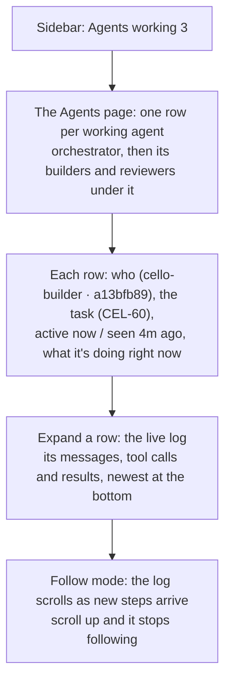
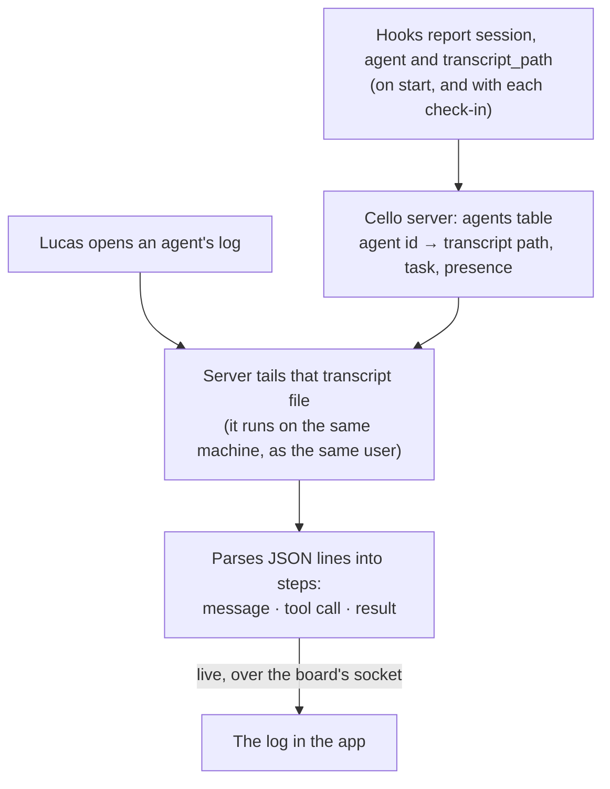

## The short version

Today "Agents working 3" is a count you can't open. With this, it works like Review and Needs input:

Tasks: CEL-65 (Backlog). Builds on CEL-55 (which agent is on each card: agent ids and types), CEL-35 (presence), CEL-15 (the hooks). Related: CEL-62 (test progress on the card), CEL-53 (the orchestrator chat).

## What Lucas sees

**The Agents page** (the sidebar item, and a "Working on it" link from a card):
- Grouped by session. The orchestrator first ("2fd0505c · this chat"), then each subagent under it: type, short id, the task it's on, presence (active now, seen 4m ago, ended), and its **current step** in one line ("Running the Docker e2e…", "Editing FacetPanel.tsx").
- Ended agents fold into "Finished today" at the bottom, so the page stays about what's happening now.
- The count in the sidebar matches the rows that are active.

**An agent's log** (expand a row, or open "Log" from the task panel's Working on it row):
- A timeline, newest at the bottom, in plain words:
  - **its messages:** what it says it's doing ("Merging main, then resolving the conflicts")
  - **tool calls,** one line each: `Bash · bun run test:docker:e2e` · `Edit · FacetPanel.tsx` · `Read · viewer.ts`, with how long each took and a ✓ or ✗
  - **results:** collapsed by default; a click shows the output (the first 200 lines, then "Show all")
  - **subagents it starts** appear as their own rows, linked
- **Follow:** on by default; scrolling up pauses it, and a "Jump to live" button brings it back.
- Filters: messages only, tools only, errors only.
- **Read-only.** Talking to an agent from here is CEL-53's job.

## Where the data comes from

Claude Code already writes a full transcript of every session and subagent to disk, as JSON lines, on this machine. Cello doesn't need agents to report anything new: it needs to know **which file belongs to which agent**, then read it.

| Source | What it gives | Used for |
| --- | --- | --- |
| **Hook input** (Cello's PostToolUse and Stop hooks, already installed) | `session_id`, `transcript_path`, `cwd`, and inside subagents `agent_id`, `agent_type` | Mapping each agent to its transcript file. CEL-55 already records agent ids |
| **SubagentStart / SubagentStop hooks** (added to `cello install claude`) | when a subagent starts and ends, its type, its transcript path | Rows appear and finish on time, even before the agent's first tool call |
| **The transcript files** (`~/.claude/projects/<repo>/<session>.jsonl`, and each subagent's own file) | every message, tool call with its input, tool result, timestamps | The log itself |

**How it flows:**

- **Read on demand, not stored.** Cello keeps only the path and a one-line "current step" per agent. The transcript stays Claude Code's; Cello reads the tail when someone has the log open and stops when it's closed. Nothing new piles up in Cello's database or backups.
- **The current step** (for the list) comes from the hook's last tool call: tool name plus a short target ("Bash · bun run test", "Edit · FacetPanel.tsx"). It's throttled like presence (CEL-35), so the board doesn't churn.
- **Only paths Cello was told about:** the server reads a transcript only when a hook reported that exact path, under `~/.claude/projects/`. No browsing the disk, and no paths from the web.
- **Other agents (Codex, …) later:** the same model (an agent → its log source) with a parser per format.

## Privacy and safety

- Transcripts can contain anything the agent saw: file contents, command output, sometimes secrets from a `.env`. They never leave this machine; the log is served to the local app only, like everything else in Cello.
- **Redaction** before display: strings that look like keys and tokens (`sk-…`, `ghp_…`, `AKIA…`, long base64 secrets) are masked, with a "show" click for Lucas.
- Images in transcripts (screenshots an agent read) show as thumbnails that open in the image modal (CEL-44).
- A file that's gone (cleaned up by Claude Code) shows "This log is no longer on disk" rather than an error.

## Data and API

- **`agents` table** (CEL-55 adds it): add `transcript_path`, `current_step`, `current_step_at`.
- **Hooks:** `cello install claude` adds SubagentStart and SubagentStop. The PostToolUse check-in sends `transcript_path` and the step summary. Both fail open and stay inside the 2 s deadline.
- **RPCs:** `agents.list` (the page), and a streaming `agent.log({ agentId, from })` that returns parsed steps and then follows new ones while the subscription is open.
- **CLI:** `cello agents` lists working agents; `cello agents log <id> [--follow]` prints the same rundown in the terminal, which is useful for the orchestrator checking on its builders.

## Phases

| Phase | What | Done when |
| --- | --- | --- |
| 1 · The Agents page | The sidebar item opens a page listing agents by session, with task, presence and current step (needs CEL-55) | Clicking "Agents working 3" shows those 3, each with its task |
| 2 · The log | Hooks report transcript paths; `agent.log` tails and parses; the expandable log with follow mode, filters, redaction | Lucas follows a builder's Docker run live, tool by tool |
| 3 · CLI and polish | `cello agents` / `cello agents log --follow`; "Finished today"; the log linked from the task panel | The orchestrator checks a builder from the terminal |

## Open questions for Lucas

Asked on the card as Needs input when this moves to Todo.

1. **How much of a tool result to show by default:** one line, or the first 10 lines?
2. **Should the log also show the agent's thinking**, when the transcript has it? The suggestion is no: messages and tools only.
3. **Keep finished agents' logs reachable from the task** after they end? The suggestion is yes, while the transcript is still on disk.
