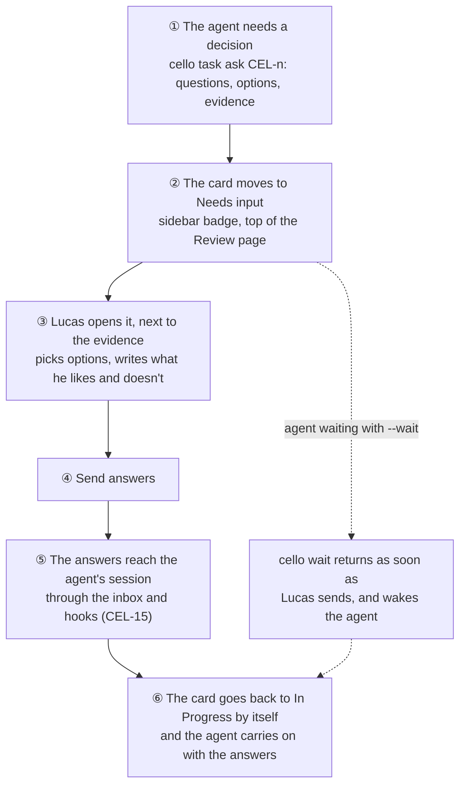
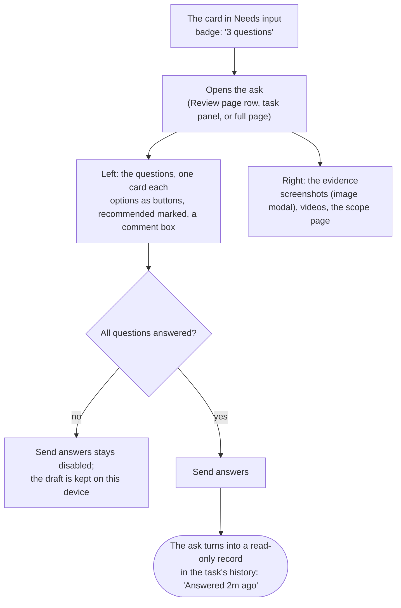

## The short version

Today, when an agent needs Lucas to decide something (which design option, which stages, what wording), it opens a page in Cello's side panel and then asks him **in the terminal**. He looks at the options in one place and answers in another, and the question isn't recorded on the task.

**Needs input** moves the whole exchange onto the card:



Task: CEL-47. Related: CEL-15 (inbox and hooks), CEL-22 and CEL-38 (the Review page), CEL-44 (image modal), CEL-28 (agent roles).

## Goals and non-goals

**Goals**

- An agent can ask Lucas one or more questions on a task, each with options, a recommended option and a reason, plus evidence (screenshots, videos, a scope page, links).
- Lucas answers **inside Cello**: on the Review page, in the task panel or the task's full page, with the evidence beside the questions.
- Anything waiting on Lucas is visible at a glance: its own column and a sidebar count.
- The answer reaches the asking session by itself (hooks), or wakes an agent that is waiting.
- Every question and answer stays in the task's history.

**Non-goals (for now)**

- Annotating screenshots (drawing on them). A later step. Lucas can already paste or drop his own screenshots into an answer (below).
- Asking anyone other than Lucas: one human per board.
- Questions that aren't about a task. Every ask belongs to a task (a scope task, if need be).
- Replacing review packets. A packet says "it's done, check it"; an ask says "I need you to decide before I continue".

## Concepts

- **Ask:** a request for decisions on one task, made by one agent session. It has a title, an optional markdown intro, one or more questions, optional evidence, and a state: **open**, **answered** or **withdrawn**. A task has at most one open ask; asking again replaces the open one (like resubmitting a packet).
- **Question:** a prompt plus one of three kinds:
  - **choose one** (radio): options, one may be marked recommended
  - **choose any** (checkboxes)
  - **text only**: no options, just Lucas's words

  Every question also has an optional comment box, so Lucas can say why, or what he'd change. **He can paste or drop screenshots into any comment box and into the overall note** (⌘V from the clipboard, or drag files in), so he can show what he means.
- **Option:** a label, an optional one-line description, an optional image (one of the ask's screenshots) and an optional **recommended** mark with the agent's reason.
- **Answers:** for each question, the options picked, the comment and any screenshots Lucas pasted, plus an overall note (which can hold screenshots too). Saved as one record when Lucas sends them.

## Statuses and the board

- A new default status, **Needs input**, between In Progress and In Review, with its own category (`waiting`) so other workspaces can rename it.
- A task enters it **only** through `cello task ask` (like In Review only through `cello task submit`). An agent moving a task there by hand is refused, with a pointer to `cello task ask`.
- It leaves when:
  - **Lucas sends the answers:** back to In Progress, claim kept.
  - **The agent withdraws the ask** (`cello task ask CEL-n --withdraw`): back to In Progress.
  - **Lucas moves the card himself:** the ask is withdrawn and recorded, and the claim ends as usual (CEL-46 tells the agent).
- **Sidebar:** a "Needs input" item with a count, above Review.
- **Review page:** a "Needs your input" group at the top, above the packets, using the same collapsed-row layout (CEL-22).

## What Lucas sees



- **Layout:** the same two-column packet layout as CEL-38. Questions on the left, evidence on the right, sticky. One column when narrow.
- **An option with an image** shows it as a thumbnail; clicking opens the image modal (CEL-44).
- **Recommended options** carry a small "Recommended" tag and the agent's reason under it. Nothing is pre-selected: Lucas picks.
- **Pasting screenshots:** ⌘V in a comment box or the note uploads the image and shows it as a thumbnail under the text (opens in the image modal; × removes it). Dragging image files in works the same. Images only (PNG, JPEG, GIF, WebP), up to 20 MB each.
- **Drafts:** picks, comments and pasted screenshots are kept until sent (the images upload right away and stay attached to the draft), so a reload or a closed panel loses nothing.
- **Keyboard:** 1-9 picks an option in the focused question, Tab moves between questions, ⌘Enter sends.
- **Sending is final** for that ask. To change his mind, Lucas comments on the card (which also reaches the agent), or the agent asks again.

## What the agent does

```bash
# A scope with one design question and two follow-ups, from a file (recommended for anything real)
cello task ask CEL-35 --file ask.json --wait

# A quick single question, inline
cello task ask CEL-43 --title "Search layout" \
  --question "Which layout?" \
  --option "Peek: list + preview|Shows the highlighted result's text" --recommend "Peek: list + preview" --because "Most results are long text" \
  --option "Palette: one line per result" \
  --attach shots/peek-dark.png --attach shots/palette-dark.png \
  --link http://127.0.0.1:4747/CEL/pages/cel-43-scope \
  --wait
```

- `--file` takes JSON (or YAML) with the title, intro, questions and evidence: the format is in docs/cli.md. Inline flags cover the one-question case.
- **`--wait`** blocks until Lucas sends the answers (or the ask is withdrawn), then prints them and exits 0. An agent runs it in the background, so the session wakes when the answer arrives. Without `--wait`, the answers arrive through the hooks (CEL-15) like a comment.
- `cello task answers CEL-n` prints the latest answers again, as text or `--json`. **Screenshots Lucas pasted** are saved to a temp folder and their paths printed next to the comment they belong to, so the agent can look at them (agents never read `~/.cello` directly). `--wait` and the hook delivery print the same paths.
- `cello wait CEL-n` waits on an existing open ask (after a restart, say).
- **Rules for agents** (AGENTS.md and docs/cli.md): ask on the card, never in the terminal, when a decision is Lucas's; one ask per task at a time; scopes always attach their screenshots and page; a recommended option always says why.

## Data and API

- **Table `asks`:** id, task_id, actor_id, session_id, title, intro (markdown), questions (JSON), state, created_at, answered_at, answers (JSON), note, withdrawn_at, withdrawn_by. Evidence, and the screenshots Lucas pastes into his answers, reuse the attachments store (CEL-10), linked to the ask (and, for Lucas's, to the question they answer).
- **Upload:** `attachment.upload` (human only) takes an image pasted in the browser and returns its id; answers reference those ids. Unreferenced uploads from abandoned drafts are cleaned up after a day.
- **Events:** `ask.created`, `ask.answered`, `ask.withdrawn`, in the same transaction as the task's status change. Every change is an event.
- **RPCs:** `ask.create` (agent; moves the task), `ask.answer` (human only, like approve), `ask.withdraw`, `ask.get`. Thin handlers over an `AskService`.
- **Inbox (CEL-15):** a new item kind, `answers`, delivered once to the asking session, formatted as the questions with the picked options and comments.
- **Contract schemas** for questions and answers in packages/contract, validated on both ends. `ask.answer` must answer every question with valid option ids.

## Edge cases

- **The asking session has ended:** the answers wait in its inbox; the task stays In Progress with the claim, so a resumed session (`claude --resume`) gets them. If another session takes over the claim, the answers go to it.
- **Lucas answers while the agent is mid-work on something else:** the hook delivers on its next tool call.
- **An ask with evidence the agent later deletes:** attachments are copied into Cello's store when asked, as with packets.
- **Two asks race on one task:** the second replaces the first (the first is marked superseded, kept in history).
- **The task is in In Review when the agent asks:** allowed; the open packet stays, and the task moves to Needs input until answered.

## Phases

| Phase | What | Done when |
| --- | --- | --- |
| 1 · Data and CLI | Needs input status, `asks` table, events, RPCs, `cello task ask` / `answers` / `wait`, inbox item, docs/cli.md | An agent can ask through the CLI, a test answers through the RPC, the agent's `--wait` returns, and the hook delivers |
| 2 · Lucas's side | Sidebar count, Review page group, the ask view (questions + evidence, drafts, keyboard), history record | Lucas answers a real scope in the app, light and dark, browser and desktop |
| 3 · Using it | AGENTS.md rules; scopes (CEL-34, CEL-35, CEL-42, CEL-43) ask on their cards; the orchestrator stops asking in the terminal | The next scope's decisions happen only in Cello |

Phase 1 is built test-first with integration tests against a real server; phase 2 ships with review-mode videos in Docker. The flow is tested end to end: an agent asks with `--wait`, Lucas answers in the browser, the agent's command returns with his answers.

## Open questions for Lucas

1. **A column, or a badge?** This spec gives Needs input its own column (visible at a glance). The alternative is a "waiting on you" badge on In Progress cards, with no new column.
2. **Withdraw on manual move:** if you drag a Needs input card somewhere else, should the ask be withdrawn (this spec), or stay open?
3. **Pre-select the recommended option?** This spec says no (you pick everything). Pre-selecting is faster but easier to send without reading.
