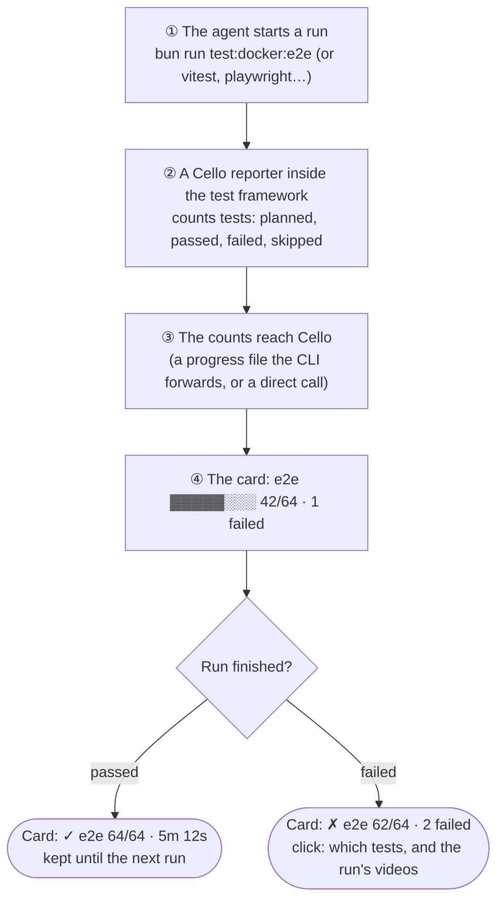
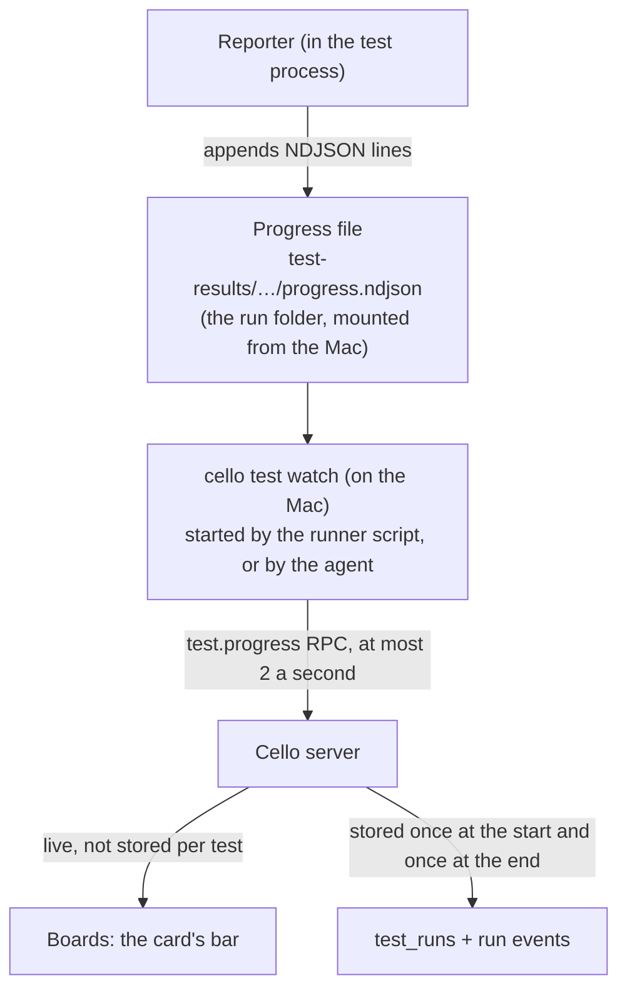

## The short version

Today, when a builder runs the end-to-end tests, the card just says "Building" for several minutes. Lucas can't tell whether tests are running, how far along they are, or whether something already failed.

With this, **the card shows the run live**, and keeps the result afterwards:



Task: CEL-62 (Backlog). Related: CEL-35 (presence and stages on the card), CEL-29 (tests in Docker), CEL-32 (watch a run live, the bigger idea this is a first step toward).

## What Lucas sees

- **On the card**, under the stage line, while a run is going: the run's name (`e2e`, `unit`, `desktop`), a thin bar, and `42/64`. A failure turns the bar's failed part red and adds `· 1 failed` straight away, without waiting for the end.
- **Several runs at once** (a builder running web and desktop in parallel) stack as short rows, at most 3 on a card.
- **When it ends:** `✓ e2e 64/64 · 5m 12s` in green, or `✗ e2e 62/64 · 2 failed` in red. The result stays on the card until the next run or until the task leaves In Progress, so a passed run isn't mistaken for a running one.
- **In the task panel:** a "Test runs" section with the latest run per kind. A click opens the run: the failed tests by name with their error's first line, and links to the run's videos and logs. Those open in Cello's side panel (CEL-60).
- **No idle animation.** The bar moves only when a test finishes. A run that stops sending for 2 minutes shows "stalled?" in amber, so a hung run is visible.
- A Display option turns test progress on cards off, like "Show agent cursors".

## Where the numbers come from

Every major test framework has a reporter API that's told when the run starts, how many tests are planned, and when each test ends. Cello ships small reporters for the frameworks it uses, plus a generic format anyone can write.

| Framework | Hook | Planned total | Per test |
| --- | --- | --- | --- |
| **Playwright** (web and desktop e2e) | custom reporter: `onBegin(config, suite)`, `onTestEnd(test, result)`, `onEnd(result)` | `suite.allTests().length` | status, duration, title path, error, attachments (videos) |
| **Vitest** (unit and integration) | custom reporter: `onTestRunStart`, `onTestCaseResult`, `onTestRunEnd` | from the collected modules | status, duration, name |
| **Anything else** (Jest, pytest, go test…) | write NDJSON lines to the progress file, or run `cello test progress` | given in a `start` line | `pass` / `fail` / `skip` lines |

**The generic format** (one JSON object per line, appended):

```json
{"type":"start","run":"e2e","total":64,"framework":"playwright"}
{"type":"test","run":"e2e","status":"passed","title":"board › drag a card","ms":1830}
{"type":"test","run":"e2e","status":"failed","title":"perf › 60 fps","ms":4900,"error":"expected 50.7 >= 55"}
{"type":"end","run":"e2e","status":"failed","passed":62,"failed":2,"skipped":0,"ms":312000,"results":"test-results/docker/2026-11-15_…"}
```

## How the numbers reach Cello

The tests often run **inside a Docker container** with its own network, so they can't call Cello on the Mac. The design works the same in and out of Docker:



- **Cello's own runner** (`scripts/test-in-docker.ts`) starts `cello test watch` on the run folder, so nothing changes for agents: `bun run test:docker:e2e` just shows up on the card.
- **Outside Docker**, the same reporter writes the same file, and `cello test watch` follows it. Agents can also run `cello test run -- <command>`, which starts the watcher, runs the command and stops the watcher. It works for any framework that writes the file.
- **Which task?** The watcher posts as the agent session, and the server attaches the run to the task that session holds (the claim). With several claims, `--task KEY-n` says which. With no claim the run is ignored, and `cello test watch` says so once.
- **Server down or slow:** the watcher drops updates and keeps the latest. Tests never wait for Cello.

## Data

- **Table `test_runs`:** id, task_id, session_id, run name, framework, status (running, passed, failed, stalled, canceled), total, passed, failed, skipped, started_at, ended_at, results path, and the failed tests as JSON (title, first error line, max 50).
- **Events:** `test.started` and `test.ended` only, so a 600-test run writes 2 events, not 600. Per-test progress is pushed live to boards and kept only as the run row's counters, updated at most every 2 s.
- **RPCs:** `test.progress` (agent, thin handler over a `TestRunService`), `test.runs` (read).
- **CLI:** `cello test watch <folder|file> [--task KEY-n]`, `cello test run [--name e2e] -- <cmd>`, `cello test progress --run e2e --pass "title"` (for hand-written integrations), `cello test runs CEL-n` (agents read the last results, including which tests failed).

## Edge cases

- **Retries** (Playwright retries a flaky test): counted once, with its final result. "Flaky" is shown when it passed on retry.
- **A run is killed** (Ctrl-C, container stopped): no `end` line, so after 2 minutes of silence the run shows "stalled?". A newer run of the same name replaces it.
- **Sharded or parallel workers:** reporters run in the main process, so the counts are already combined.
- **Unknown total** (a framework that can't tell up front): the bar shows counts only ("42 done · 1 failed"), with no fraction.
- **Reviewers' runs** count too: they share the session, so their runs show on the task they're reviewing.

## Phases

| Phase | What | Done when |
| --- | --- | --- |
| 1 · Data and CLI | `test_runs`, events, `test.progress`, `cello test watch / run / runs`, the NDJSON format, docs/cli.md | A test feeds a progress file and the run's counts land on the task |
| 2 · Reporters | A Playwright reporter and a Vitest reporter in the repo; `test-in-docker.ts` starts the watcher | `bun run test:docker:e2e` shows up on the claimed task by itself |
| 3 · The card | The bar on cards and list rows, Test runs in the panel, failed tests and links, "stalled?", the Display option | Lucas watches a real e2e run fill up on the card, light and dark |
| 4 · Other projects | `cello install` drops the reporters into a repo that uses Playwright or Vitest; the generic format documented for others | focus-extension's e2e shows on its cards |

## Open questions for Lucas

These go on the card as Needs input once this moves to Todo.

1. **Unit tests too, or only end-to-end?** Unit runs take seconds, so their bar flashes past. The suggestion is to show them only as a result ("✓ unit 1069").
2. **Keep the result after the task is submitted?** The suggestion is yes, as a small "✓ e2e" in the review packet, and gone from the card.
3. **Show the run that's running right now in the sidebar too** ("Agents working · 1 testing")?
